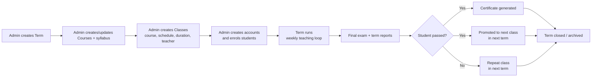
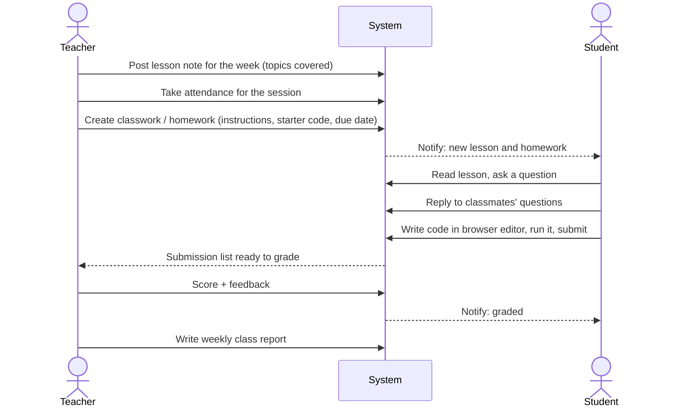
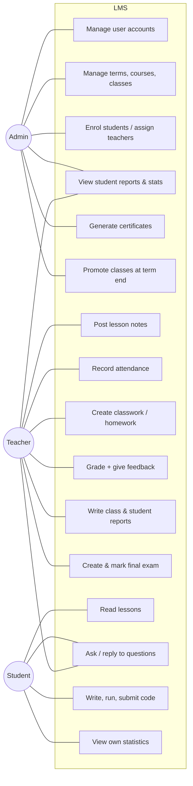

# 01 — System Analysis: Coding Club LMS

> Source: `system_notes.txt`. This document describes the problem, the people involved, and how work flows through the club. Requirements are in `02-system-requirements.md`; the technical design is in `03-architecture.md`.

---

## 1. Problem Statement

The coding club runs courses taught by teachers to students over terms. Today this work is spread across several places: class schedules, lesson notes, homework, scores, attendance, reports and certificates. That makes it hard to:

- see how a student is doing over time (attendance, scores, improvement),
- give students one place to read lessons, ask questions and submit code,
- let teachers grade code and write reports without extra admin work,
- promote classes at the end of a term and issue certificates without errors.

**Goal:** a web-based LMS where **Admins** run the club, **Teachers** teach and assess, and **Students** learn, practise code in the browser and track their own progress.

## 2. Scope

### In scope (from the notes)
| Area | Summary |
|---|---|
| User management | Admin creates Student and Teacher accounts. Students enrol in one or more courses; teachers are assigned to courses/classes. |
| Class management | Course, schedule (day/time), duration, term. Classes are promoted each term. |
| Teaching content | Weekly lesson notes and reviews. |
| Q&A | Students ask questions on lessons and reply to each other. |
| Assessment | Classwork, homework/assignments with an embedded code editor and compiler, final exams. Scores, feedback, due dates. |
| Reporting | Weekly class reports, student reports (attendance, performance, comments, support needed), pass/fail. |
| Analytics | Graphs of student statistics for teachers, admins and the students themselves. |
| Certificates | Generated for students who complete or pass a course. |

### Out of scope for v1 (confirmed)
- Payments and fees
- Parent portal (not needed yet — may be added later as a read-only role)
- Automatic grading with test cases (teachers grade manually)
- Running Python/Java code inside the LMS (postponed for budget reasons; HTML/CSS/JS preview is included because it runs in the browser for free)
- Email, Google or social login (Admin assigns username + password)
- Languages other than English in the UI
- Live video classes (use an external link such as Zoom/Meet if needed)
- Mobile native apps (the web app will be responsive)
- Public self-registration (accounts are created by Admin only, as in the notes)

## 3. Stakeholders and Actors

| Actor | Description | Main goals |
|---|---|---|
| **Admin** | Club owner or coordinator. Usually 1–3 people. | Set up terms, courses, classes and accounts. Monitor students. Issue certificates. Promote classes. |
| **Teacher** | Instructor assigned to one or more classes. | Plan and post lessons, set and grade work, record attendance, write reports, see class performance. |
| **Student** | Learner enrolled in one or more classes (possibly a minor). | Read lessons, ask questions, write and submit code, see feedback and own progress. |
| *System* | Background jobs. | Send reminders, close late submissions, run code, compute statistics. |
| *External: Code runner* | Sandboxed execution service. | Compile and run student code safely. |

## 4. Key Domain Concepts

These terms are used across all three documents.

| Concept | Meaning |
|---|---|
| **Course** | A subject at a level, e.g. *Python Level 1*, *Web Basics*. Has a syllabus (ordered list of topics). It is reusable across terms. |
| **Term** | One of **4 terms per year** (e.g. Term 1 2027). Classes belong to a term. |
| **Class** | One run of a Course in a Term: **one weekend session per week** (a day — Sat or Sun — and a start time), a session length (**90 min default**, or 120), a number of weeks (**10–12**), one or more teachers and a list of enrolled students. E.g. *Python L1 — Sat 9:00 — 90 min — 12 weeks — Term 1 2027*. |
| **Enrolment** | A student's membership in a class. A student can have several. |
| **Session** | One weekly meeting of a class on a date. Week *n* of the class = session *n*. Attendance, the weekly lesson and the weekly class report are all tied to a session. |
| **Lesson** | The weekly note/review a teacher posts for a class. Linked to syllabus topics. Students ask questions on it. |
| **Assessment** | Something students do that can be scored: **Classwork**, **Homework/Assignment**, or **Final Exam**. |
| **Submission** | A student's answer to an assessment (code, text and/or files), with score and feedback. For paper or in-class work the teacher enters the score directly in the gradebook. |
| **Gradebook** | A table of a class's students × assessments where teachers type scores and short comments quickly. |
| **Club time zone** | One setting (default `Asia/Phnom_Penh`) used for all schedules and due dates. |
| **Report** | Written by teachers. A **Class (weekly) report** covers syllabus coverage and attendance for a session. A **Student (term) report** covers performance, comment, support needed and pass/fail. |
| **Promotion** | At the end of a term, passing students move to the next class (often the next level course) in the new term. |
| **Certificate** | A document issued to a student for completing or passing a class, with a verification code. |

## 5. Current Process vs. Proposed Process

### 5.1 Term lifecycle (proposed)

### 5.2 Weekly teaching loop

## 6. Use Case Overview

## 7. Analysis of Notable Points in the Notes

| Note | Analysis / interpretation |
|---|---|
| "Student: registered in one/more courses" | Model as **enrolments in classes**, not courses directly, so the same course can run several times (different days, terms). |
| "Teacher: assigned for the courses" | Assign teachers to **classes**. Allow more than one teacher (lead + assistant). |
| "Create Class (Course, schedule time, duration)" | "Duration" means both the **session length** (90 min default, or 120) and the **class length** (10–12 weeks). The class stores a weekend day, start time, session length, first session date and number of weeks. The system creates all weekly sessions at once, and teachers can cancel one (e.g. a holiday) or add a make-up session. |
| "Check students report (… improvement)" | Improvement needs a definition. Proposal: trend of a student's average score over time within a term and across terms, plus attendance trend. See BR-10. |
| "Update/Promote the class every term" | Needs a guided wizard: pick source class → pick target course/term → system pre-selects passing students → admin confirms. Old class becomes read-only (archived). |
| "compiler (embedded text editor)" | The club teaches **Python, Java (multi-file, packages) and HTML/CSS/JS**. Running Python/Java safely needs a server sandbox, which costs money, so **v1 has an editor without Run** for Python/Java. HTML/CSS/JS runs in a sandboxed browser preview for free. See Architecture §6. |
| "Write/Update Report (… support line need?)" | A field on the student report: does the student need extra support, and what kind. Flags it on the admin dashboard. |
| "create/mark final exam result, write report whether pass or fail" | The final exam is an assessment of type *Exam*. The overall score out of 100 is **End-term exam 60% + Classwork 30% + Homework 10%**. The pass/fail decision lives on the student term report and drives promotion and certificates. |
| "view the lesson note/review and ask the question / Reply to other's question" | Threaded Q&A per lesson. Teachers can also answer, mark an answer as accepted, and moderate. |

## 8. Assumptions

1. Club size is small to medium: up to ~500 students, ~30 teachers, ~50 active classes per term.
2. Many students may be under 18, so privacy and safe Q&A matter.
3. It is an **after-school weekend programme**: classes meet only on Saturday or Sunday, **one session per week**, 1.5 h by default (some 2 h). Classes are in person; the LMS does not host video.
4. One club (single organisation). Multi-branch support is not needed in v1.
5. Admin can also act as a teacher if needed (a user can hold more than one role).
6. Internet access is available during classes; the app must work on low-end laptops and phones.
7. The **$100 budget is one-time**. It pays for one Hetzner VPS (≈€5–6/month) and the `cckh.dev` domain for about 13–16 months; after that the club needs a small monthly budget.
8. Students usually keep the username and password the Admin gives them, so Admin must be able to reset passwords quickly.
9. Students without a working runner write and test code in an editor/IDE on club laptops (or at home) and submit it through the LMS. Teachers run it locally when grading if needed.
10. All users are in **one time zone** (default `Asia/Phnom_Penh`, set once by Admin).
11. Students often share club laptops, so sessions must end quickly when idle.

## 9. Decisions

| # | Topic | Decision | Impact |
|---|---|---|---|
| 1 | Programming languages | **Python, Java, HTML/CSS/JS** | All three get an in-browser editor with syntax highlighting and multiple files. |
| 2 | Running code | **No server code runner for now** (budget) | Python/Java: write + submit only, no Run button. HTML/CSS/JS keeps a **live preview in the browser**, which costs nothing. Teachers can download any submission as a `.zip` and run it in their own IDE. A runner can be added later behind a ready-made interface. |
| 3 | Grading | **Teacher grading only** | No test cases or auto-scoring. |
| 4 | Grading scheme | **Overall /100 = End-term exam 60% + Classwork 30% + Homework 10%** | Calculated automatically (BR-12). |
| 5 | Pass mark | **60 / 100** | Default pass mark on every course (BR-13). |
| 6 | UI language | **English only** | No translation framework. |
| 7 | Parents | **No access needed yet** | No parent role. Guardian contact is stored for Admin only. |
| 8 | Budget | **$100 one-time** | Pays for one VPS + domain for ≈13–16 months. |
| 9 | Login | **Username + password assigned by Admin** | No email/Google login. Admin resets passwords. Login slips can be printed. |
| 10 | Terms & schedule | **4 terms per year**; each class runs **10–12 weeks** (set per class); **one weekend session per week**, **90 min default or 120 min** | Each class stores its own day (Sat/Sun), start time, session length and number of weeks. All sessions are created when the class is created. Week *n* = session *n*. |
| 11 | Java projects | **Multiple files, with packages** | The editor supports a file tree with folders (e.g. `com/club/Main.java`). Same multi-file support for Python and Web. |
| 12 | Program input | **Not needed for now** | No stdin feature (there is no runner yet). |
| 13 | Certificates | **The club has a design** (to be provided later) | Template built from your design in Phase 2. |
| 14 | Hosting | **Cloudflare (free plan) in front of one Hetzner VPS in Singapore** (2 vCPU / 4 GB, Docker Compose) | Cloudflare: DNS, HTTPS, CDN cache, login rate limit, Tunnel (no open web ports), R2 for backups. The VPS runs the app + PostgreSQL. A Python/Java runner can be added later on the same server for free (Architecture §9). |
| 17 | Domain | **`lms.cckh.dev`** (Web preview on `preview.cckh.dev`) | Registered on Cloudflare Registrar. |
| 18 | Source code | **Public GitHub repository** (for now) | Unlimited free CI. No secrets or student data in git. |
| 19 | Architecture review | **All findings in `04-architecture-review.md` accepted** (2026-10-18) | Folded into docs 01–03. |
| 15 | Maintainer | **The owner** maintains both the server and the code | Upkeep must stay small: automated updates/backups/alerts, a runbook, and one restore drill per term. |
| 16 | Way of working | **Same as codingspacekh**: prototype first → milestones → TDD | P0 prototype, then milestones with tests written first and exit criteria (`05-milestones.md`). |

## 10. Remaining Open Questions

1. **Certificate design files**: logo, layout, signer names and signatures (whenever ready, needed by M6).
2. **Time zone**: confirm `Asia/Phnom_Penh` as the club time zone.
