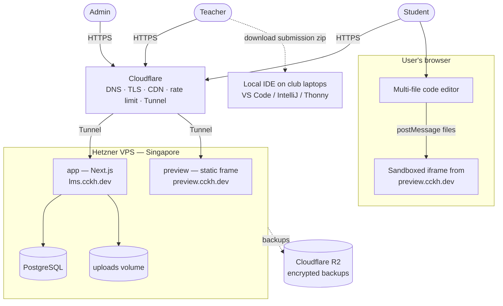
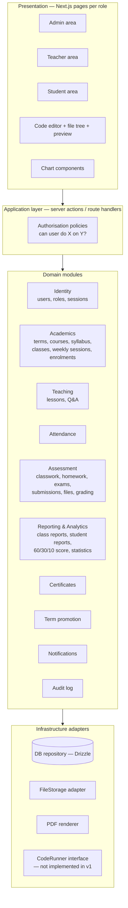
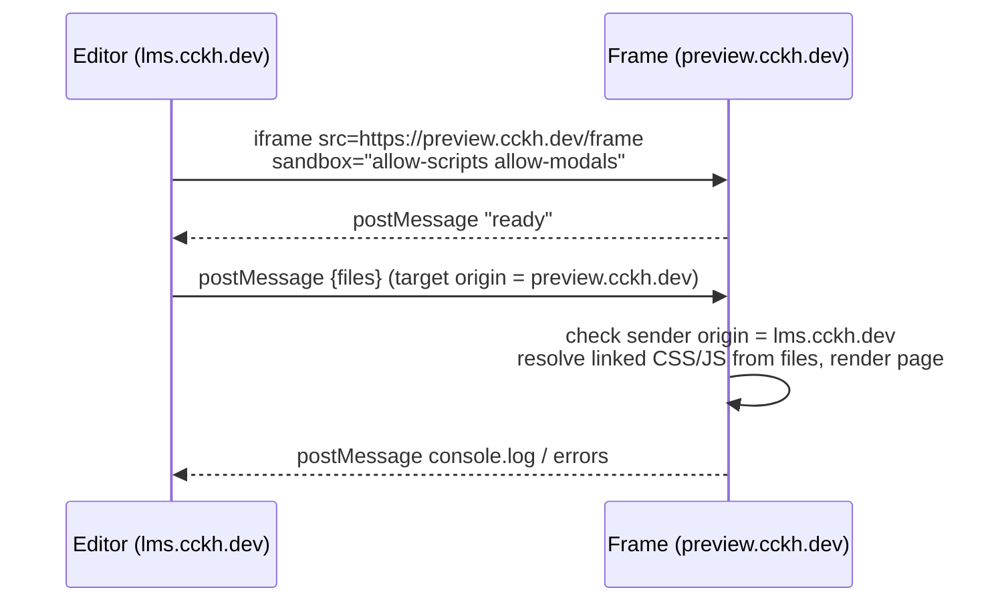
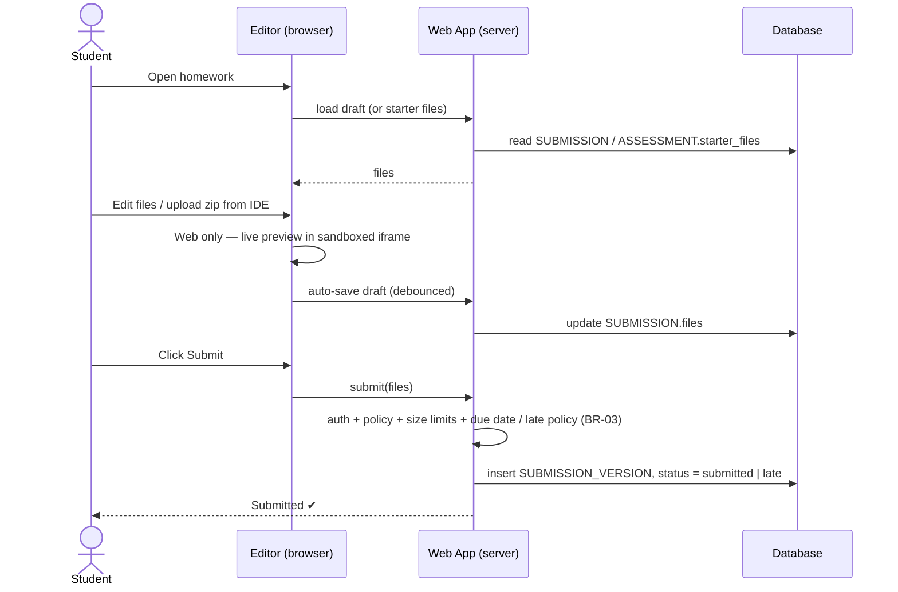
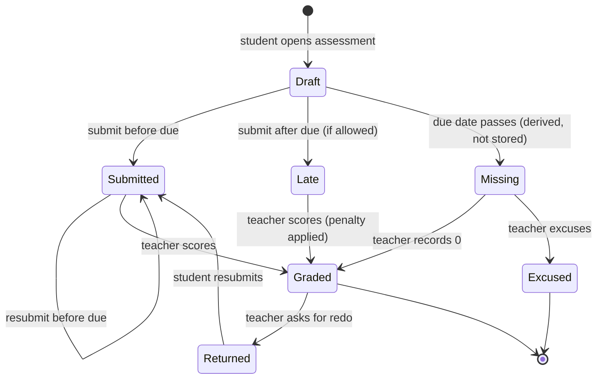
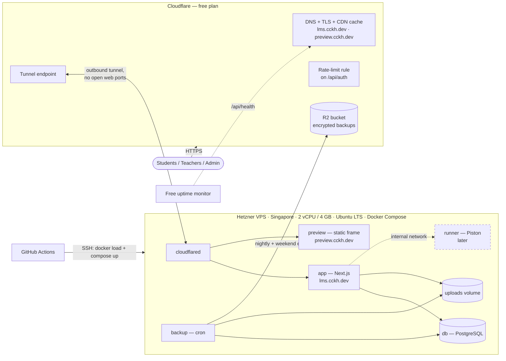
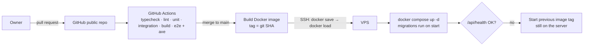

# 03 — Architecture: Coding Club LMS

> Implements the requirements in `02-system-requirements.md`. Decisions marked **(ADR)** are summarised in §11.
> Last updated 2026-10-18: club decisions (`01-system-analysis.md §9`) + the **accepted architecture review** (`04-architecture-review.md`). In short: Python / Java (multi-file) / Web; teacher grading + gradebook; 60/30/10 scoring, pass mark 60; English only; assigned username + password with role-based session lengths; weekend classes (one session/week, 10–12 weeks, 4 terms/year); **$100 one-time budget, no server code runner in v1**; **Cloudflare (free) in front of one Hetzner Singapore VPS**; **`lms.cckh.dev`**, Web preview on **`preview.cckh.dev`**; public GitHub repo.
---

## 1. Architecture Style

**Modular monolith** — one web application with clear internal modules, one PostgreSQL database and one file store.

Why:
- Small team, small-to-medium load (≈500 users, busy only at weekends) → microservices would add cost and complexity with no benefit.
- One TypeScript codebase for UI, server logic and DB schema keeps it easy to maintain (NFR-10).
- **Cloudflare edge + one VPS** (§9): the app, the preview frame and PostgreSQL run as Docker containers on one small server. Cloudflare's free plan provides DNS, HTTPS, caching, rate limiting, a tunnel (no open web ports) and backup storage. It is built from standard parts (Next.js, PostgreSQL, Docker), so it can move to another provider easily.
- Student code is **never executed on the server** in v1. Web projects run in the student's own browser inside a sandbox (§6).

## 2. System Context



## 3. Technology Stack (recommended)

| Layer | Choice | Reason |
|---|---|---|
| Language | **TypeScript** end-to-end | One language for UI, server and schema. |
| Web framework | **Next.js (App Router)** — React Server Components, Server Actions, Route Handlers | Full-stack in one project; server-side auth checks; `standalone` output gives a small Docker image. |
| UI | **Tailwind CSS + shadcn/ui** | Accessible, consistent components quickly. |
| Code editor | **CodeMirror 6** **(ADR-03)** | Light and works on phones/tablets; modes for Python, Java, HTML, CSS, JS. |
| File tree + zip | Custom file-tree component; zip/unzip **in the browser** with **fflate** ([ADR 0002](./adr/0002-editor.md)) | Multi-file Java packages; upload/download zip with no server cost. fflate has no `eval` (JSZip tripped the strict CSP) and checks sizes before decompressing. |
| Web preview | **Separate preview origin** `preview.cckh.dev`: sandboxed iframe, files sent by `postMessage` **(ADR-09)** | Students' scripts run under the preview's own CSP, while the LMS keeps a strict CSP. Free, because it runs in the student's browser. |
| Rich text | **Markdown** (with code blocks), rendered and sanitised server-side | Teachers write code-friendly notes; XSS-safe (NFR-05). |
| Charts | **Recharts** | Simple React charts for statistics (FR-TCH-18, FR-STU-07). |
| Database | **PostgreSQL** in Docker on the VPS | Relational data with strong integrity; good for reports; no usage limits. |
| ORM / migrations | **Drizzle ORM** | Typed schema, SQL-like queries for reports, plain migrations. |
| Auth | **Better Auth** (username plugin + admin plugin, roles) **(ADR-04, [ADR 0003](./adr/0003-auth.md): plus our origin hook and per-role session rules in `getActor()`)** | Username + password only, admin-created accounts, admin password reset, sessions in DB. No email needed. |
| Validation | **Zod** | One schema for forms and server input. |
| File storage | **`FileStorage` interface** → local disk volume on the VPS | Lesson attachments; backed up to R2. Interface allows moving to S3-style storage later. |
| Dates & time | `timestamptz` in UTC + one **club time zone** (`Asia/Phnom_Penh`); conversion with a time-zone library | BR-19: due dates and "next session" are always correct. |
| PDF | **@react-pdf/renderer** + QR code, generated **on demand** | Certificates from the club's design (FR-ADM-11); nothing big to store. |
| Background work | **None needed by the app in v1**: time-based states are worked out when data is read (§7.4). Backups run in a `backup` container (cron: nightly + weekend extras). | Keeps the app simple. |
| Edge | **Cloudflare free plan**: DNS, TLS, CDN cache, rate-limit rule, **Tunnel** (`cloudflared`), **R2** for backups **(ADR-11)** | No open web ports on the server; no certificate management; free. |
| Hosting | **Hetzner VPS, Singapore, 2 vCPU / 4 GB, Ubuntu LTS + Docker Compose** **(ADR-05, §9)** | ≈€5–6/month: the $100 covers ≈13–16 months; close to users; room for a future runner. |
| Image delivery | Built in GitHub Actions, sent to the VPS over SSH (`docker save` → `docker load`) | No registry to manage; previous images kept for rollback. |
| Testing | **Vitest** (unit), **Vitest + React Testing Library** (components), **Vitest + PostgreSQL in Docker** (integration), **Playwright + axe** (end-to-end, accessibility) | Same tools as codingspacekh; TDD on every change. |
| CI/CD | GitHub Actions (free, public repo): typecheck, lint, unit, integration, build, e2e + axe, secret scan on every PR; build image + SSH deploy on merge | NFR-10, §9.3. |

## 4. Application Structure (logical modules)



**Rules for modules**
- UI never talks to the database directly; it calls server actions/route handlers.
- Every server entry point first resolves the user, then calls `Policy` (BR-01, BR-02) before any domain logic.
- Domain modules own their tables; cross-module access goes through module functions (reporting is the exception: read-only SQL views).
- Infrastructure is behind interfaces (`FileStorage`, `CodeRunner`) so providers can be swapped or added later.

### Planned folder layout (for later implementation)

```
src/
  app/                    # Next.js routes
    (auth)/login
    admin/ ...            # users, terms, courses, classes, reports, certificates, promotion
    teacher/ ...          # classes/[id]/weeks/[n], attendance, assessments, reports, stats
    student/ ...          # dashboard, classes/[id], assessments/[id], stats
    api/                  # route handlers: file upload/download, certificate PDF
  modules/
    identity/ academics/ teaching/ attendance/ assessment/
    reporting/ certificates/ promotion/ notifications/ audit/
      (each: schema.ts, service.ts, policy.ts, validators.ts)
  lib/
    db/  auth/  storage/  pdf/  runner/ (interface only)
  components/             # shared UI, editor, file tree, web preview host, charts
preview/                  # static frame for preview.cckh.dev (frame.html + script, own CSP)
infra/                    # compose.yaml, cloudflared config, backup scripts (no secrets)
tests/  e2e/
docs/  docs/adr/
```

## 5. Data Model

### 5.1 Entity-relationship diagram

```mermaid
erDiagram
    USER ||--o{ USER_ROLE : has
    USER ||--o| STUDENT_PROFILE : "is (student)"
    USER ||--o| TEACHER_PROFILE : "is (teacher)"

    TERM ||--o{ CLASS : contains
    COURSE ||--o{ CLASS : "runs as"
    COURSE ||--o{ SYLLABUS_TOPIC : has
    COURSE |o--o| COURSE : "next level"

    CLASS ||--o{ CLASS_TEACHER : "taught by"
    USER ||--o{ CLASS_TEACHER : teaches
    CLASS ||--o{ ENROLMENT : has
    USER ||--o{ ENROLMENT : "enrolled as student"
    CLASS ||--o{ SESSION : "weekly sessions"
    SESSION ||--o{ ATTENDANCE : records
    ENROLMENT ||--o{ ATTENDANCE : for

    SESSION ||--o| LESSON : "weekly lesson"
    LESSON }o--o{ SYLLABUS_TOPIC : covers
    LESSON ||--o{ QUESTION : has
    QUESTION ||--o{ REPLY : has
    USER ||--o{ QUESTION : asks
    USER ||--o{ REPLY : writes
    USER ||--o{ POST_REPORT : files
    QUESTION ||--o{ POST_REPORT : "reported in"

    CLASS ||--o{ ASSESSMENT : has
    SESSION ||--o{ ASSESSMENT : "set in / due at"
    ASSESSMENT ||--o{ SUBMISSION : receives
    ENROLMENT ||--o{ SUBMISSION : makes
    SUBMISSION ||--o{ SUBMISSION_VERSION : history

    SESSION ||--o| CLASS_REPORT : "weekly report"
    ENROLMENT ||--o| STUDENT_REPORT : "term report"
    ENROLMENT ||--o| CERTIFICATE : earns

    USER ||--o{ PLAYGROUND_PROJECT : owns
    USER ||--o{ NOTIFICATION : receives
    USER ||--o{ AUDIT_LOG : performs
```

### 5.2 Key entities and fields

| Entity | Key fields |
|---|---|
| **USER** | id, username (unique, used to log in), password_hash, display_name, avatar_url, must_change_password (default false), status (active/inactive), last_login_at, created_at |
| **USER_ROLE** | user_id, role (`admin` / `teacher` / `student`) |
| **STUDENT_PROFILE** | user_id, date_of_birth, school_grade, guardian_name, guardian_phone, notes (admin-only) |
| **TEACHER_PROFILE** | user_id, phone, bio |
| **TERM** | id, year, number (1–4), name (e.g. "Term 2 2027"), start_date, end_date, status (planned/active/closed) |
| **COURSE** | id, code, name, level, description, next_course_id, default_language (python/java/web), pass_mark (default **60**), grading_weights (default `{exam: 60, classwork: 30, homework: 10}`) |
| **SYLLABUS_TOPIC** | id, course_id, order, title, description |
| **CLASS** | id, course_id, term_id, name, **day_of_week (sat/sun)**, **start_time**, **session_minutes (90 default / 120)**, **first_session_date**, **num_weeks (10–12)**, room, capacity, status (active/archived), promoted_from_class_id |
| **CLASS_TEACHER** | class_id, user_id, role (lead/assistant) |
| **ENROLMENT** | id, class_id, student_id, status (active/withdrawn/completed), **enrolled_on** (date — BR-17), ended_on, transferred_from_enrolment_id |
| **SESSION** | id, class_id, week_no, date, start_time, minutes, status (scheduled/held/cancelled), replaces_session_id (for make-ups), note |
| **ATTENDANCE** | session_id, enrolment_id, status (present/late/absent/excused), note, marked_by |
| **LESSON** | id, session_id, title, content_md, attachments, status (draft/published), publish_at, author_id |
| **LESSON_TOPIC** | lesson_id, topic_id |
| **QUESTION** | id, lesson_id, author_id, body_md, code_snippet, accepted_reply_id, visibility (visible/under_review/hidden), created_at |
| **REPLY** | id, question_id, author_id, body_md, visibility (visible/under_review/hidden), created_at |
| **POST_REPORT** | id, post_type (question/reply), post_id, reporter_id, reason, created_at, resolved_by, resolved_at, outcome (restored/removed) |
| **ASSESSMENT** | id, class_id, session_id (week set), type (classwork/homework/exam), title, instructions_md, language (python/java/web/none), starter_files (json), attachments, max_score, due_at (default: next session start), allow_late, late_penalty_pct, status (draft/published/closed) |
| **SUBMISSION** | id, assessment_id, enrolment_id, status (draft/submitted/late/graded/returned/excused), files (json: `[{path, content}]`, e.g. `src/com/club/Main.java`), submitted_at, score, feedback_md, graded_by, graded_at |
| **SUBMISSION_VERSION** | id, submission_id, files (json), submitted_at |
| **PLAYGROUND_PROJECT** *(phase 2)* | id, owner_id, name, language, files (json), updated_at |
| **CLASS_REPORT** | id, session_id, topics_covered (topic ids), attendance_summary (auto), comment, author_id |
| **STUDENT_REPORT** | id, enrolment_id, performance_rating, comment, needs_support, support_note, exam_pct, classwork_pct, homework_pct, calculated_score (BR-12), final_score, adjustment_reason, result (pass/fail/pending), published_at, author_id |
| **CERTIFICATE** | id, enrolment_id, verification_code (unique, random), template_version, issued_by, issued_at, revoked_at |
| **NOTIFICATION** | id, user_id, type, payload (json), read_at |
| **AUDIT_LOG** | id, actor_id, action, entity, entity_id, before (json), after (json), at |
| **CLUB_SETTINGS** | single row: club_name, logo, time_zone (default `Asia/Phnom_Penh`), certificate_template_version |

**Design notes**
- Attendance, submissions, reports and certificates hang off **ENROLMENT** (student-in-class), so data stays correct when a student is in several classes or repeats a course.
- **One session per week** means the class schedule is just four fields on CLASS (day, time, minutes, weeks). All SESSION rows are created in the same transaction as the class (BR-15).
- **"Missing" is not stored.** A submission is shown as *missing* when `due_at` has passed and nothing was submitted. Likewise a lesson is visible when `status = published` and `publish_at ≤ now`. This removes the need for scheduled jobs.
- **Gradebook** (FR-TCH-19) writes the same SUBMISSION rows: for paper or in-class work the teacher's score creates a submission with no files. One table backs both grading screens.
- **Late enrolment** (BR-17): every score/attendance query filters by `enrolment.enrolled_on`. This is enforced in the SQL views, so no screen can forget it.
- **Time** (BR-19): sessions store a local `date` + `start_time`; `due_at` is `timestamptz` (UTC), computed from the club time zone.
- Submission files are stored as JSON text in Postgres (code is small: limit ≈200 KB per submission), so no file storage is used for code.
- Soft deletes / status fields instead of hard deletes (FR-AUTH-04, BR-07).
- Indexes on: `enrolment(class_id)`, `enrolment(student_id)`, `submission(assessment_id)`, `attendance(session_id)`, `session(class_id, week_no)`, `session(date)`, `question(lesson_id)`.

### 5.3 Statistics and "improvement"

At this scale, statistics are computed live with SQL views; no separate analytics store.

| Metric | Source |
|---|---|
| Overall score /100 | 60% exam + 30% classwork + 10% homework (BR-12), shown live during the term as "current standing" vs. pass mark 60 |
| Attendance % | ATTENDANCE per enrolment, cancelled sessions excluded (BR-09) |
| Homework completion | submitted ÷ published homework past due |
| Score trend | assessment scores by week number |
| Improvement | rolling average of last N vs previous N assessments; term-over-term final score (BR-10) |
| Weak topics | scores grouped by syllabus topics linked to the lesson/session of each assessment |
| Class distribution | histogram of scores per assessment |

No SQL views after all (M5, 2026-10-20): due times are worked out from the sessions in TypeScript (ADR-08), so a view would have to repeat those rules. Reports read the gradebook's own calculation (`src/modules/reporting`), and an independent SQL query in the integration tests checks it.

## 6. Code Editor Design (FR-CODE)

### 6.1 What each language can do in v1

| Language | Write | Multi-file | Run in LMS | How it's tested |
|---|---|---|---|---|
| **HTML / CSS / JS** | ✔ | ✔ (several pages, CSS and JS files) | **✔ live preview in the browser** | In the preview + console panel |
| **Python** | ✔ | ✔ (modules) | ✘ (v1) | Student runs it in an IDE (e.g. Thonny/VS Code); teacher downloads the zip |
| **Java** | ✔ | ✔ (packages as folders) | ✘ (v1) | Student runs it in an IDE (e.g. IntelliJ/VS Code); teacher downloads the zip |

### 6.2 Editor component
- **File tree** on the left (create / rename / delete files and folders), **CodeMirror** tabs on the right.
- **Java packages:** folders map to packages (`src/com/club/game/Main.java`). The editor warns if a file's `package` line doesn't match its folder. This is a common beginner mistake, and catching it in the browser costs nothing.
- **Starter files:** the teacher's template project is copied into the student's project the first time it is opened.
- **Upload:** individual files or a `.zip`, unpacked in the browser. Only text files with allowed extensions (`.py .java .html .css .js .json .txt .md`) are accepted. Limits: ~30 files, ~200 KB in total.
- **Download:** the whole project as a `.zip`, zipped in the browser. Teachers use this to open a submission in their IDE, and students use it to continue at home.
- **Auto-save** of the draft every few seconds of idle time, and on leaving the page.

### 6.3 Web preview (the only "run" in v1) — separate origin (ADR-09)
**Why a separate origin:** an `<iframe srcdoc>` inherits the Content Security Policy of the page that contains it. The LMS runs a strict CSP (no inline scripts), which would block students' `<script>` and `onclick=` code. Relaxing it would weaken the whole LMS. So the preview runs on its own origin, the way CodePen and JSFiddle do.



- The **LMS** keeps a strict CSP; its only allowance is `frame-src https://preview.cckh.dev`.
- The **preview** server sends its own permissive CSP so students' code (inline scripts, CDN libraries, images) runs. It **sets no cookies** and has no API.
- The iframe sandbox **does not** include `allow-same-origin`, so student code gets an opaque origin and can't read storage or cookies, even of `preview.cckh.dev`.
- Both sides check message origins: the frame accepts files only from `https://lms.cckh.dev`, and the editor accepts console messages only from the frame's window.
- The preview refreshes about 0.5 s after typing stops. Teachers see the same preview when grading.
- **Verified in the M0 spike** with tests: students' inline scripts run; the LMS page has zero CSP violations; student code can't read LMS cookies or call the LMS API.

### 6.4 Future: running Python/Java (not in v1)
The `CodeRunner` interface (`run({ language, files, stdin, limits }) → { stdout, stderr, exitCode, status }`) is defined but not implemented. When the club is ready, there are three ways to add it without changing the rest of the app:

| Option | Cost | Notes |
|---|---|---|
| **Python in the browser (Pyodide)** | $0 | Runs in a Web Worker on the student's laptop. Good for beginner Python. First load is large (~10 MB, then cached). Planned for Phase 3 (FR-CODE-08). |
| **Self-hosted runner (Piston) on the same VPS** — *recommended when the club wants Run* | **$0 extra** (already on the VPS, §9.2) | Python + Java on the server in an internal-only container with time/memory limits and no network. |
| **Managed sandbox (e.g. Vercel Sandbox)** | Pay per use | No server upkeep; needs an ongoing budget. |

### 6.5 Submit flow



### 6.6 Submission lifecycle



## 7. Key Workflows (architecture view)

### 7.1 Creating a weekend class (FR-ADM-05, FR-TCH-05)
1. Admin picks course, term, **Saturday or Sunday**, start time, **90 or 120 min**, first session date, **10–12 weeks**, teacher(s).
2. System checks that the first session date falls on the chosen day and inside the term, and warns about teacher clashes (same day, overlapping time).
3. In one transaction: create CLASS + `num_weeks` SESSION rows (week 1…n, every 7 days).
4. Later changes: **cancel** a session (holiday) → homework due then moves to the next session (BR-16); **move** a session to another date; **add a make-up** session that takes over the cancelled week number.

### 7.2 Term-end promotion (FR-ADM-13)
1. Admin opens the Promotion wizard → picks source class(es) in the closing term.
2. System proposes the target: `course.next_course_id` in the next term. Admin can pick an existing class or create one (copies day, time, length and teachers as defaults).
3. Students with `STUDENT_REPORT.result = pass` (≥ 60) are pre-selected; failed ones are offered a repeat class.
4. On confirm, **in one DB transaction**: create target class + sessions (if new), create new ENROLMENTs, mark old enrolments `completed`, set `promoted_from_class_id`, archive the old class, write AUDIT_LOG.
5. Optionally bulk-issue certificates for the passed students.

### 7.3 Certificate generation (FR-ADM-11)
1. Check BR-05 (result = pass, or admin override with reason).
2. Generate a random verification code (≥ 128-bit, URL-safe); save the CERTIFICATE row; write the audit log.
3. The PDF is **rendered on demand** whenever it is downloaded, from the club's design (logo, layout, signer names/signatures supplied later) plus a QR code linking to `/verify/{code}`. `template_version` keeps old certificates looking the same after a design change.

### 7.4 Time-based behaviour without scheduled jobs
| Behaviour | How |
|---|---|
| Missing homework | Derived at read time: `due_at < now` and no submission. |
| Scheduled lesson publishing | Lesson visible when `publish_at ≤ now`. |
| "Due soon" notices | Shown on the dashboard when it loads (due within 48 h). |
| Backups | Cron in the `backup` container: nightly + 13:00/18:00 on weekends (§9.5). |

## 8. Security Architecture

| Concern | Measure |
|---|---|
| Authentication | Better Auth sessions (HTTP-only, Secure, SameSite cookies); Argon2/bcrypt hashes; Admin-only password reset (new password shown once, audit logged); optional forced change at first login. |
| Sessions (FR-AUTH-10) | **Students: 2 h idle / 12 h max, no "remember me"** (shared club laptops). Teachers/admins: up to 7 days, renewed on activity. "Signed in as … · Sign out" always visible; Admin can sign a user out everywhere. |
| Brute force (FR-AUTH-11) | App rate limit per username and per IP, with temporary lockout; plus a **Cloudflare rate-limit rule** on `/api/auth/*`. |
| Authorisation | One `Policy` module, e.g. `canGrade(user, assessment)`; all checks on the server; queries scoped by enrolment/assignment (BR-01, BR-02, BR-11). **Policy matrix tests** cover every role × action × own/other class **(ADR-10: app-layer authorisation, no database RLS)**. |
| Input | Zod validation on every server action; parameterised queries via ORM; size limits on submissions and uploads. |
| XSS / CSP | **Strict CSP** on `lms.cckh.dev` (nonces, no inline scripts); Markdown rendered with a sanitiser; user HTML never trusted. Student web pages run only on `preview.cckh.dev` in a sandboxed iframe (§6.3). |
| Uploads | Allowed extensions only; zip unpacked in the browser with path checks (no `../`) and size limits; content stored as text. |
| CSRF | Server Actions' built-in origin checks; SameSite cookies. |
| Files | Stored on a private volume outside the web root; type/size limits; every download goes through the app with an authorisation check. |
| Network | No open web ports: traffic arrives only through the Cloudflare Tunnel; firewall allows SSH only; DB and runner on an internal Docker network (§9.4). |
| Secrets | Root-only `.env` on the server + GitHub Actions secrets; never in the **public** repo; secret scanning in CI. |
| Minors' data | Guardian details visible only to Admin; Q&A visible only within the class; **report button** hides a post until a teacher reviews it (BR-20); moderation tools for teachers. Backups encrypted. No real student data in demo/seed data or in the repo. |
| Audit | AUDIT_LOG for grade, result, promotion, certificate, password-reset, sign-out-everywhere and account changes (NFR-11). |
| Review | OWASP ASVS Level 1 checklist + ZAP baseline scan before launch (M7), as in codingspacekh. |

## 9. Deployment & Hosting — Cloudflare edge + one VPS (chosen)

**Decision (ADR-05, ADR-11):** **Cloudflare's free plan** sits in front of **one Hetzner VPS in Singapore** that runs everything in Docker Compose. Cloudflare handles DNS, HTTPS, caching, the login rate limit and the tunnel to the server, and R2 stores the off-site backups. The VPS has **no open web ports**, because `cloudflared` makes an outbound tunnel to Cloudflare. The whole setup is paid from the $100 one-time budget.



### 9.1 Accounts and names
| Item | Choice |
|---|---|
| Domain | **`cckh.dev`**, registered on **Cloudflare Registrar** |
| LMS | **`https://lms.cckh.dev`** |
| Web preview origin | **`https://preview.cckh.dev`**: a different hostname with no cookies (§6.3) |
| Cloudflare | Free plan: DNS, proxy/CDN, SSL mode *Full (strict)* via Tunnel, 1 rate-limit rule, Tunnel, R2 (10 GB free) |
| VPS | **Hetzner Cloud, Singapore**, 2 vCPU / 4 GB / 40 GB NVMe (CX23 or the current equivalent), Ubuntu Server LTS |
| Source code | **Public GitHub repository**, `main` protected, pull requests only, required CI checks |

### 9.2 Containers (Docker Compose)

| Service | Image | Reachable from | Persistent volume | Notes |
|---|---|---|---|---|
| `cloudflared` | Cloudflare `cloudflared` | outbound only | — | Routes `lms.cckh.dev` → `app:3000` and `preview.cckh.dev` → `preview:8080`. |
| `app` | Our Next.js image (standalone output) | `cloudflared` only | `uploads` | Strict CSP; runs DB migrations on start; `/api/health`. Memory limit ≈1 GB. |
| `preview` | Small static web server (unprivileged nginx) serving `frame.html` + its script | `cloudflared` only | — | Own permissive CSP so students' scripts run; sets no cookies; accepts files from `https://lms.cckh.dev` only (`postMessage` origin check). |
| `db` | PostgreSQL (current major version) | internal network only | `pgdata` | Never exposed; only `app` and `backup` can reach it. |
| `backup` | Small image with `pg_dump`, `age`, `rclone` | — | — | Schedule in §9.5. |
| `runner` *(later)* | Piston | internal network only, **no internet** | — | Added when the club wants Run for Python/Java (§6.4). |

The `FileStorage` adapter writes to the `uploads` volume. Lesson attachments are capped (e.g. 10 MB per file) so the disk doesn't fill up.

### 9.3 Deployment pipeline



- Images are **built in GitHub Actions**, not on the 4 GB server, and **sent straight to the VPS over SSH**, with no container registry to manage. The last ~3 images stay on the server for instant rollback.
- The deploy SSH key is limited to the deploy user and stored as a GitHub Actions secret, so it is never in the public repo.
- Migrations are forward-only and run before the new app starts. A backup runs first if a migration changes or removes data.
- **Deploys happen on weekdays only**, never during weekend class hours.

### 9.4 Server security (hardening checklist)
- SSH **key-only**, root login disabled, a non-root deploy user.
- Firewall (Hetzner Cloud Firewall + `ufw`): **only SSH (22) inbound**. No 80/443 is needed because of the Tunnel. *Optional later:* SSH through Cloudflare Access, closing 22 to the internet.
- `fail2ban` for SSH; **unattended security upgrades** on.
- Containers run as non-root where possible; `db` and `runner` sit on an internal Docker network with no published ports.
- Secrets (DB password, auth secret, Tunnel token, R2 keys, backup encryption key) live in a root-only `.env` on the server and in GitHub Actions secrets, **never in the repo**. A secret-scanning check runs in CI.
- Docker log rotation so logs can't fill the disk.

### 9.5 Backups & restore
| What | When (club time zone) | Where | Kept |
|---|---|---|---|
| Database (`pg_dump`, compressed, encrypted with `age`) | **Nightly 02:00**, plus **13:00 and 18:00 on Saturday and Sunday** | Cloudflare R2 bucket (private) | 14 daily + 8 weekly |
| `uploads` volume | Same schedule, incremental | Same bucket | Same |
| Server config (`compose.yaml`, `cloudflared` config) | In the git repo (no secrets) | GitHub | Always |

- **RPO** (maximum data loss): ~4 h at weekends, 24 h on weekdays. **RTO** (time to recover): < 2 h.
- The backup encryption key is kept **off the server**, in the owner's password manager.
- **Restore drill once per term**: restore the latest backup into a local Docker Postgres, start the app and sign in. The result is recorded in the runbook.
- Disaster recovery: new VPS → install Docker → clone the repo → put back `.env` → restore DB + uploads → start the Tunnel. DNS doesn't change, because the Tunnel follows the server.

### 9.6 Monitoring
- **Uptime:** free external monitor on `https://lms.cckh.dev/api/health` every 5 min, with alerts by email/Telegram.
- **Disk/memory:** small cron script alerts when disk > 80% or memory is low.
- **Backups:** each run reports success/failure, and a missed run triggers an alert.
- **Logs:** structured JSON logs (`docker compose logs`); optional free tier of an error-tracking service.

### 9.7 Environments
| Environment | Where | Purpose |
|---|---|---|
| Local | Owner's laptop: `docker compose` (app + preview + Postgres) | Development, seeded demo data |
| CI | GitHub Actions with a throw-away Postgres service | Every pull request |
| Production | The VPS (`lms.cckh.dev`) | Real club data |
| *Staging (optional)* | Second Compose project on the same VPS at `staging-lms.cckh.dev`, with its own small DB and demo data only | Try a release before the weekend, if memory allows |

### 9.8 Cost (one-time budget $100)
| Item | Cost |
|---|---|
| Hetzner VPS (2 vCPU / 4 GB, with IPv4) | ≈ **€5–6 / month** (check the Singapore price when ordering) |
| `cckh.dev` on Cloudflare Registrar | ≈ $10–15 / year (at cost) |
| Cloudflare free plan (DNS, Tunnel, CDN, rate limit, R2 ≤ 10 GB), GitHub public repo + CI, all software | $0 |
| **Total** | **$100 covers ≈ 13–16 months.** After that, plan for ≈ $6–8 / month. |

### 9.9 Operations: who does what
| Task | Frequency | Who |
|---|---|---|
| Check the uptime/backup alerts | When they arrive | Owner |
| Apply non-security OS updates, reboot if needed | Monthly, on a weekday | Owner |
| Deploy new versions | As released, on weekdays | Owner |
| Restore drill | Once per term | Owner |
| Renew domain / pay the VPS | Yearly / per billing period | Owner |

## 10. Requirement → Architecture Traceability

| Requirement group | Module / component |
|---|---|
| FR-AUTH-* | Identity, Better Auth (role-based session lengths, rate limit), Policy, Cloudflare rate-limit rule |
| FR-ADM-01..08 | Identity, Academics (class + weekly session generation) |
| FR-ADM-09..10, FR-TCH-18, FR-STU-07 | Reporting & Analytics (SQL views), Charts |
| FR-ADM-11..12 | Certificates, on-demand PDF renderer |
| FR-ADM-13..14 | Promotion, Academics, Audit |
| FR-TCH-01..04, FR-STU-02..04 | Teaching (Lessons, Q&A) |
| FR-TCH-05..06 | Academics (sessions), Attendance |
| FR-TCH-07..12, FR-STU-05..06 | Assessment, Editor, Web preview, zip upload/download |
| FR-TCH-19 | Assessment (gradebook writes SUBMISSION rows) |
| FR-TCH-20, FR-ADM-16 | Reporting (syllabus coverage), Academics (club settings, time zone) |
| FR-STU-10 | Teaching (POST_REPORT, visibility) |
| FR-TCH-14..17 | Reporting (class/student reports, 60/30/10 score, pass mark 60), Assessment (exam) |
| FR-CODE-01..07 | Editor component, file tree, Web preview iframe |
| FR-CODE-08..10 | `CodeRunner` interface (future) |
| FR-SYS-* | Notifications (in-app), Audit |

## 11. Architecture Decision Summary

Each ADR gets its own file in `docs/adr/` when it is first implemented (M0/M1), as in codingspacekh.

| ADR | Decision | Alternatives considered | Revisit when |
|---|---|---|---|
| ADR-01 | Modular monolith on Next.js (App Router) + TypeScript; Server Actions + Route Handlers over domain modules (no separate API service) | **Laravel 12 + Inertia React** (re-evaluated 2026-10-19: safer defaults and calmer upgrades, but two ecosystems; owner chose Next.js for one language and the same stack as codingspacekh); separate SPA + API; Django; Pages Router (only needed in codingspacekh because of Arwes) | Team or load grows significantly, or a mobile app needs a versioned API |
| ADR-02 | **No server code execution in v1.** Web projects preview in the browser; Python/Java are written + submitted, and teachers download a zip. `CodeRunner` interface reserved. | Piston on the same VPS (free, planned later); managed sandbox (needs ongoing budget); running code in the app container (rejected — unsafe) | Club wants Run for Python/Java → add the Piston container |
| ADR-03 | CodeMirror 6 editor with a custom file tree; zip in the browser | Monaco (heavier, weak on mobile) | Need for VS Code-like features |
| ADR-04 | Better Auth, username + password only, admin-created accounts, role-based session lengths | Auth.js credentials; hosted auth (Clerk, Auth0); Supabase Auth (self-hosted Supabase is too heavy for 4 GB) | Need SSO / Google login |
| ADR-05 | **Hetzner VPS (Singapore, 2 vCPU / 4 GB) + Docker Compose**, paid from the $100 | All on Cloudflare Workers + D1 (no server upkeep, but lock-in, SQLite, no free runner); Vercel Hobby + Neon (non-commercial terms, limits); paid managed tiers (over budget) | Budget runs out (~13–16 months) or load outgrows the server |
| ADR-06 | PostgreSQL + Drizzle; analytics via SQL views (late-enrolment filter built in) | Separate analytics store | Reports get slow (> 1 s) |
| ADR-07 | Overall score computed on the server from 60/30/10 weights and pass mark 60, stored per course | Teachers calculating in spreadsheets | Club changes its grading scheme |
| ADR-08 | Time-based states (missing, scheduled publish, due soon) derived at read time; no app cron jobs | Cron jobs | Email/push notifications are added |
| ADR-09 | **Web preview on a separate origin** (`preview.cckh.dev`), sandboxed iframe + `postMessage` | `srcdoc` iframe (blocked by the LMS's strict CSP); relaxing the LMS CSP (weakens security) | — |
| ADR-10 | **Authorisation in the app** (one Policy module + exhaustive matrix tests), no database RLS | Postgres RLS as in codingspacekh (adds complexity with a single app DB user and no direct client DB access) | Another client starts talking to the DB directly |
| ADR-11 | **Cloudflare free plan as the edge**: DNS, TLS, CDN, rate limit, Tunnel (no open web ports), R2 backups; no Caddy | Caddy + open 80/443 on the VPS; paid CDN | Cloudflare terms or limits change |

## 12. Delivery Plan

Same way of working as codingspacekh: **prototype first → milestones → TDD**.

1. **P0 — Clickable prototype** ✅ approved 2026-10-19 (dashboard design, version 2): https://claude.ai/artifact/VsMdeZuM2y3nosrwMdhKnj
2. **`05-milestones.md`** — the build plan in the codingspacekh format: Goal → Build → **Tests first** → Exit criteria → Result. A milestone is done only when its tests are green in CI, its exit criteria are met on production, the backup still restores, and the owner signs off. The next milestone starts only after that.
3. Proposed order (from `04-architecture-review.md §8`): M0 spikes (preview origin + CSP, editor on low-end devices, Better Auth username/admin, VPS + Tunnel + SSH deploy) → M1 walking skeleton → M2 Academics → M3 Teaching → M4 Assessments → **R1 pilot with one class** → M5 Reports & statistics → M6 Term operations → M7 Hardening → **R2 club-wide launch**.
