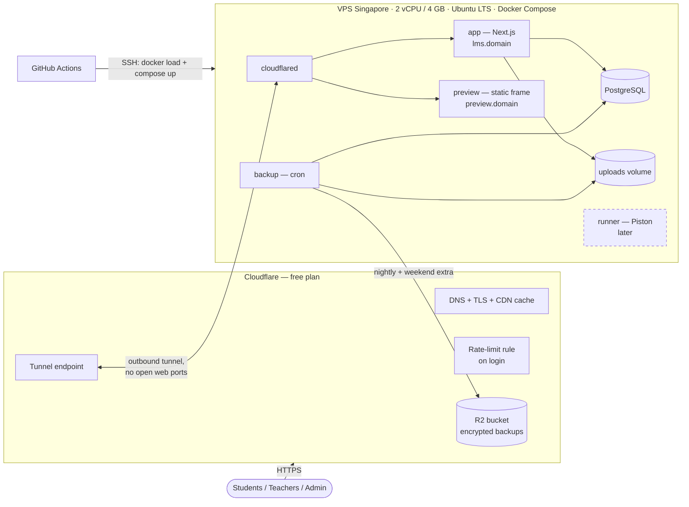

# 04 — Architecture Review: Coding Club LMS

> Review of `03-architecture.md` before any prototype or code. Date: 2026-10-18.
> **Status: ACCEPTED by the owner on 2026-10-18** (all findings; Q1 Cloudflare edge + Hetzner Singapore VPS, Q2 `lms.cckh.dev`, Q3 public repo). Folded into docs 01–03.

---

## 1. What was checked

The architecture was checked against the **real constraints** of this project, not general best practice:

| Constraint | Source |
|---|---|
| One person (the owner, a teacher) maintains **both the server and the code**, part-time | Owner, 2026-10-18 |
| **$100 one-time** budget; Option B (self-managed VPS) chosen; owner wants **Cloudflare** | Owner, 2026-10-18 |
| Users are mostly **minors**, often on **shared club laptops**; usage peaks on **weekend** mornings/afternoons | 01 §8 |
| Python / Java (multi-file) / Web; **no server code runner** in v1; teacher grading only | 01 §9 |
| Same way of working as **codingspacekh**: prototype first → milestones → **TDD** with CI gates, ADRs, runbook | Owner, 2026-10-18 |

Each finding has a severity: **High** = would break something or block launch; **Medium** = would cause real problems in use; **Low** = improvement or tidy-up.

## 2. Verdict

The overall shape is right for this use case. That covers the modular monolith on one server, Next.js + PostgreSQL, no server code runner in v1, derived time states, and server-side 60/30/10 scoring. It stays simple enough for one part-time maintainer and fits the budget.

**Three things must change before building** (§3, High), and several smaller gaps should be fixed in the documents now, because they are cheap on paper and expensive later.

| Area | Decision in 03 | Review result |
|---|---|---|
| Architecture style (modular monolith) | Keep | ✅ Correct for 1 maintainer, ~500 users |
| Next.js (App Router) + TypeScript | Keep | ✅ App Router is fine here (codingspacekh used Pages Router only because of Arwes) |
| PostgreSQL + Drizzle, analytics via SQL views | Keep | ✅ |
| Better Auth (username + password, admin-created) | Keep | ✅, with shorter sessions for students (F8) |
| CodeMirror 6 + file tree, zip in the browser | Keep | ✅ Verify on a low-end laptop/phone in the M0 spike |
| No server code runner in v1; `CodeRunner` interface | Keep | ✅ |
| Web preview in a `srcdoc` iframe | **Change** | ❌ Conflicts with a strict CSP (F3) |
| Hosting "VPS from Cloudflare" | **Change** | ❌ Cloudflare does not rent VPSs (F1) |
| Domain `lms.cckh` | **Change** | ❌ Not a complete domain name (F2) |
| Caddy for HTTPS | **Drop** | Not needed behind Cloudflare Tunnel (F4) |
| Nightly backup only | **Adjust** | Weekend data at risk (F12) |
| Data model / rules | **Adjust** | Time zone, late enrolment, gradebook, multi-part exams (F5–F7) |

## 3. High-severity findings

### F1 — Cloudflare is not a VPS provider → use Cloudflare *in front of* the VPS
**Finding:** Option B needs a rented Linux server. Cloudflare doesn't sell general-purpose servers. Its hosting products (Workers, Pages, D1, Containers) are a different, serverless model.

**Recommendation — "Cloudflare edge + small VPS":**
- **Cloudflare (free plan)** handles everything at the edge: **DNS**, **HTTPS certificates**, **CDN cache** for static files, DDoS protection, a free **rate-limit rule** on the login page, **Cloudflare Tunnel** (`cloudflared`) to reach the server without opening web ports, and **R2** for off-site backups. You already use R2 for codingspacekh.
- **VPS** from a provider with a **Singapore** region: Hetzner is cheapest (2 vCPU / 4 GB "CX23" listed at about €4–6/month with an IPv4 address after its April 2026 price change; check the Singapore price on hetzner.com). Vultr, DigitalOcean and Linode also work but cost more for 4 GB. Hetzner's Singapore traffic allowance is small (~0.5–1 TB/month), which is plenty for an LMS behind Cloudflare's cache.
- Budget: ≈ €5–6/month VPS + ≈ $10–15/year domain → **$100 covers ≈ 13–16 months**.

**Alternative considered — host everything on Cloudflare** (Workers Paid $5/month + D1 + R2), with no server at all:

| | Cloudflare edge + VPS (**recommended**) | All on Cloudflare Workers |
|---|---|---|
| Monthly cost | ≈ €5–6 | ≈ $5 |
| Server upkeep | OS updates, backups, restore tests | None |
| Database | PostgreSQL (full SQL, views, transactions) | D1 (SQLite) — fine at this size, fewer features |
| Next.js | Runs normally (standalone Node) | Needs the OpenNext adapter; some features differ |
| Future Python/Java runner | **Free** on the same VPS (Piston) | Needs Cloudflare Containers (pay per use) |
| Local dev = production | Yes (Docker Compose) | Mostly (Wrangler emulation) |
| Lock-in | Low (move the containers anywhere) | High |

You chose a VPS knowing it needs upkeep, and want the free code runner later, so **edge + VPS** fits best. ➜ *Confirm (Q1).*

### F2 — `lms.cckh` is not a complete domain
**Finding:** `.cckh` isn't a top-level domain, so `lms.cckh` can't be registered or put on Cloudflare. A subdomain needs a registered parent domain, e.g. `lms.cckh.dev`, `lms.cckh.org` or `lms.codingclubkh.com`.

**Recommendation:** register a domain on **Cloudflare Registrar** (sold at cost, DNS already on Cloudflare), in the same way as `codingspacekh.dev`. To my knowledge Cloudflare Registrar doesn't sell `.kh` domains, so a `.com.kh` / `.edu.kh` name would come from a Cambodian registrar, with DNS then pointed to Cloudflare. ➜ *Confirm the domain (Q2).*

### F3 — The Web preview would be blocked by the LMS's own security policy
**Finding:** An `<iframe srcdoc>` **inherits the Content Security Policy of the page that contains it**. The LMS should run a strict CSP (as codingspacekh does), which blocks inline scripts. A student's `<script>` and `onclick=` code would then be blocked inside the preview. If the CSP is relaxed to allow them, the protection for the whole LMS is weakened.

**Recommendation — a separate preview origin** (the approach CodePen and JSFiddle use):
- Serve one small static page from **`preview.<domain>`** (same server, own Cloudflare Tunnel hostname) with a **permissive CSP of its own** and **no cookies**.
- The editor embeds `https://preview.<domain>/frame` in an iframe with `sandbox="allow-scripts allow-modals"` (still **no** `allow-same-origin`) and sends the project files by `postMessage`. The frame builds the page and reports `console.log` / errors back by `postMessage`.
- The LMS keeps a strict CSP: `frame-src https://preview.<domain>`.
- Proven in the **M0 spike** with tests: student inline scripts run in the preview; the preview can't read LMS cookies or call the LMS API; the LMS page has no CSP violations.

## 4. Medium-severity findings

### F4 — Caddy is unnecessary behind Cloudflare Tunnel
With the Tunnel, `cloudflared` makes an outbound connection to Cloudflare, and Cloudflare serves HTTPS to users. The server needs **no open web ports (80/443)** and no certificates, so Caddy can be removed. That's one less component to maintain.
- Firewall: only SSH (22) open, key-only. *Optional:* SSH through Cloudflare Access too (free for small teams), which closes port 22 to the internet.
- `cloudflared` routes `lms.<domain>` → `app:3000` and `preview.<domain>` → the static preview page.

### F5 — Time zone is not defined
Sessions are wall-clock times ("Saturday 09:00"), but the server runs in UTC. Without a rule, due dates and "next session" can be off by hours.
**Recommendation:** one **club time zone** setting (e.g. `Asia/Phnom_Penh`). Store all timestamps in UTC (`timestamptz`), store session times as local date + time, and convert at the edges. Unit tests cover due dates around midnight and term boundaries.

### F6 — Late enrolment and transfers would unfairly lower scores
A student who joins in week 4 would get 0 for weeks 1–3 under BR-12.
**Recommendation (new BR-17):** assessments **due before the enrolment date** are left out of that student's score, attendance % and completion rate. A **transfer** to another class ends the old enrolment (withdrawn) and starts a new one, and scores don't carry over unless Admin moves them, which is logged.

### F7 — Gaps in grading: paper work and multi-part exams
- Classwork and exams are often **on paper or done in class without the editor**, but the design only grades one submission at a time. **Add a gradebook:** a table of students × assessments where the teacher can type scores and short comments quickly for a whole class (new FR-TCH-19, Must).
- An end-term exam may have **several parts** (e.g. theory + practical). **Adjust BR-12:** exam % = sum of all *exam* scores ÷ sum of their max scores, the same as classwork and homework.

### F8 — Shared club laptops need shorter student sessions
Many students sign in on shared laptops at the club.
**Recommendation:** student sessions end after **2 h idle / 12 h maximum**, with no "remember me" option. Teachers and admins get **7 days, renewed on activity**. The dashboard shows "Signed in as …, not you? Sign out" prominently, and Admin can "sign out everywhere" for a student. Login is rate-limited in the app **and** by the Cloudflare rule.

### F9 — The backup plan risks losing a weekend's work
A nightly backup can lose up to 24 h of data, which could be a whole Saturday of attendance and marking.
**Recommendation:** nightly backups, **plus an extra backup at the end of each weekend teaching day** (e.g. 13:00 and 18:00 on Sat/Sun), all encrypted to R2. Target: lose at most ~4 h of data at weekends and 24 h on weekdays, and recover within 2 h. Continuous Postgres backup (WAL archiving) is possible later but adds upkeep.

## 5. Low-severity findings

| # | Finding | Recommendation |
|---|---|---|
| F10 | The certificate QR code points to `/verify/{code}`, but the verify page is only "Could" (Phase 3). | Build the verify page **with** certificates (Phase 2). It's a few hours of work. |
| F11 | The deploy pipeline depends on GitHub Container Registry limits for private repos. | Build the image in GitHub Actions and **send it straight to the VPS over SSH** (`docker save \| ssh docker load`). There's no registry to manage, and the previous image stays on the server for rollback. |
| F12 | Private vs public repo is undecided. Private repos get 2,000 free CI minutes/month; public repos get unlimited minutes. | A **public repo** like codingspacekh is fine (no secrets or student data in git) and gives unlimited CI. Choose private if you prefer; then keep E2E runs lean. ➜ *Q3* |
| F13 | Authorisation relies on the app only (codingspacekh also used database RLS). | Keep authorisation in the app (one `Policy` module) but test it **exhaustively**: a generated test for **every role × every action × own/other class**. Record in an ADR why RLS isn't used (one app DB user, all access through server code). |
| F14 | No overview of how much of the syllabus each class has covered. | Add a **syllabus coverage** view per class (topics covered in weekly reports vs. the course syllabus). It reuses existing data. |
| F15 | Moderation for minors relies on teachers noticing problem posts. | Add a **"Report" button** on Q&A posts. Reported posts are hidden until a teacher reviews them. |

## 6. Capacity check (one 2 vCPU / 4 GB VPS)

| Component | Memory (approx.) |
|---|---|
| Ubuntu + Docker | 300–400 MB |
| Next.js app (one Node process) | 300–500 MB |
| PostgreSQL (`shared_buffers` 256 MB) | 400–600 MB |
| `cloudflared` | ~50 MB |
| Backup job (only while running) | ~100 MB |
| **Total today** | **≈ 1.2–1.7 GB** of 4 GB |
| *Future Piston runner (Python + Java)* | *+1–1.5 GB → still fits* |

Load: ~150 concurrent users on a weekend morning means a few requests per second, which one Node process handles easily. Cloudflare caches static files (JS, CSS, fonts). Disk (40 GB): app images ~2 GB, database < 1 GB/year, attachments capped. **Verdict: comfortable, with room for the runner.** A k6 load test at 3× the weekend peak confirms this before launch (M7).

## 7. Revised deployment picture

## 8. Fit with the codingspacekh way of working

| Practice from codingspacekh | Plan for this project |
|---|---|
| Prototype before code (Figma → HTML prototype) | **P0:** clickable HTML prototype of the three role journeys with mock data, signed off by the owner before M0 |
| Milestones with **tests written first** and **exit criteria** | `05-milestones.md` in the same format (Goal → Build → Tests first → Exit criteria → Result) |
| M0 spike on the riskiest parts → ADR go/no-go | **M0 spikes:** preview origin + CSP (F3); editor + file tree + zip on a low-end laptop and a phone; Better Auth username/admin with Drizzle; VPS + Tunnel + SSH deploy "hello world" |
| M1 walking skeleton: CI gates, protected `main`, PR-only | Same, plus Docker Compose, first deploy to the VPS and a **first restore drill** |
| Red → Green → Refactor; requirement IDs in commits | Same (e.g. `FR-TCH-06: attendance defaults to present`) |
| Test pyramid: Vitest, RTL, Playwright + axe, coverage gates | Same tools. Integration tests run against PostgreSQL in Docker, and **policy matrix tests** replace pgTAP/RLS tests (F13) |
| ADRs, runbook, ASVS L1 security review before launch | Same. The runbook adds VPS tasks (updates, restore drill, disk) |
| Pinned dependency versions ≥ 2 weeks old | Same |

**Proposed milestone order** (detailed in `05-milestones.md` after approval):
`P0 Prototype → M0 Spikes → M1 Walking skeleton → M2 Academics (users, terms, courses, classes + sessions, enrolments) → M3 Teaching (lessons, Q&A, attendance) → M4 Assessments (editor, preview, submissions, grading, gradebook) → R1 Pilot with one real class → M5 Reports & statistics (60/30/10, pass/fail, charts) → M6 Term operations (certificates + verify, promotion, login slips, CSV import, notifications, audit) → M7 Hardening & launch → R2 Club-wide launch`

## 9. Questions for the owner

1. **Hosting (F1):** Cloudflare (DNS, Tunnel, R2 backups) in front of a **Hetzner Singapore** VPS (or another provider you prefer)? Or did you mean hosting everything on Cloudflare Workers?
2. **Domain (F2):** which registered domain will the LMS live under (e.g. `lms.cckh.dev`)? Do you already own it?
3. **Repository (F12):** public (unlimited CI, like codingspacekh) or private?
4. **Accept the other findings** (F3–F15) so they can be folded into docs 01–03?
