# 05 — Milestones & Build Order: Coding Club LMS (lms.cckh.dev)

Companion to `02-system-requirements.md` (requirement IDs FR-, BR-, NFR-) and `03-architecture.md` (ADR-). Written 2026-10-19, after the P0 prototype was approved. Same way of working as codingspacekh: **prototype → milestones → TDD**.

---

## 1. How the order was chosen

1. **Biggest risks first.** Three things could change the plan: the Web preview on a separate origin under a strict CSP (ADR-09), the multi-file editor on low-end laptops and phones (ADR-03), and per-role session rules in the auth library (ADR-04). A short spike (M0) settles them before anything depends on them.
2. **Pipeline and server before features.** TDD needs working tests, CI, the VPS, deploys and a restore drill from day one (M1). Each later milestone adds tests to that pipeline and deploys to production when it's done.
3. **Build in the order the club uses it.** Accounts and classes (M2) come before lessons and attendance (M3). Those come before homework and grading (M4). After M4 one real class can run a term: that is **R1, the pilot**.
4. **Calculation-heavy features after real data.** Reports, the 60/30/10 engine and charts (M5) are built once the pilot produces real attendance and scores to check them against.
5. **Term-end tools last, but before launch.** Certificates and promotion (M6) are needed only at the end of a term. M7 hardens everything before **R2, the club-wide launch**.

```mermaid
flowchart LR
  P0(["P0 ✅<br/>Prototype"]) --> M0["M0<br/>Spikes"]
  M0 --> M1["M1<br/>Walking skeleton<br/>CI · VPS · deploy · backups"]
  M1 --> M2["M2<br/>Academics<br/>accounts · classes · sessions"]
  M2 --> M3["M3<br/>Teaching<br/>lessons · Q&A · attendance"]
  M3 --> M4["M4<br/>Assessments<br/>editor · submissions · gradebook"]
  M4 --> G1(["G1 · Go live<br/>server set-up"])
  G1 --> R1(["R1 · Pilot<br/>one real class"])
  R1 --> M5["M5<br/>Reports & statistics"]
  M5 --> M6["M6<br/>Term operations<br/>certificates · promotion"]
  M6 --> M7["M7<br/>Hardening"]
  M7 --> M8["M8<br/>Club look<br/>brand · three homes"]
  M8 --> M9["M9<br/>Lesson note editor"]
  M9 --> R2(["R2 · Club-wide launch"])
  R2 --> L["Later<br/>Pyodide · runner"]
```



## 2. Summary

| # | Milestone | Main outcome | Requirements | Effort* |
|---|---|---|---|---|
| **P0** ✅ | Prototype | Clickable dashboard prototype of all three roles, approved 2026-10-19 | all journeys | done |
| **M0** ✅ | Spikes | Go/no-go with measurements for the preview origin + CSP, the editor on low-end devices, and Better Auth username/roles/sessions | ADR-03, 04, 09 | 4 days |
| **M1** ✅ | Walking skeleton (code; server set-up in G1) | Public repo + required CI checks, Docker Compose, VPS + Cloudflare Tunnel, automatic deploys with rollback, sign-in, dashboard shell, backups + first restore drill | NFR-04, 05, 10 | 5 days |
| **M2** ✅ | Academics | Club settings, accounts and passwords, terms, courses + syllabus, weekend classes with weekly sessions, enrolments, transfers | FR-AUTH-01…07, 10, 11 · FR-ADM-01…08, 16 · FR-TCH-05 | 6 days |
| **M3** ✅ | Teaching | Weekly lessons, Q&A with reporting, attendance, weekly class report, syllabus coverage | FR-TCH-01…06, 14, 20 · FR-STU-02…04, 10 | 5 days |
| **M4** ✅ | Assessments | Classwork/homework/exams, multi-file editor, Web preview, submissions, grading, gradebook | FR-TCH-07…12, 19 · FR-STU-05, 06 · FR-CODE-01…06 | 8 days |
| **G1** ✅ | Go live | Owner's server and Cloudflare set-up (runbook §2); first deploy, restore drill, uptime alert | NFR-04 | 1–2 hours |
| — | **R1: Pilot** | One real class uses the LMS on production for at least 4 weeks | | |
| **M5** ✅ | Reports & statistics | 60/30/10 overall score, end-term exam, term reports with pass/fail, charts for all three roles, admin dashboard | FR-TCH-15…18 · FR-ADM-09, 10 · FR-STU-07 | 6 days |
| **M6** ✅ | Term operations | Certificates + `/verify`, promotion wizard, login slips, CSV import, notifications, audit log, playground | FR-ADM-11…14 · FR-AUTH-08, 09 · FR-STU-08, 09 · FR-SYS-01, 02 · FR-CODE-07 | 6 days |
| **M7** ✅ | Hardening | ASVS L1 review, ZAP, k6 load test, disaster-recovery rehearsal, runbook, privacy check | NFR-01…12 | 5 days |
| **M8** ✅ | Club look | Champion Coders brand (logo, dark blue, Titillium Web), kid-friendly styling, new home pages for all three roles, term puzzle | NFR-08 · FR-STU-01, 11 · FR-TCH-21 · FR-ADM-10 · BR-21 | 4 days |
| **M9** ✅ | Lesson note editor | Word-processor-style lesson note with code blocks, pictures and tip boxes; notes that read like a book page for students | FR-TCH-22 · FR-STU-12 · BR-22 | 4 days |
| **M10** ✅ | Fix mistakes | Edit, undo and delete-if-unused for terms, courses, classes and people (reopen a closed term, change a class after it is created) | FR-ADM-01…05 · BR-23, 24 | 3 days |
| **M11** ✅ | Run code | Run Python and Java from the editor and the Playground, with an input box, on our own locked-down runner on the same server | FR-CODE-09, 10 · BR-25 · ADR-0004 | 4 days |
| **M12** ✅ | Q&A editor | The word-processor-style editor, with code blocks, in questions and replies | FR-STU-03, 04 · FR-TCH-03 · BR-26 | 2 days |
| **M13** ✅ | Change my password | Admins and teachers change their own password on a My account page | FR-AUTH-06 | 1 day |
| **M14** ✅ | Weekly report sheet, online classes, support lines | The weekly report as a sheet with one row per student; online classes with a Zoom link; Admin's Weekly reports page; support lines for students who need help | FR-TCH-14 · FR-ADM-05, 17, 18 · FR-STU-13 · BR-27…29 | 7 days |
| **M15** | Safer promotion | Promote several Ready classes at once, see each new class's places and timetable clashes before confirming, undo a promotion until the new classes start | FR-ADM-13 · BR-30 | 4 days |
| **M16** | Student password, archived accounts | Students change their own password on My account; People shows active accounts only, with an Archived list to restore or delete from | FR-AUTH-04, 06 · BR-23, 31 | 2 days |
| **M17** ✅ | Security fixes | Fix the 13 confirmed findings of the security audit run-1 (5 medium, 8 low): runner, shared-load limits, sign-in limits, lifecycle and privacy rules, backup restore | NFR-01, 05, 06, 07 · FR-AUTH-11 · BR-11 | 4 days |
| **M18** | More course languages | Admin adds languages such as Scratch and Roblox; their work is handed in as a project file or a link, which the teacher downloads or opens to mark | FR-ADM-04 · FR-STU-05 · FR-TCH-11 · BR-32 | 3 days |
| — | **R2: Club-wide launch** | Every class of the next term runs on `lms.cckh.dev` | | |

\* *Effort = focused working days for one developer, tests included. Total ≈ **45 focused days**. At 2–3 focused days a week alongside teaching, that is about **4–5 months**: R1 could pilot in **Term 1 · 2027** (from Sat 9 Jan 2027) and R2 launch in **Term 2 · 2027**. These are planning ranges (±30%), not promises. AI-assisted pace on codingspacekh was faster, but the server work here is new.*

---

## 3. Development process: Test-Driven Development

### 3.1 The loop
Every change follows **Red → Green → Refactor**:
1. **Red:** write a failing test that states the behaviour from a requirement ID, and watch it fail.
2. **Green:** write the smallest code that passes.
3. **Refactor:** clean up while everything stays green.
4. Commit with the requirement ID, e.g. `FR-TCH-06: attendance defaults to present`.

Features start **outside-in**: a Playwright acceptance test for the user journey is written first and stays red. Unit and integration tests drive the pieces until it turns green.

### 3.2 Test pyramid and tools
| Level | Tool | What it covers | Speed |
|---|---|---|---|
| Unit | **Vitest** | Score engine (BR-12…14, 17), session generator (BR-15, 16, 19), time-zone conversion, attendance % (BR-09), Java package check, zip path safety, Markdown sanitiser, Zod schemas | ms |
| Component | **Vitest + React Testing Library** | Editor + file tree, gradebook grid (keyboard), attendance buttons, chart components (table view = chart data) | ms |
| Integration | **Vitest + PostgreSQL in Docker** | Server actions and routes against a real database: auth, sessions, submissions, transactions (promotion, class creation) | seconds |
| Authorisation | **Policy matrix tests** (Vitest, generated) | Every role × every action × own/other class: allowed or refused (ADR-10, replaces RLS/pgTAP) | seconds |
| End-to-end | **Playwright** + `@axe-core/playwright` | Journeys for each role on desktop and phone sizes; accessibility on key pages; preview-origin isolation | minutes |
| Performance | **k6**, bundle budget | Weekend-peak load test (M7); first-load JavaScript budget per PR | minutes |
| Security | Header/CSP tests, XSS corpus, policy matrix, secret scan, **OWASP ZAP baseline** | NFR-05, 06 | minutes |

### 3.3 CI gates (GitHub Actions, every pull request)
`typecheck` → `lint` + `format` → `unit + component` (coverage: **≥ 90%** for domain rules and server code, ≥ 80% overall) → `integration` (Postgres service) → `policy matrix` → `build` + bundle budget → `e2e + axe` (desktop + mobile) → `secret scan` + `dependency audit`. ZAP baseline runs nightly and before each release. **A red gate blocks the merge.** Merging to `main` builds the image and deploys it to the VPS (weekdays only; §9.3 of the architecture).

### 3.4 Definition of Done (each feature)
- [ ] Acceptance test written first, now green.
- [ ] Unit/integration tests for new logic; coverage thresholds met.
- [ ] Policy matrix updated for any new action; security tests updated for any new route, table or input.
- [ ] Accessibility check passes; works by keyboard and at phone width.
- [ ] Follows the dashboard design from P0 (tokens, cards, charts per the dataviz rules).
- [ ] Requirement ID in the commit; docs updated if behaviour changed.

### 3.5 Milestone gate (the "pass before moving on" rule)
A milestone is **done** only when:
1. every test listed under **Tests first** exists, was red first, and is now green in CI on `main`;
2. every **Exit criterion** is met and checked on **production** (`lms.cckh.dev`) from G1 onward. Before G1, it's checked on a local production build and in CI;
3. the nightly backup still restores (checked by the restore test);
4. the owner signs off, and a **Result** block is added under the milestone, as in codingspacekh.

The next milestone does not start until all four are true.

---

## 4. Milestones in detail

### P0 — Clickable prototype — ✅ APPROVED 2026-10-19
> **Result:** https://claude.ai/artifact/VsMdeZuM2y3nosrwMdhKnj (source `prototype/cckh-lms-prototype.html`).
> - Version 1 (notebook style) was rejected for its look. **Version 2**, a clean dashboard (sidebar, white cards, Geist font, dataviz-style charts with hover and table views), was approved: "much better; the rest can be updated later on".
> - Workflows confirmed for all three roles: weekend class creation with sessions, people + one-time passwords, student report, promotion, certificates; class overview, weekly lesson/attendance/work/Q&A/report, gradebook, grading, statistics, term reports; student week, lesson + Q&A, homework editor (Python / Java packages / Web preview), progress.
> - Smaller refinements are allowed during M2–M6, as each screen is built for real.

### M0 — Spikes (4 days) — ✅ DONE 2026-10-19: **GO** on all three (owner signed off)
> **Result** (`spikes/m0/`, throwaway; decisions in [ADR 0001](./adr/0001-preview-origin.md), [ADR 0002](./adr/0002-editor.md), [ADR 0003](./adr/0003-auth.md)):
> - **66 tests written first, all passing:** 37 unit, 13 integration (PostgreSQL 18 in Docker), 16 browser (desktop + phone). Type check clean; `npm audit`: 0 vulnerabilities.
> - **Spike A, preview origin: GO.**
>   - Students' inline scripts and `onclick=` run on the preview origin, while the LMS keeps a strict nonce CSP with **zero violations**.
>   - Student code can't read LMS cookies, the page or storage. A credentialed request from it arrives with `Origin: null` and no cookie, and is refused.
>   - Other sites can't embed the frame.
> - **Spike B, editor: GO.**
>   - Typing in a 30-file Java project with the CPU slowed 4×: median 32 ms, 95th percentile **40 ms** (target < 50 ms).
>   - Works on a phone. Editor page ≈ 350 KB of compressed JavaScript (budget 450 KB; M4 target ≤ 300 KB via per-language loading).
> - **Spike C, auth: GO.** Usernames, Admin-only accounts, students signed out after 2 h idle / 12 h total, staff 7 days, sign out everywhere, and the 6th wrong password in a minute refused.
> - **Findings that changed the plan:**
>   1. **JSZip** trips the strict CSP (its Node polyfills call `Function()`), so the app uses **fflate**, which also refuses zip bombs before decompressing.
>   2. **Better Auth checks `Origin` only when a cookie is present**, and `/sign-in/username` has no first-login CSRF check, so our hook refuses any browser POST to `/api/auth/*` not sent from the LMS.
>   3. **Per-role session lengths aren't built into Better Auth**, so they're enforced in `getActor()`.
>   4. Every mutating route must refuse `Origin: null` / foreign origins, which becomes a route-level test in M4.
> - **Setup for M1, done 2026-10-19:** Docker Compose 5.6.0 installed with Homebrew and registered as a Docker CLI plugin (`cliPluginsExtraDirs` in `~/.docker/config.json`), so `docker compose` works.
**Goal:** prove the three risky parts work before anything depends on them. Throwaway branch; each spike ends in an ADR.

**Build:**
- **Spike A, preview origin (ADR-09):** two local origins (e.g. `lms.localhost:3000` and `preview.localhost:8080`). The LMS page has a strict nonce-based CSP. A static `frame.html` is served with its own permissive CSP and receives files by `postMessage`.
- **Spike B, editor (ADR-03):** CodeMirror 6 with Python/Java/HTML/CSS/JS modes, a file tree with folders, and zip/unzip in the browser. Measured on a low-end laptop profile (4× CPU throttling) and a phone viewport.
- **Spike C, auth (ADR-04):** Better Auth (username + admin plugins) with Drizzle and Postgres. Admin creates a user; username login; **role-based session lengths** (student 2 h idle / 12 h max, staff 7 days rolling); sign out everywhere; login rate limit.

**Tests first:**
- Playwright (A): a student `<script>` and `onclick=` run in the preview; the LMS page reports **zero CSP violations**; student code **cannot** read LMS cookies or call an LMS API route with credentials; the frame ignores `postMessage` from any origin except the LMS.
- Vitest (B): zip round trip keeps paths and content; entries with `../` or absolute paths are rejected; size/file-count limits are enforced. Playwright (B): a 30-file Java project opens, and typing latency stays under 50 ms with 4× throttling; the editor bundle size is recorded.
- Integration (C): admin-only user creation; no public sign-up route; a student session expires after 2 h idle and 12 h total, while a teacher session survives 3 days with activity; sign out everywhere revokes all sessions; the 6th wrong password in a minute is refused.

**Exit criteria:** ADRs `docs/adr/0001-preview-origin.md`, `0002-editor.md` and `0003-auth.md` each record **go** or the fallback, with measurements. If Better Auth can't do per-role session lengths cleanly, the ADR records the wrapper design (or an alternative library) before M1.

### M1 — Walking skeleton (5 days) — ✅ CODE DONE 2026-10-19 · server set-up deferred to **G1**
> **Result** (PRs #1, #2):
> - **Repo:** public repo `codingspacekh/cckhlms`. `main` is protected: PRs only, squash merges, **5 required checks** (format · lint · types · unit + coverage · audit; integration on PostgreSQL 18; e2e with Playwright + axe on desktop and phone; gitleaks; infrastructure), enforced for admins too.
> - **App:**
>   - Next.js 16 with a strict per-request CSP.
>   - Better Auth sign-in with usernames, the LMS-origin hook and per-role sessions.
>   - Drizzle baseline migration (auth tables, `club_settings` with `Asia/Phnom_Penh`, `audit_log`). Migrations run at start-up; if start-up fails, the app exits.
>   - Policy module with the role × action matrix test; sign-in redirect and real 403 pages; dashboard shell from P0.
> - **Infrastructure:**
>   - App and preview images; `compose.prod.yaml` with cloudflared, no published ports and an internal-only database.
>   - age-encrypted backups to R2: nightly + weekend runs, 14 daily + 8 weekly.
>   - `provision.sh`; Deploy workflow with health check, automatic rollback and weekday-only releases; `docs/runbook.md`.
> - **Tests:** 46 unit/component, 26 integration, 14 e2e, plus infrastructure checks. The app image boots and migrates in Docker, and a backup restores with identical checksums.
> - **Found and fixed by the tests:**
>   - muted text below WCAG contrast;
>   - the app starting against a missing database;
>   - a PostgreSQL init-restart race;
>   - an outdated shellcheck on the CI runner.
> - **Deviation (owner's decision, 2026-10-19):** the paid account set-up (Hetzner, Cloudflare domain/Tunnel/R2, monitors) is **deferred**. Exit criteria 2–4 (automatic deploy to `lms.cckh.dev`, first restore drill from R2, uptime alert) move to **G1: Go live**, which must be done before R1. Exit criterion 1 (a failing PR can't merge) is met.

**Goal:** every later change runs through a working TDD pipeline and lands on the real server.

**Build:**
- Public GitHub repo; `main` protected (PRs only, required checks, enforced for admins); folder layout from architecture §4; TypeScript strict, ESLint, Prettier, pinned dependency versions ≥ 2 weeks old.
- Next.js (App Router) + Drizzle; baseline migration: `user`, `user_role`, `session`, `club_settings`, `audit_log`.
- Sign-in from Spike C; security headers + strict CSP; `Policy` module with the **matrix test harness**.
- Dashboard shell from P0: design tokens (light/dark), sidebar, top bar, card, tile, pill, table, chart primitives.
- Docker Compose: `app`, `preview`, `db` locally; plus `cloudflared` and `backup` in production.
- **Server:** Hetzner Singapore VPS hardened (architecture §9.4); `cckh.dev` on Cloudflare; Tunnel for `lms.cckh.dev` and `preview.cckh.dev`; Cloudflare rate-limit rule on `/api/auth/*`.
- **CI/CD:** all gates from §3.3; on merge, build the image → `docker save` → SSH → `docker load` → `compose up` → health check → automatic rollback to the previous image if unhealthy.
- **Backups:** nightly + weekend runs to R2, encrypted; free uptime monitor; `docs/runbook.md` started.

**Tests first:**
- Header test: CSP (no `unsafe-inline` scripts), HSTS, `nosniff`, Referrer-Policy, Permissions-Policy, `frame-src` limited to `preview.cckh.dev`.
- Policy matrix harness: an action with no policy entry **fails** the test run.
- Playwright: the sign-in page loads and passes axe; an admin signs in and sees the dashboard shell; a student who opens an admin URL gets "not allowed".
- Backup test (CI): seed the DB → run the backup script → restore into a fresh Postgres → row counts and a checksum match.
- Deploy smoke (CI, after deploy): `https://lms.cckh.dev/api/health` returns OK with the new commit SHA; a deliberately unhealthy image triggers rollback (rehearsed once).

**Exit criteria:** a pull request with a failing test cannot merge; a merged one deploys to `lms.cckh.dev` on its own; the first **restore drill** from R2 is done and recorded in the runbook; the uptime alert reaches the owner.

### M2 — Academics (6 days) — ✅ DONE 2026-10-19 (owner signed off)
> **Result** (PRs #4–#7):
> - **People (FR-ADM-01/02, FR-AUTH-02/03/04/07/10):**
>   - create students, teachers and admins with a suggested username and a one-time password on a login slip;
>   - reset passwords; switch accounts off and on (signed out at once and told why at sign-in); sign out everywhere;
>   - you can't switch off yourself or the last active admin; guardian details are admin-only.
> - **Club settings (FR-ADM-16):** club name and time zone (validated IANA zone).
> - **Terms (FR-ADM-03):** auto-named; no duplicates or overlapping dates; planned → active → closed, at most one active.
> - **Courses (FR-ADM-04):** code, language, pass mark 60 and weights 60/30/10 (must add up to 100, also checked in the database), a loop-free next level, and an ordered syllabus whose topics keep their identity when edited.
> - **Weekend classes (FR-ADM-05/06/08, FR-TCH-05, BR-15/16):**
>   - Saturday or Sunday, 90/120 min, 10–12 weeks, with a live preview where tapping a holiday adds a week;
>   - class, teachers and sessions are created in one transaction;
>   - clash warnings (teacher, room, student) must be confirmed;
>   - cancel (± an extra week at the end), move, and make-up sessions; week numbers come from the dates.
> - **Enrolments (FR-ADM-07, BR-17/18):** join date defaults to today in club time; duplicate, full-class, switched-off and closed-term refusals; transfers and withdrawals keep history.
> - **Own views (FR-STU-01):** teachers see only their classes (students, next session, schedule changes); students see only their current classes and the next one.
> - **Permissions:** the first **own-class** rules (`class.schedule`, `class.view`); the matrix now tests own vs other class.
> - **Time zone (BR-19):** `zonedToUtc`, `nextSession` and `todayIn`, tested with Phnom Penh (Sat 06:00 = Fri 23:00 UTC; the date changes at local midnight) and a daylight-saving zone.
> - **Migrations 0001–0004:** profiles; term/course/syllabus; class/class_teacher/class_session; enrolment. All have CHECK constraints and one-active/one-lead/one-per-day unique indexes.
> - **Tests:** 144 unit/component (100 % lines), 75 integration (98 % lines across all modules), 31 e2e including the **M2 exit journey** (term → course → class → two students → enrol → withdraw → the student and the teacher see the class and its next session).
> - **Found and fixed by the tests:**
>   - a new teacher didn't appear when added from the Students tab;
>   - wide tables weren't keyboard-scrollable;
>   - `toLocaleDateString` writes dates differently in Node and Chromium, so dates are now formatted by hand;
>   - the integration coverage wasn't measuring the academics modules.
> - **Exit criterion:** until G1 the owner checks it on a local production build. The e2e journey already performs the full set-up.

**Goal:** the Admin can set up a real term: people, courses, weekend classes and enrolments.

**Build:**
- Club settings, including the time zone (`Asia/Phnom_Penh`).
- Accounts: create student/teacher; readable generated password **shown once**; reset; deactivate; sign out everywhere; optional forced change at first login.
- Terms (4 per year), courses + ordered syllabus + next-level course, pass mark (60) and weights (60/30/10) per course.
- Classes: Saturday/Sunday, start time, 90/120 min, first date, 10–12 weeks, room, capacity, lead/assistant teachers; **all weekly sessions created in one transaction**; cancel, move, add make-up session.
- Enrolments with `enrolled_on`; transfers (BR-18); clash warnings (FR-ADM-08).
- The People and Classes screens as in P0.

**Tests first:**
- Unit (session generator): right weekday only; 10/11/12 weeks; a cancelled date pushes later weeks along; a make-up session takes the cancelled week's number; **time-zone cases**, e.g. a Saturday 06:00 class in Phnom Penh is Friday 23:00 UTC and must still show as Saturday.
- Unit: password generator format; username rules; clash detection for overlapping times (teacher, room, student).
- Integration: class + sessions are created together or not at all; a transfer ends one enrolment and starts another; a deactivated user can't sign in; reset invalidates the old password and logs an audit row.
- Policy matrix: only Admin manages accounts/classes; a teacher sees only assigned classes; a student sees only enrolled classes.
- Playwright: Admin creates term → course → class → two students → enrols them → reads the one-time passwords; the student signs in and sees the class and next session.

**Exit criteria:** on production, the owner sets up the pilot class for real (or a full demo term) without help, and the generated sessions match the club calendar.

### M3 — Teaching (5 days) — ✅ DONE 2026-10-19 (owner signed off)
> **Result** (PRs #9–#13, stacked: merge in order):
> - **Lesson notes (FR-TCH-01/02, FR-STU-02, ADR-08):**
>   - each week has a lesson: title, Markdown note and syllabus topics, with a live preview from the same server-side renderer students get;
>   - publish now, save as draft, or schedule in club time; whether a scheduled lesson is visible is worked out at read time, so there's no background job;
>   - students see only published lessons of classes they're in now.
> - **Attachments (FR-TCH-01, NFR-05):**
>   - up to 10 files of 10 MB per lesson, stored under random ids on the backed-up uploads volume;
>   - the served type comes from our allowlist; only PNG, JPEG, GIF and WebP show inline, everything else downloads with `default-src 'none'; sandbox`;
>   - uploads go through a route handler that checks Origin, caller and size before reading the body; downloads need the lesson's read permission (drafts give others a 404).
> - **Attendance (FR-TCH-06, BR-09, BR-17):**
>   - everyone starts present; one tap or arrow key per change, saved at once, with a note per student;
>   - opens on the day of the session; late joiners can't be marked for weeks before they joined;
>   - attendance % = (present + late) / (sessions held − excused), shown per student on the class page.
> - **Q&A (FR-STU-03/04/10, FR-TCH-03, BR-11, BR-20):**
>   - students ask (text + code) and reply; teachers reply, mark or unmark the answer, remove and restore;
>   - **Report** hides a post from classmates at once, its author sees "Under review"; restore/remove resolves every open report with an audit row; the weeks table shows "N to review".
> - **Weekly report and coverage (FR-TCH-14, FR-TCH-20):**
>   - a **Weekly report** tab per week: topics covered (suggested from the lesson's topics) and a comment; the attendance summary is worked out from the attendance rows, so it never goes stale;
>   - the weeks table shows each held week's report as done or missing;
>   - a **Syllabus coverage** card on the teacher's and the admin's class pages lists every topic with the weeks that covered it.
> - **Permissions:** `lesson.write`, `attendance.mark`, `qa.moderate` and `report.write` are for the class's own teachers; `lesson.read` and `qa.post` also for students enrolled now. "Own" for students means enrolled, tested both ways round.
> - **Migrations 0005–0009:** lesson + topics; attachment; attendance; Q&A posts + reports; class report + topics.
> - **Tests:** 270 unit/component (including a 33-case **XSS corpus** for the Markdown renderer: loosening it on purpose failed 26 cases), 141 integration (98 % lines), 50 e2e including the **M3 exit journey** (`m3-journey.spec.ts`: the teacher publishes a lesson and takes attendance → the student reads and asks → a classmate answers → the teacher marks the answer and writes the weekly report → coverage matches for the teacher and the admin), attendance for 15 students by keyboard and by touch, and axe on every new page with no CSP violations.
> - **Found and fixed by the tests:** table row headers inherited the small grey column-label style (M2 tables too); the admin dashboard test assumed it ran first.
> - **Left for later:** copying a lesson from a previous class (FR-TCH-04, "if time allows").
> - **Local demo data:** `npm run seed:dev` now adds M3 data for Python Level 1 (lessons, attendance, Q&A with one post to review, weekly reports).
> - **Exit criterion:** until G1 the owner checks it on a local production build (or `npm run seed:dev` + `npm run dev`). The e2e journey already runs a rehearsal week end to end.

**Goal:** a teacher can run a week: lesson note, attendance, questions and a weekly report.

**Build:**
- Weekly lessons per session: Markdown with code blocks, attachments, syllabus topics, draft/publish/scheduled publish (derived at read time, ADR-08); copy a lesson from a previous class (FR-TCH-04, if time allows).
- Q&A: ask (text + code), reply, accept answer, teacher hide/remove; **Report** button hides a post until a teacher reviews it (BR-20).
- Attendance: everyone present by default, one tap to change, saved per tap; late-enrolment sessions excluded.
- Weekly class report: topics covered, attendance summary filled in automatically, comment; **syllabus coverage** view (FR-TCH-20).

**Tests first:**
- Unit: Markdown sanitiser against an **XSS corpus** (outputs nothing executable); attendance % per BR-09 with late, excused and late-enrolment cases; publish visibility at, before and after `publish_at` in the club time zone.
- Integration: a reported post becomes `under_review`, is invisible to other students and visible to its author as "under review"; restore/remove resolves the report with an audit row.
- Policy matrix: students only see their own class's lessons and Q&A; only teachers of the class can moderate.
- Playwright: teacher publishes week 3 → student reads it and asks → a classmate replies → teacher accepts the answer; teacher takes attendance for 15 students by keyboard and touch; axe passes on lesson and Q&A pages.

**Exit criteria:** on production, a teacher runs one real or rehearsal week end to end (lesson, attendance, Q&A, weekly report), and the syllabus coverage view matches.

### M4 — Assessments (8 days) — ✅ DONE 2026-10-20 (owner signed off; PRs #14–#19 merged)
> **Result** (PRs #14–#19, stacked: merge in order):
> - **Setting work (FR-TCH-07/08, BR-01, BR-16):**
>   - each week has a **Classwork & homework** tab: classwork, homework or exam; Python, Java, Web or paper / in class; out of; late policy; draft or published;
>   - homework is due at the start of the next session by default, classwork at the end of its own session, or a fixed time;
>   - the due time is worked out when read, so cancelling or moving a session moves it (BR-16) with no job to run.
> - **Editor (FR-CODE-01/02/03/05/06, ADR 0002):**
>   - CodeMirror 6 with a file tree (add, rename, delete), up to 30 files / 200 KB;
>   - upload files or a .zip (an IDE's top folder is stripped; unsafe paths refused), download a .zip;
>   - the Java package check with a one-click fix;
>   - teachers set starter files; students' drafts autosave a second after typing, at once for whole-file changes, and before the tab closes;
>   - the editor page's JavaScript is 306 KB gzipped (measured 2026-10-20): inside the 450 KB budget, but 6 KB over M0's ≤ 300 KB target.
> - **Web preview (FR-CODE-04, NFR-05/06, ADR 0001):** the student's page runs on the preview origin in a sandboxed frame, with a console panel. Spike A's isolation tests run against the real app: the page can't read LMS cookies, the LMS page, its storage or LMS pages, and LMS actions refuse requests from it.
> - **Submissions (FR-STU-05, FR-TCH-10, BR-03, BR-04, BR-17):**
>   - **Submit** saves first, so the last change is always in it;
>   - resubmit until the due time, every version kept; after it, late if allowed, otherwise refused;
>   - the teacher's list shows submitted / late / missing / not due / joined after it was due, with counts; "missing" is worked out when read.
> - **Marking (FR-TCH-11/12, FR-STU-06, BR-04, BR-14):**
>   - each student's work opens read-only (with the preview for Web), downloads as a .zip, and shows older versions as history;
>   - score + feedback go on the latest version only: a newer hand-in since the page loaded is never overwritten;
>   - **Return for redo** needs a note; the student can hand it in again, even after the due time;
>   - students see their mark, the feedback, and what late work counts as after the penalty; their work lists say *Marked 8.5 / 10*, *Returned for redo*, *Handed in* or *Missing*.
> - **Gradebook (FR-TCH-19, BR-12, BR-13, BR-17):**
>   - a **Gradebook** tab per class: students × published work; type a score, `ex` to excuse, or nothing to clear;
>   - Tab moves across, Enter / Shift+Enter down / up; each cell saves by itself; errors keep what was typed;
>   - scores for paper work (or for code work never handed in) become submissions without files;
>   - each student's current overall score: 60 % exams + 30 % classwork + 10 % homework from work that's marked or missing (late penalty taken off, excused and not-yet-due left out), shown against the course's pass mark;
>   - a comment per cell, which the student sees with their mark.
> - **Permissions:** `assessment.write` and `work.grade` are for the class's own teachers; `work.save` and `work.submit` for students enrolled now, who only ever see their own work and marks (BR-11).
> - **Migrations 0010–0014:** assessments; drafts; submissions; marks on submissions; excusals and teacher-entered scores.
> - **Tests:** 415 unit/component (98 % lines), 181 integration (98 % lines), 82 e2e. They include the **M4 exit journey** (`m4-journey.spec.ts`): the teacher sets Java homework → the student writes two files, fixes the package warning and submits → the teacher downloads the .zip and marks it → the student sees the score and feedback. They also include the Web preview and isolation tests (`preview.spec.ts`) and a class's paper-quiz scores typed into the gradebook by keyboard (`gradebook.spec.ts`: 15 students in about 3 seconds, against the 2-minute exit criterion).
> - **Found and fixed by the tests:** reloading within a second of an upload lost it (now saved at once); React 19 cleared the Set-work form after an error (now submitted by hand); the mark form lost its confirmation when the page refreshed.
> - **Left for later:**
>   - inline line comments (FR-TCH-11, "C");
>   - the older Courses / People / Lesson forms still clear what was typed after an error (the same React 19 behaviour, fixed in M4's new forms).
> - **Local demo data:** `npm run seed:dev` now adds M4 data for Python Level 1: a homework with one marked and one to-mark hand-in, a Web homework, and week 2's paper quiz in the gradebook.
> - **Exit criterion:** until G1 the owner checks it on a local production build (or `npm run seed:dev` + `npm run dev`).

**Goal:** students write and submit code; teachers grade it quickly, including paper work in the gradebook.

**Build:**
- Assessments: classwork/homework/exam (exam may have several parts), starter files, attachments, due date (default: start of the next session), late policy; homework due on a cancelled session moves to the next one (BR-16).
- Multi-file editor from Spike B: file tree, Java package check with a one-click fix, upload files/zip, download zip, autosave.
- **Web preview on `preview.cckh.dev`** from Spike A, with a console panel.
- Submissions: draft → submitted/late (blocked if late isn't allowed), resubmit until due, version history, return for redo; "missing" derived at read time.
- Grading view (file tree, read-only code, download zip, score, feedback) and the **gradebook** (keyboard entry, per-cell autosave, missing/late/excused/to-mark states).

**Tests first:**
- Unit: due/late rules in the club time zone; late penalty (BR-14); Java package checker (match, mismatch, missing line, default package); zip import path safety and size limits; BR-16 due-date move.
- Component: gradebook Enter/Tab movement and per-cell save; editor file tree add/rename/delete.
- Integration: resubmission keeps versions and grades only the latest (BR-04); late submission when not allowed is refused; gradebook score for paper work creates a submission without files.
- Policy matrix: a student can never read another student's submission or files; teachers only grade their own classes.
- Playwright: teacher sets Java homework → student edits a multi-file project, fixes the package warning, submits → teacher opens it, downloads the zip, grades it → student sees score and feedback. Web homework: the preview runs the student's script and the console shows `console.log`; the **isolation tests from Spike A run here against the real hostnames**.

**Exit criteria:** on production, one homework cycle runs end to end for Python, Java and Web, and the gradebook takes a class's paper-quiz scores in under 2 minutes.

### G1 — Go live (owner set-up, ≈ 1–2 hours) — ✅ DONE 2026-10-30 (owner signed off; live on `lms.cckh.dev` since 2026-10-29)
- Do `docs/runbook.md` §2: domain, Hetzner server + `provision.sh`, Cloudflare Tunnel, rate-limit rule, R2 + age keys, healthchecks.io, GitHub `production` secrets, `DEPLOY_ENABLED`.
- **Exit criteria** (the ones carried over from M1):
  1. a merged PR deploys to `lms.cckh.dev` on its own;
  2. the first **restore drill** from R2 is done and logged (runbook §6);
  3. the uptime alert reaches the owner.
- **Repeat M7's server checks on the real server, before any real data** (owner's decision, 2026-10-21): the load test, the ZAP baseline and a disaster-recovery rehearsal onto a second server. The steps are in `docs/runbook.md` §8.
- Until G1, the milestone gate (§3.5, point 2) is checked on a **local production build** and in CI, instead of on production.

> **Result** (2026-10-29/30, PRs #54, #55, #63; runbook §8 has each check's numbers).
> - **Set-up:** `cckh.dev` on Cloudflare; a Hetzner server in Singapore (2 vCPU / 4 GB, Ubuntu 24.04, $30.99 a month, more than the €5–6 planned: the owner chose to keep Singapore); the Cloudflare Tunnel, DNSSEC, the sign-in rate-limit rule, R2 with a 30-day lock, the age keys, healthchecks.io and UptimeRobot; GitHub's `production` environment.
>   - *Found:* a second tunnel connector installed on the laptop from the dashboard took live traffic and gave 502s while the server was healthy. Removed; the runbook says never to run one on a laptop.
> - **Exit criterion 1 met:** every merged PR since #54 deployed on its own (#54–#63).
> - **Exit criterion 2 met:** the first restore drill from R2, with the real key, passed on 2026-10-30 (runbook §6). It found the key saved in the password manager without its `AGE-SECRET-KEY-` start, now fixed.
> - **Exit criterion 3:** UptimeRobot watches `/api/health`, but the alert wasn't seen by pausing the app. **The owner signed off without that test (2026-10-30).**
> - **M7's checks on the real server:** the load test (page p95 302 ms, autosave p95 190 ms, nothing out of memory), the ZAP baseline (0 high in all four scans) and the edge and cookie checks all passed.
>   - The **rebuild onto a second server** was not repeated on Hetzner: the owner chose the free laptop restore drill instead, since M7 rehearsed the rebuild (12½ min). It is a once-a-term task in runbook §4.
> - **Left open, by the owner's decision:** HSTS at the edge (`docs/security-review.md`: turn it on in Cloudflare, or the app sends it), and the uptime alert test above.

### R1 — Pilot (one real class, ≥ 4 weeks)
- One class (e.g. Python Level 1, Term 1 · 2027) uses the LMS on production for at least 4 weekly sessions, with real accounts.
- Weekly: the owner collects feedback from the teacher and 2–3 students; fixes go through the normal TDD/PR process (no hot-fixing on the server).
- A restore drill is repeated with real data. Real attendance and scores feed the M5 checks.

### M5 — Reports & statistics (6 days) — ✅ DONE 2026-10-20 (owner signed off; PRs #20–#24 merged) · pilot spreadsheet check during R1
> **Result** (PRs #20–#24, stacked: merge in order). Built before G1 and R1, like M4: the checks against the pilot's real numbers move to R1 (see the exit criterion).
> - **Score engine (BR-12/13/14/17):**
>   - a **golden table** of 31 hand-worked cases (`score-golden.test.ts`);
>   - it found three disagreements with a spreadsheet, all fixed: an exact half came out just under (63.75 → 63.7); **59.95 showed as 59.9**, so a pass was shown as a fail; and the late penalty was rounded to 2 decimals before it counted;
>   - rounding now clears float noise and rounds halves up like `ROUND(…, 1)`, and late points are exact.
> - **Current standing (FR-TCH-17, FR-ADM-09, FR-STU-07):**
>   - `src/modules/reporting` works out each student's overall score and its parts, the suggested result, attendance and homework handed in, from the gradebook's own loader, so every screen agrees;
>   - the teacher's Students tab shows Homework and Standing.
>   - *Changed from the plan:* no SQL views (architecture §5.3). Due times are worked out from the sessions in TypeScript (ADR-08), so views would have to repeat those rules. Instead, an **independent SQL query** in the integration test (exact `numeric` arithmetic) must agree with the engine for every student. It was checked both ways round by breaking each side.
> - **Term reports (FR-TCH-15/16/17, BR-08, BR-13):**
>   - a Term reports tab per class: rating, comment, needs support (with what support), an optional adjusted final score, and the result;
>   - the suggested result is chosen to start with; a different score or result needs a reason, which is logged;
>   - **Publish** sends the class's reports together or not at all, and **snapshots** the numbers;
>   - after that, only Admin or the **lead** teacher may change a report, with a reason; the change takes the current numbers and is logged with before/after;
>   - Admin reaches the same table from the class page.
> - **Charts (FR-TCH-18):**
>   - a chart kit built to the dataviz rules: thin bars, hairline grid, one scale, pass-mark reference, a legend only for ≥ 2 series;
>   - one text-only tooltip on hover and focus;
>   - a **table view built from the same data**;
>   - drawn at its real width, so text stays readable on a phone;
>   - the palette was validated against the app's surfaces in both modes.
> - **Statistics tab:** class average, below the pass mark, homework handed in; attendance and score trend by week; average by task; spread of standings; **topics to revisit** (from the lesson's and the weekly report's topics).
> - **My progress (FR-STU-07):**
>   - a tile per class;
>   - my scores by task next to the class average;
>   - this term against my last;
>   - my published term reports.
>   - *Privacy (BR-11):* the class average shows only from **5 scores** up, so a classmate's mark can't be worked out from it; the staff-only support note never reaches the student.
> - **Admin (FR-ADM-09/10):**
>   - the dashboard: tiles, standings across classes, this weekend's sessions, a classes table, and **needs attention** (support flags, missing weekly reports by class, attendance under 75 % after 2 sessions);
>   - a **student report** per student (from People or the dashboard): per class standing, attendance, homework, scores by task, improvement (BR-10: last 4 scores against the 4 before), the term report with the support flag, and final scores term by term.
> - **Permissions:** `termreport.write` (the class's teachers) and `termreport.amend` (Admin or the lead teacher). The policy matrix gains a `'lead'` rule.
> - **Migration 0015:** `student_report`.
> - **Tests:** 516 unit/component (97 % lines), 217 integration (98 % lines), 94 e2e. They include:
>   - the golden table;
>   - the SQL cross-check (`standing.test.ts`);
>   - axe in light **and dark** mode on Statistics and My progress;
>   - the **M5 exit journey** (`m5-journey.spec.ts`): the teacher checks Statistics and publishes term reports with one student flagged → the admin dashboard shows the flag and the student report shows the published report → the student sees it on My progress.
> - **Found by looking at the screens** (the dataviz skill's last step), not by the tests:
>   - the Table button wrapped under long subtitles;
>   - a 2.5 tick on a count axis;
>   - columns without values;
>   - 6 px axis text on phones;
>   - one alert per missing weekly report (now one per class);
>   - a classes table wider than its card;
>   - the student area's top bar said "My week" on every page (now "Learning").
> - **Local demo data:** `npm run seed:dev` adds draft term reports for Python Level 1, with one student flagged as needing support.
> - **Exit criterion:** until G1 and the pilot (R1), the owner checks it on a local production build (or `npm run seed:dev` + `npm run dev`). The pilot class's standings against a hand-calculated spreadsheet, with **zero differences**, is done during R1.

**Goal:** scores, term results and charts are correct and easy to read.

**Build:**
- **Score engine**: the 60/30/10 overall score with weight sharing (BR-12), late penalty (BR-14), late enrolment (BR-17), multi-part exams, shown as "current standing" during the term.
- Student term report: rating, comment, needs support; suggested Pass/Fail at 60 with override + reason (audit, BR-08/13); publish.
- Charts for teacher statistics, the admin student report and the student's progress, built to the dataviz rules from P0 (hover, legend for ≥ 2 series, table view, validated colours).
- Admin dashboard tiles and "needs attention" alerts (FR-ADM-10).

**Tests first:**
- Unit (golden table, at least 25 cases): normal, missing, excused, late, late enrolment, no exam yet (weights shared), multi-part exam, all-excused category, rounding to 1 decimal; plus **the pilot's real numbers** checked against a hand-calculated spreadsheet.
- Integration: SQL views and the score engine agree for every pilot student; override without a reason is refused; publishing writes an audit row.
- Component: each chart's table view shows exactly the plotted values; tooltips use text only (no HTML injection).
- Playwright + axe: teacher finalises term reports → admin dashboard and the student's progress page update; charts pass axe in light and dark mode.

**Exit criteria:** the owner checks the pilot class's standings against a spreadsheet with **zero differences**, and the teacher can explain every number on the term report.

### M6 — Term operations (6 days) — ✅ DONE 2026-10-21 (owner signed off; PRs #26–#30 merged) · pilot class's end of term on production at the end of R1
> **Result** (PRs #26–#30, merged in order). Built before G1 and R1, like M4 and M5: running the pilot class's real end of term on production (the exit criterion) happens at the end of R1.
> - **Archive and promotion (FR-ADM-13/14, BR-07), #26:**
>   - closing a term archives its classes: they can be read but not changed (`whileOpen()` in the policy), and teachers find them under Past classes;
>   - the **promotion wizard** pre-selects the next level's class for passed students and a repeat class for the others, and moves everyone in **one transaction** with one audit row listing every move;
>   - it waits until every term report is published.
>   - *Changed from the plan:* the wizard moves students into next term's classes that already exist rather than creating them, and the link is per student (`enrolment.promoted_from_id`).
> - **Certificates (FR-ADM-11/12, FR-STU-08, BR-05/06), #27:**
>   - issued to everyone who passed in one click, or to another student with a reason;
>   - each has a 130-bit code (Crockford base32, read back however it's typed) and a QR code to the public **`/verify/{code}`** page;
>   - reissuing revokes the old code;
>   - students download their own PDF from My progress;
>   - Khmer names print correctly (embedded Noto Sans and Noto Sans Khmer).
>   - **Still needed from the club:** the certificate design. The PDF uses the prototype's placeholder (template v1); the club's design becomes v2 without changing issued certificates.
> - **Accounts (FR-AUTH-08/09), #28:**
>   - **CSV import** of students: every problem named by line; all-or-nothing in one transaction; optional enrolment into a class;
>   - **login slips** for a class, with new passwords;
>   - both end on a sheet of slips that prints two to a row.
> - **Notifications (FR-SYS-01, FR-STU-09), #29:**
>   - a bell with the count of new ones, and a Notifications page for each area;
>   - students hear about new lessons and work, work due within 48 hours, marks, redo requests and replies;
>   - teachers hear about questions, reported posts and hand-ins to mark.
>   - *Changed from the plan:* nothing is stored per notification. Each feed is worked out when it's read (ADR-08), so a scheduled lesson or "due soon" turns up on time without a background job.
> - **Audit log (FR-SYS-02, NFR-11), #30:**
>   - **Club → Audit log** for Admin: newest first, 50 at a time, in words (who, what, about whom, and details such as a score before → after or a reason);
>   - filters for the kind of action (sensitive kinds first), a person (what they did and what was done to them), and dates in the club's time zone;
>   - sign-ins are left out unless asked for;
>   - a unit test reads the source, so no action can be recorded without a name in the viewer.
> - **Playground (FR-CODE-07), #30:**
>   - a student's own Python, Java or Web projects, outside any class: up to 10, autosaved, with the live preview for Web;
>   - same project limits as work; found by their owner only.
> - **Found by looking at the screens:**
>   - the code editor lost its styles when opened from a link inside the app (homework pages too): its `<style>` carried a later request's CSP nonce. It now uses the page's own;
>   - an "Actions" heading hidden for screen readers made several tables widen the page on a phone;
>   - the audit table's details ran off the right edge.
> - **Migrations 0016–0019.**
> - **Tests:** 652 unit/component, 315 integration, 114 e2e. They include:
>   - promotion all-or-nothing (a failure midway leaves nothing changed);
>   - a certificate refused for a failed student without a reason;
>   - a revoked code shows "revoked";
>   - CSV errors with line numbers, importing nothing;
>   - codes of at least 128 bits;
>   - an **audit row for every sensitive action** of FR-SYS-02 (`audit-log.test.ts`);
>   - the QR code read back out of a real certificate PDF.
> - **The M6 exit journey** (`m6-journey.spec.ts`):
>   - the teacher publishes the term reports;
>   - Admin promotes the class and issues the certificate;
>   - **a phone scans the QR code** (decoded from the downloaded PDF), opens the link signed out and sees **"Valid"**;
>   - the audit log shows each step.
> - **Exit criterion:** until G1 and the pilot (R1), the owner checks it on a local production build (or `npm run seed:dev` + `npm run dev`). Running the pilot class's end of term fully in the LMS on production is done at the end of R1.
> - **Security exception (owner's decision, 2026-10-21):** markdown-it **15.0.3** is pinned although it was 5 days old (rule: ≥ 2 weeks), because it fixes two high advisories against 15.0.2 (GHSA-gfr2-rv44-r23c, GHSA-vfgh-jcmw-g37q) that failed `npm audit` in CI. One applied to our options: a crafted Q&A post could take quadratic time to render.

**Goal:** the end of term runs inside the LMS.

**Build:**
- Certificates from the club's design: PDF rendered on demand with a QR code; public **`/verify/{code}`** page; reissue revokes the old code (BR-05, 06).
- Promotion wizard: passed students go to the next-level class, others to a repeat class; one transaction; old class archived (BR-07).
- Login slips, CSV import of students, in-app notifications, audit log viewer, playground (FR-CODE-07).

**Tests first:**
- Integration: promotion is all-or-nothing (a failure midway leaves nothing changed); a certificate is refused for a failed student unless Admin overrides with a reason; a reissued certificate's old code shows "revoked" on `/verify`.
- Unit: CSV import reports errors with line numbers and imports nothing if any row is invalid; verification codes are ≥ 128-bit and URL-safe.
- An audit row is asserted for every sensitive action listed in NFR-11.
- Playwright: end of term → term reports published → promotion → certificates issued → a phone scans the QR code (opens the verify URL) and sees "Valid".

**Exit criteria:** the pilot class's end of term is run fully in the LMS (promotion + certificates) on production.

### M7 — Hardening (5 days) — ✅ DONE 2026-10-28 (owner signed off the runbook and M7; PRs #32–#36, pre-launch review #49, #51, #52)
**Goal:** safe and reliable for the whole club.

**Build / checks:**
- OWASP **ASVS Level 1** review (`docs/security-review.md`), **ZAP baseline** with no high findings, dependency audit clean or documented.
- **k6** load test at **3× the weekend peak** (~450 virtual users on a weekend-morning mix) → API p95 < 500 ms, no errors, memory within limits on the 4 GB server.
- **Disaster-recovery rehearsal:** build a new VPS from the runbook and restore the latest backup in **< 2 hours**.
- Privacy check: no real student data in the repo, seeds or logs; guardian data visible only to Admin; data export/delete for one student works.
- Accessibility sweep (keyboard, contrast, phone width) on every screen; runbook complete (alerts, updates, restore, renewals).

**Owner's decisions (2026-10-21):**
- **Deleting a student's data anonymises it** (NFR-07 with the retention table in docs/02). Their name, username, guardian contact, password, sessions, drafts, Playground projects and the text they wrote are erased. Their marks, attendance and results stay, under "Deleted student", so class statistics and the audit log stay true. Their certificates are revoked.
- **Server checks run locally first:** k6 and ZAP against the production containers limited to the server's size (2 CPUs, 4 GB), and the disaster-recovery rehearsal in a fresh Linux VM. **G1 repeats all three on the real server.**
- Each M7 PR merges when its CI passes; the owner signs off M7 as a whole.
- **Login-slip passwords get a third word** (word-word-word-NN, about 29 bits); existing ones work until reset.

**Tests first:**
- Integration: an Admin export holds everything stored about one student, and only that student; deleting their data erases every personal field listed above in one transaction, keeps their marks in the class's numbers, revokes their certificates, and writes an audit row with no name; only Admin can do either. More than 5 failed sign-ins for one username in a minute are refused, from any IP, and more than 10 from one IP, whatever the usernames; a class of 30 still signs in together from one IP.
- Unit: no file outside the admin screens reads guardian contact; the policy matrix covers the new actions; the ASVS checklist rows are each Met, N/A or an Action with a reason.
- Infrastructure: the app container runs read-only with no capabilities and `no-new-privileges`; PostgreSQL logs errors without the values in them.
- ZAP baseline against the production build: no high findings. k6 at ~450 virtual users: p95 < 500 ms, no errors, no valid session treated as signed out.
- Playwright + axe: every screen in light and dark mode, at phone width, and by keyboard.

**Exit criteria:** all checks pass and are recorded; the owner signs off the runbook.

> **Result** (PRs #32–#36; each merged when its CI passed). Every check below ran against the production build on a laptop sized like the server; G1 repeats the server-side ones on Hetzner (runbook §8).
> - **Privacy (NFR-07), #32:**
>   - Admin downloads a student's data (JSON) or deletes their personal data. Deleting **anonymises**: personal data gone, marks kept under "Deleted student", certificates revoked, one transaction, audited without names.
>   - Guardian contact is read only by admin code (a source scan); PostgreSQL logs errors without values; example phone numbers are fake.
> - **Sign-in and containers, #33:**
>   - The old limit of 5 sign-ins a minute per address would have locked out a class on one Wi-Fi. Now **failed** sign-ins are limited per username (5/min) and per address (10/min), and login slips get **3-word passwords** (~29 bits).
>   - The app container is read-only with no capabilities; every container sets `no-new-privileges`; e2e no longer reuses a stray server.
> - **Security review, #34:** OWASP **ASVS Level 1 met** (`docs/security-review.md`, 40 rows); **ZAP baseline: 0 high** anonymously and as each role. ZAP found that 17 forms sent their fields in the address before the page's script loaded, **the sign-in password included**: all post now. COOP/CORP added; the session cookie is checked `__Secure-`/`HttpOnly`/`Secure`/`SameSite=Lax`.
> - **Load test (NFR-01/03), #35:** k6 with **450 people** (3× the weekend peak) on 2 shared CPUs: **page p95 434 ms, autosave p95 167 ms, 0 failures in 33,881 requests, nobody signed out**, app 398 MiB / db 111 MiB.
>   - The first run failed (page p95 3.9 s). Fixes: one server process per vCPU (`infra/app/cluster.mjs`, start-up under a database lock), and keep-alive 95 s. Node's 5 s dropped about 1 autosave in 2,000, which users would have seen as 502s through cloudflared.
> - **Accessibility, runbook, disaster recovery, #36:**
>   - `zz-a11y-sweep.spec.ts` crawls **every screen** of each role (all 44 page types, checked against `src/app`) and passes axe in **light and dark** mode, fits a **360 px** phone, and has a skip link and a **visible focus** on everything Tab reaches.
>   - **Disaster-recovery rehearsal** in a fresh Ubuntu 24.04 VM (2 vCPU, 4 GB), following runbook §4: **12½ minutes** from "server lost" to a checked restore (target 2 hours). It found three bugs, all fixed with tests:
>     - `provision.sh` stopped on 24.04 (`/run/sshd`), so SSH hardening, the firewall and fail2ban were never set up;
>     - **`deploy.sh` could never pass its health check** (no `APP_TAG` for `compose exec`), so the first real deploy would have failed (`infra/tests/deploy-script.sh`);
>     - **lesson files were backed up but never restored**, and came back owned by root (`backup-restore.sh` now checks both).
>   - The runbook is complete: version-aware commands, the full restore, alerts for sign-in limits and slow pages, software updates, renewals, the deletion log, and the **G1 go-live checklist** (§8).
> - **Not done, on purpose:** the 4× repeated class-access queries per page (a 10–15 % CPU saving; it needs care after Server Actions); MFA for Admin (beyond ASVS L1).
> - **Pre-launch review, 2026-10-28** (`docs/prelaunch-review.md`, after M8 and M9): a second security pass before G1. It closed Better Auth's unused endpoints, kept stray laptop files out of the app image, moved the app to a database role that isn't a superuser, and stopped one report from hiding a teacher's Q&A post (PRs #49, #52, #51).
> - **Exit criterion:** ✅ met 2026-10-28: all checks pass and are recorded here, in `docs/security-review.md`, `docs/prelaunch-review.md` and runbook §6. The owner signed off the runbook and M7.

### M8 — Club look (4 days) — ✅ DONE 2026-10-24 (owner signed off on a local production build; PRs #40–#43)
**Why:** the owner felt the app looked like a generic AI-made template (2026-10-24) and asked for a look that is clearly the club's own and friendly for children. The redesign prototype was approved the same day: "it's very well designed. approved." (https://claude.ai/artifact/SoozYG2faUcsPkZZ8nS2KB, three screens: Student "My week", Teacher "Today", Admin dashboard).

**Goal:** every screen wears the club's brand, and each role's home page leads with what that person needs today.

**Build (one PR each, each starting from `main`):**
1. **Brand and shell** (`m8-brand`): the Champion Coders logo in a dark blue sidebar; **Titillium Web** for all text (Khmer names fall back to the system's Khmer font); new colour tokens for light and dark (dark blue `#152a5c`, action blue `#0a5aa0`, the logo's green and pink as accents); larger text (16 px) and rounder cards, buttons and fields with touch targets of at least 44 px; the top bar shows the date and the term week. Every existing screen picks the look up from the shared styles.
2. **Student "My week"** (`m8-student-home`, FR-STU-01, FR-STU-11, BR-21): a greeting card with the next class (day, time, room, teacher) and a button to its lesson; the **term puzzle**; a to-do list (work due, then recently done with marks); the latest project; the latest teacher feedback.
3. **Teacher "Today"** (`m8-teacher-home`, FR-TCH-21): the next class first (time, room, students, that week's lesson, Take attendance); before class: who was away last week, how many handed in the latest homework, questions waiting; new work to mark; this weekend's classes.
4. **Admin dashboard** (`m8-admin-home`, FR-ADM-10): a term banner (which week, weeks to go, the term's weeks as puzzle pieces); the four headline numbers in one strip; **Needs your attention** first; this weekend; the classes table; the score-band chart in the new colours.

**Left out of the prototype on purpose:** "Show on the big screen" for teachers and "Remind" for missing weekly reports. Both would be new features, so they wait until the owner asks for them. Student work cards show the work's name and time, not program output, because the server doesn't run code (no runner in v1).

**Tests first:**
- Unit: every text colour token passes 4.5:1 against the surfaces it sits on, in light and dark (contrast computed in the test, not eyeballed); the light and dark token sets stay in step; the root layout loads Titillium Web.
- Unit: the term puzzle rule (BR-21): earned, Away, Not yet, This week, Coming up, Joined later; cancelled sessions have no piece; late hand-in earns the piece; excused work and excused absence count.
- Integration: the student, teacher and admin home data against a seeded class (next class, puzzle pieces, to-do order, away last week, handed-in count, questions waiting, work to mark, attention list).
- Playwright: the logo shows with the club's name as its text; each home page shows its new sections; the existing layout, theme, phone-width and accessibility sweep tests stay green in light and dark.

**Exit criteria:** the three home pages match the approved prototype; every screen passes the accessibility sweep in both themes and at phone width; the owner signs off.

> **Result** (PRs #40–#43, stacked: merge in order). Checked on a local production build, like M4–M7 before G1.
> - **Brand and shell, #40:**
>   - Titillium Web from files in the repo (no request to Google); dark blue sidebar with the logo on a white tile; the logo also on sign-in and the certificate check page.
>   - New light and dark tokens; `brand.test.ts` checks every text colour against every background it sits on (4.5:1) in both themes.
>   - 16 px text, buttons and fields at least 44 px tall; the top bar shows the term week.
>   - *Found:* the shared e2e fixture's term (100 days from three weeks ago) began overlapping "Term 1 · 2027" on 2026-10-24, failing 27 tests on `main` too. `academics.spec.ts` now uses 2031.
>   - *Found:* `next-env.d.ts` is gitignored, so CI's typecheck couldn't type image imports: `src/types/images.d.ts`.
> - **Student "My week", #41:**
>   - greeting with the next class, the term puzzle (BR-21), to do and marks, latest project, latest feedback;
>   - students' classes in the sidebar.
>   - *Found by looking at the screens:* the puzzle first used today's date, so after a Saturday class had ended the greeting already showed next week while the puzzle still said This week. It now uses the same next session as the greeting.
> - **Teacher "Today", #42:** next class with its lesson, Take attendance; who was away last time, homework handed in, unanswered questions; hand-ins to mark; my classes.
> - **Admin dashboard, #43:** term banner with the weeks as puzzle pieces; the four numbers in one strip; Needs your attention first; this weekend; classes with "Below pass"; score bands.
> - **Left out on purpose** (new features, not asked for): "Show on the big screen" (teacher) and "Remind" for missing weekly reports (admin). Student work cards show names and times, not program output (no runner in v1).
> - **Exit criterion:** ✅ met 2026-10-24: the owner checked the three home pages on a local production build (`npm run seed:dev` + `npm run build` + `npm start`) and signed off M8.

### M9 — Lesson note editor (4 days) — ✅ DONE 2026-10-24 (owner signed off on a local production build; PRs #44–#46)
**Why:** teachers write a note every week, and a Markdown box is hard to use for text, code and pictures together; the preview was also hard to read (owner, 2026-10-24). The editor prototype was approved the same day: "it's very good", for the **lesson note only**, keeping the tip box (https://claude.ai/artifact/SoozYG2faUcsPkZZ8nS2KB, board "Teacher · Lesson note editor"). Homework instructions and feedback keep their Markdown boxes for now.

**Goal:** a teacher writes a week's note with text, code and pictures without knowing Markdown, and students read it easily on a laptop or a phone.

**Build (stacked PRs, merged in order):**
1. **Readable notes** (`m9-reader`, FR-STU-12): the student's week page and the teacher's Student view use a reading layout (about 720 px wide, 19 px text, line height 1.75); code blocks get colours, line numbers and a **Copy** button; `> [!TIP]` becomes a tip box; a picture becomes a figure with its caption, sized by `#small`, `#medium` or `#full`. Code colours come from the CodeMirror language parsers the app already has (`@lezer/highlight`), worked out on the server, so the reader needs no new package. Every note written so far looks better straight away.
2. **The editor** (`m9-editor`, FR-TCH-22, BR-22): **Tiptap 3.31.4** (ProseMirror, MIT licence; 3.32.0 is under two weeks old) with its Markdown extension, so the note is still saved as Markdown and the server's renderer stays the only thing that turns it into HTML. Toolbar (text style, bold, italic, code, link, lists, Code, Picture, Tip box, undo/redo), the **+** and `/` menu, code blocks with a language and the same colours as the reader, Markdown shortcuts, the **Write / Student view** switch, and Publish, Schedule, Syllabus topics and Files in a column on the right. Drafts save by themselves; a published or scheduled note asks before leaving with unsaved changes. The editor is loaded only on the lesson note page.
3. **Pictures in the note** (`m9-pictures`, BR-22): upload, drag in or paste a screenshot; the browser shrinks it (reusing `src/lib/project/shrink.ts`) and uploads it as a lesson file marked *in the note* (new column `lesson_attachment.in_note`); Small/Medium/Full and a caption; pictures taken out of the note are deleted on save; pasted pictures from other websites are not copied in.

**Left out on purpose:** the editor in homework instructions and feedback (owner chose the lesson note only); tables; an "Open in Playground" button on code blocks (new feature, not asked for).

**Tests first:**
- Unit (reader): tip boxes, figures with captions and sizes, code colours and line numbers; the existing XSS corpus still passes, and code text, captions and languages are escaped (a `<script>` in a code block or caption stays text); unknown sizes or languages fall back safely.
- Unit (editor): Markdown → editor → Markdown keeps every block type; **every lesson note in the seed and the test fixtures renders the same for students after being opened and saved** in the editor.
- Integration: an in-note picture is stored, is hidden from the Files list and its limit, is deleted when taken out of the note, and can be opened by the class's students only once the note is published; a published note doesn't save by itself.
- Component: Copy puts exactly the code on the clipboard; toolbar buttons show their state (`aria-pressed`) and work from the keyboard.
- Playwright + axe: a teacher writes a note with a heading, a list, a Python code block, a pasted picture and a tip box, publishes it, and a student sees each part and copies the code; the editor and the reading view pass axe in light and dark and at 360 px.

**Exit criteria:** the editor and the student's note match the approved prototype; old notes open and save without changing what students see; the owner writes a real week's note with code and a picture on a local production build, checks it as a student on a phone, and signs off M9.

> **Result** (PRs #44–#46, merged in order after M8 on 2026-10-24). Checked on a local production build, like M4–M8 before G1.
> - **Readable notes, #44:** `renderNote` gives notes a reading layout, code blocks with a language label, colours, line numbers and Copy, tip boxes and captioned figures. Code colours come from the CodeMirror parsers the app already had, so the reader needed no new package. Q&A, instructions and feedback keep the plain renderer.
>   - *Found by looking at the screens:* `.note` (status notices) and `.tip` (chart tooltips) were already class names, so the reading view uses `.reading` and `.tip-box`.
> - **The editor, #45:** Tiptap 3.31.4, installed with `npm --before=2026-10-10` so all 53 new packages are at least 16 days old. The note is still saved as Markdown in the same form field. Toolbar, + and `/` menu, code blocks in the course's language, Markdown shortcuts, pasted Markdown becomes formatting, Write / Student view, and the side column. Drafts save themselves; published notes only on Update, with a warning before leaving.
>   - *Found by the round-trip tests (58):* Tiptap turned raw HTML into formatting, made loose lists tight, joined pictures that sat in separate paragraphs, dropped tables, and broke code containing ```. Each is handled, so old notes render the same after saving.
>   - *Changed from the plan:* the editor's own stylesheet is off (`injectCSS: false`) because the CSP allows only the app's stylesheet; its few base styles are in `globals.css`.
>   - *Found:* "Back returns to where you were" was flaky because a scroll made before `ScrollReset` started was never recorded. It now records the position when it starts (15/15 runs).
> - **Pictures in the note, #46:** choose a file, paste a screenshot or drop one in. The browser shrinks it to 1600 px and at most 2 MB, then it is stored as a lesson file marked `in_note` (migration `0022`). Small/Medium/Full and a caption; up to 20 a note; kept out of the files to download and their limit of 10. A picture taken out of the note is deleted when the note is saved, but not when a draft saves itself, so moving a picture never loses it. A new lesson is saved as a draft before its first picture.
> - **Exit criterion:** met. The owner checked the editor and the student's note on a local production build and signed off M9 on 2026-10-24.

### M10 — Fix mistakes: edit, undo, delete-if-unused (3 days) — ✅ DONE 2026-10-30 (owner signed off; PRs #57–#59)
**Why:** setting up the real club on `lms.cckh.dev` (G1), the owner found the admin pages "really uncomfortable": terms, classes and people could only be added, a typo or a wrong date couldn't be fixed, a class's teachers, room or time couldn't change after it was created, and a term closed by accident couldn't be reopened (owner, 2026-10-29: "better if we can do CRUD on all"). The owner chose **delete only what nothing depends on yet**; anything with history is switched off or archived as before, so marks and attendance are never lost.

**Goal:** an admin can put right any mistake in a term, course, class or account from the table it appears in, and can undo closing a term.

**Build (stacked PRs, merged in order):**
1. **Terms** (`m10-terms`, FR-ADM-03, BR-23, BR-24): **Edit** on each row opens a dialog (year, term number, first and last day); the new dates must still hold every session of the term's classes. Status can go back: an active term can return to **planned**, and a closed term can be **reopened** (active again, if no other term is active), which un-archives the classes that closing archived; promoted classes stay archived. **Delete** a term with no classes.
2. **Courses and classes** (`m10-classes`, FR-ADM-04…06, BR-23): **Delete** a course no class uses. **Edit class** on the class page: name, room, capacity and teachers at any time (with the usual clash warning); start time and length at any time, applied to the sessions still to come; course, term, day, first date and number of weeks while the class hasn't started (no session has passed and nothing is in it yet), regenerating its sessions. **Delete** a class with no students, lessons or work. An archived class stays read-only (reopen the term to change it).
3. **People** (`m10-people`, FR-ADM-01, 02, BR-23): **Edit** on each row: name, username, guardian name and phone or phone, notes. **Delete** an account that was never put in a class, never taught one and wrote nothing; otherwise Switch off as before. Nobody can delete themselves or the last active admin.

**Left out on purpose:** changing someone's role (delete the unused account and add it again); deleting anything with history (BR-23); undoing a promotion (separate, if ever needed).

**Tests first:**
- Integration: each edit saves, is audited and keeps the same rules as creating (term overlap and duplicates, course code, class clashes, username format and uniqueness); term dates that would leave a session outside are refused; reopen un-archives only the classes closing archived, refuses while another term is active, and archived classes accept changes again; each delete works when unused and is refused with the reason when not (a term with a class, a course with a class, a class with a student or a lesson, a person in a class or who wrote anything); a class that has started refuses a course/term/day/date change but accepts time, room and teachers; only Admin can do any of it.
- Component: the edit dialogs show the saved values, show errors next to the form, and confirm before deleting.
- Playwright + axe: an admin fixes a term's dates, closes and reopens it, edits a class's teacher and room, edits a student's guardian phone, and deletes an unused course; the dialogs pass axe in light and dark and at 360 px.

**Exit criteria:** every term, course, class and account can be edited from its table or page; an accidental close can be undone; nothing with history can be deleted; the owner fixes real set-up data on `lms.cckh.dev` and signs off M10.

> **Result** (stacked PRs `m10-terms` → `m10-classes` → `m10-people`, 2026-10-29). No database migration: every change uses the existing tables.
> - **Terms:** Edit on each row opens a dialog (year, number, dates); **Reopen** on a closed term, **Back to planned** in the dialog of an active one; **Delete** a term with no classes. Closing says how many classes it archived and that Reopen undoes it.
> - **Classes and courses:** **Edit class** on the class page. A new time or length moves the sessions still to come that had the old one; a session moved to its own time keeps it. Before the class starts, its sessions are made again and the dates cancelled at creation stay cancelled. A class name the LMS made follows the course, day and time; a typed one is kept. **Delete class** and **Delete course** when nothing uses them.
>   - *Changed from the plan:* "started" doesn't count enrolments, because students are enrolled before week 1; it counts a passed session, lessons, work, attendance and weekly reports. Assistants can now be chosen (the New class form only had a lead).
> - **People:** **Edit** on each row (name, username, guardian name and phone or phone, notes); a new username signs in straight away with the same password. **Delete account** only when the person was never in or teaching a class, wrote or marked nothing and made no change in the LMS (sign-ins don't count). The audit entry names the fields that changed, never a guardian's details.
>   - *Found by the existing guard tests:* the NFR-07 check that only admin code mentions guardian contact flagged the audit labels (they name the field, not the value); the FR-SYS-02 check that every sensitive action is recorded made `account.update` and `account.delete` part of its run.
> - **Tests:** 4 new files (integration: terms, classes, accounts; component: terms, class, people dialogs) and 3 new Playwright journeys with axe on each open dialog.
> - **Exit criterion:** met. The owner tested the edits, the reopened term and the deletes and signed off M10 on 2026-10-30; it went live on 2026-10-29 (658b151).

### M11 — Run code (4 days) — ✅ DONE 2026-10-30 (owner signed off; PRs #60, #61 and the input fix in #62)
**Why:** students write Python and Java but can only hand it in; only Web work runs (owner, 2026-10-29: "there is no way to run python and java. the same should apply to the playground"). Prototype approved the same day (https://claude.ai/artifact/QFLzXG1LhQZaQ2YAk6BbmF, boards 1–2). The owner chose the **same server** (free) and an **input box before Run**; ADR-0004 records how the runner stays safe without a privileged container.

**Goal:** a student presses Run on their Python or Java homework or Playground project, with input typed in a box, and sees what it prints, or why it didn't compile, within a few seconds, on any laptop or phone.

**Build (stacked PRs, merged in order):**
1. **The runner** (`m11-runner`, FR-CODE-09, BR-25, ADR-0004): `infra/runner/` (image: Python 3.12 + Java 21 + `runner.py`), the `runner` service in `compose.prod.yaml` (no network, a socket shared with the app, read-only, no secrets, limits), the `CodeRunner` client (`src/server/runner.ts`), `runCode` with the checks (signed in, file limits, 20 runs a minute, 10 KB input) and its Server Action; a dev service in `compose.yaml`; the deploy sends the runner image only when it changed; runbook §2.9.
2. **Run in the editor** (`m11-run-ui`, FR-CODE-10): a Run panel beside the code for Python and Java: Input, Run/Stop, Output (input lines in green, errors in pink), "Finished in … s", and for an error a link to the file and line; in homework and classwork, the Playground, the teacher's starter files and the teacher's view of a student's work.

**Left out on purpose:** an interactive terminal (owner chose the input box); automatic tests or marks from runs; pictures or files written by a program; Run for Web work (it already has its preview).

**Tests first:**
- Runner (`infra/tests/runner-image.sh`, in CI's infrastructure job): Python and multi-file Java with packages print the expected output; input lines are read and echoed with markers; a compile error and an exception come back as such; an endless loop stops at the time limit; a fork bomb, a memory hog and a flood of output are stopped and reported; there is no network at all; a program can't read another run's folder or anything outside its own; file paths with `..` or `/` are refused; a wrong token is refused on TCP; a third run at once waits, and the runner says "busy" when it can't.
- Unit: the runner client turns every reply (and a timeout or a runner that's down) into a result the editor can show; input echo markers; the error line finder for Python tracebacks and `javac` errors.
- Integration: `runCode` refuses someone signed out, a language other than Python or Java, too many or too big files, too much input, and the 21st run in a minute; passes the files to the runner and returns its result.
- Component: the Run panel sends the files and input, shows Running…, the output with input in green, the error with its line link, and Stop.
- Playwright + axe (with the runner in CI): a student runs Python homework with input; a Java Playground project with two classes in a package runs, then a compile error shows its line; the panel passes axe in light and dark and at 360 px.

**Exit criteria:** the runner checks all pass in CI; on `lms.cckh.dev` a Python homework and a Java Playground project run with input from a student account; ten runs at once from a class finish without the site slowing (page p95 < 500 ms); the owner signs off M11.

> **Result** (PRs #60 runner → #61 Run panel, 2026-10-29/30).
> - **The runner, #60:** `infra/runner/` (Temurin JDK 21 + Ubuntu's Python 3.12, `runner.py` with the standard library only). A Python run takes about 0.1 s and a Java one about 0.9 s with compiling, on the laptop. 22 checks in `infra/tests/runner-image.sh`, now in CI's infrastructure job.
>   - *Changed from the plan:* the runner has **no network at all** and talks to the app over a Unix socket in a shared volume; on the `internal` network a program could have called the LMS from inside the server, without Cloudflare's sign-in limits. gVisor is left for later: it needs root and extra set-up for the socket. The runner needs `KILL` as well as `SETUID`, `SETGID` and `CHOWN`, to stop a program that runs as another user.
>   - *Found by the checks:* Python's `cwd` is entered before the user switch, which root can't do in a slot's folder, so the folder is entered after it; root can't change a folder's permissions after giving it away; equal soft and hard CPU limits kill with SIGKILL straight away, so the hard limit is a second later and an endless loop reads as "ran longer than 10 seconds".
>   - The runner's image is tagged with `infra/runner`'s git tree and sent only when the server doesn't have it; `deploy.sh` also tags it `current` for commands typed by hand.
> - **Run in the editor, #61:** the Run panel beside the code (under it on a narrow screen), in homework, the Playground, the starter files and the teacher's view of a hand-in. *Found by axe:* beside the panel the code was narrow enough to scroll sideways, out of reach of the keyboard; the file list narrows beside Run, and the code is focusable, read-only too.
> - *Found by the owner, trying it:* a program with `input()` and an empty Input box ended in an `EOFError` traceback, with the runner's own wrapper in it. Now the runner reports `needs_input` (Python's `input()` or Java's `Scanner` running out), the panel says "Waiting for input" and puts the cursor in the Input box, and an empty Input box says beforehand that the program reads input (#62).
> - **Exit criterion:** met. The owner tested Python and Java runs with input locally and signed off M11 on 2026-10-30; the runner went live the same day (first deploy sent its image and started it).

### M12 — The editor in Q&A (2 days) — ✅ DONE 2026-10-30 (owner signed off; PR #62)
**Why:** students ask about code ("explain this piece of code"), and the question box is plain text with a separate code box (owner, 2026-10-29). Prototype approved (boards 3–4); the owner chose the editor for **questions and replies**.

**Goal:** asking or answering, anyone can write text with code blocks in the class's language, and everyone reads them with colours and Copy.

**Build:** a compact version of the M9 editor (`src/components/teaching/note-editor/`): bold, italic, code in a sentence, lists, link and code blocks with a language, Markdown shortcuts and paste; no pictures, headings or tip boxes. Saved as Markdown in the same `body_md` (BR-26); shown with the reader's code blocks (colours, Copy). Questions written before M12 keep their separate code box.

**Tests first:** unit: the Q&A renderer keeps the XSS corpus out and shows code blocks with colours, and refuses pictures and raw HTML; component: the compact toolbar, a code block in the class's language, the length limit; integration: a question and a reply with code are saved as Markdown and shown to the class; Playwright + axe: a student asks with a Python code block, a teacher replies with code and marks it as the answer, a classmate copies the code.

**Exit criteria:** a real question with code is asked and answered on `lms.cckh.dev`; old questions look the same; the owner signs off M12.

> **Result** (PR #62, 2026-10-30). `NoteEditor` takes `variant="post"`: the toolbar a question needs (bold, italic, code, link, lists, Code block, undo/redo), no text style, picture, tip box or + and `/` menu, its own field name and label, and it empties when its form is reset. Questions and replies are shown with `renderPost` (the note's code blocks with colours and Copy; pictures stay links). Each question has **Write a reply**, which opens one editor under it, and the editor loads only when the page needs it. A post may be 8,000 characters (it was 4,000, without its code).
> - *Changed from the plan:* the post editor keeps the lesson note's document model. Leaving out tip boxes or pictures made Markdown with one of them crash the editor; what a post may show is `renderPost`'s job, which its XSS corpus checks.
> - **Exit criterion:** met. The owner asked and answered questions with code and signed off M12 on 2026-10-30.

### M13 — Change my password (1 day) — ✅ DONE 2026-10-30 (owner signed off; PR #66)
**Why:** the owner forgot the only admin's password on 2026-10-30 (fixed with runbook §3.2, #65) and asked for a way for admins to set their own. Admins could already *reset* anyone's password on People, but that gives a random one; FR-AUTH-06 ("change my own password") was never built. Prototype approved 2026-10-30; the owner chose **admins and teachers only**: students keep their login-slip passwords, and a teacher or admin resets them.

**Goal:** an admin or teacher, signed in, chooses a new password they can remember.

**Build:** the name at the bottom of the sidebar links admins and teachers to **My account** (`/admin/account`, `/teacher/account`): their name, username and role, and **Change password** (current password, the new one twice, at least 12 characters). A change keeps this session and signs out every other one, and is in the audit log. Wrong current passwords count like wrong sign-ins (5 a minute per username, FR-AUTH-11). Better Auth's own `/change-password` stays switched off.

**Tests first:** unit: the policy row (admin and teacher yes, student no); component: the form sends the three fields, shows a mistake next to its field, confirms a change; the sidebar links admins and teachers to My account, and not students; integration: a change works for sign-in, keeps this session, ends the others and is audited; a wrong current password, a short, unchanged or mismatched new one change nothing; the 6th wrong current password in a minute is refused; a student is refused; Playwright + axe: a teacher changes their password and signs in with the new one.

**Exit criteria:** an admin and a teacher change their password on `lms.cckh.dev`; students see no change; the owner signs off M13.

> **Result** (PR #66, 2026-10-30, live as 186d28a). **My account** at `/admin/account` and `/teacher/account`; the sidebar's name links there for admins and teachers only. `changeOwnPassword` checks the new password (12–128 characters, not the current one, typed the same twice), then the current one, counted by the sign-in limit (`signInRefusal`/`recordSignIn`), keeps this session, ends the others and writes `account.password_change_own`. The form empties after every try, so a password never comes back to the page.
> - *Found while building:* the FR-SYS-02 audit test does every audited action once, so it now changes a password too. The e2e test uses its own teacher, because a change signs out the shared e2e accounts' other sessions.
> - *Also on 2026-10-30, before M13:* a lost password for the only admin had no way back; `ADMIN_RESET_*` in the server's `.env` (runbook §3.2, #65) now resets it at start-up.
> - **Exit criterion:** met. The owner changed their password on `lms.cckh.dev` and signed off M13 on 2026-10-30.

### M14 — Weekly report sheet, online classes, support lines (7 days) — ✅ DONE 2026-10-31 (owner signed off; PRs #68–#70)
**Why:** the owner, 2026-10-30: the weekly report should work like spreadsheet cells, one row per student (attendance pulled from the attendance taken, participation, the teacher's comment, and a note telling Admin whether the student needs support); the club runs classes **in a room and online**, and an online class needs its Zoom link (the same all term) where the room goes, for students to click; Admin reads every class's weekly reports, then puts the students who need help into a **support line**: an extra online session on a day agreed with the guardian, which the students and their teachers must see. Prototype approved 2026-10-30 (https://claude.ai/artifact/NL8Jxg9F2yqgYCyQPYM7bE, screens 1–8). The owner chose: one session per support line, on any day of the week; in the app only (Admin already talks to guardians).

Built in three steps, one PR each, each merged only after the owner says so.

**M14a — Online classes (1.5 days)**
- **Build:** the class form's **Where the class meets**: *In a room* (the room, as now) or *Online (Zoom)* with a Zoom link (`class.mode`, `class.meeting_url`; BR-28). The classes list's Room column becomes *Where*. An online class shows **Join on Zoom** (new tab) on the student's My week and class page and on the teacher's Today; the room clash warning (FR-ADM-08) only compares rooms.
- **Tests first:** unit: the link check (`https://` only, length) and the form's mode switch; integration: a class is created and changed from a room to online and back (switching clears the other one), and each change is audited; a student of the class gets the link, a student of another class doesn't; Playwright + axe: Admin makes a class online, its student presses Join on Zoom.

**M14b — The weekly report sheet and Admin's Weekly reports (3 days)**
- **Build:** the Weekly report tab becomes a sheet (BR-27): one row per student with Attendance, Participation, Teacher comment, Needs support and Note for admin; each cell saves when left; ↑ ↓ and Enter move down a column; *Mark everyone here as active*; a totals row. The attendance cell calls the attendance service, so both tabs always agree. New `class_report_student` rows (report, enrolment, participation, comment, needs support, note); the `class_report` row is made by the first save, so "written" and "missing" keep working. Topics covered and the general comment stay below. Admin gets **Weekly reports** under Term (FR-ADM-17): term and week, one row per class (where, attendance, active, needs support, written or missing), a read-only sheet per class with previous and next week, and **Needs support this week** with each note. The dashboard's missing-reports box links there.
- **Tests first:** unit: the policy rows (teachers of the class write, Admin reads all, students nothing) and the totals; component: the sheet's cells, keyboard moves and save states, participation hidden for absent and excused students; integration: a cell save upserts the report and its student row, a changed attendance cell changes the attendance record, 500-character limits, a report can't be written before its day or for a cancelled session, another class's teacher is refused, the Weekly reports list and Needs support this week for a week across classes; Playwright + axe: a teacher fills the sheet with the keyboard, Admin reads it on Weekly reports.

**M14c — Support lines (2.5 days)**
- **Build:** **Support lines** under Term (FR-ADM-18, BR-29): the students ticked in Needs support this week arrive in the form, *Add a student* picks any student in an active class; the Zoom link (filled in from the last support line), a day (the date picker, any day), a start time, a length and a message. The list shows this term's support lines (upcoming or done); an upcoming one can be changed or deleted, and *Copy for another day* starts a new one from it. New `support_line` and `support_line_student` (by enrolment) tables. Students see a **Support line** card on My week with Join on Zoom until it ends, and teachers a card on Today with their own students; both get a notification (FR-STU-09 gets a `support_line` kind). Create, change and delete are in the audit log.
- **Tests first:** unit: the support line rules (not in the past, length, at least one student, link) and the policy row (Admin only); component: the form's student list (add, remove, the teachers who will be told); integration: a support line is shown to its students and their class teachers only, a teacher sees only their own students' names, a student sees no other names, it disappears after it ends, a change or delete reaches everyone, each is audited; Playwright + axe: Admin picks two flagged students from Weekly reports and makes a support line, the student sees it on My week and the teacher on Today.

**Exit criteria:** on `lms.cckh.dev`, an online class's student joins from Join on Zoom; a teacher writes a week's sheet and Admin reads it on Weekly reports; Admin makes a support line that its students and their teacher see; old weekly reports still open; the owner signs off M14.

> **Result** (PRs #68–#70, 2026-10-30/31, live as ee28866).
> - **M14a online classes** (#68): `class.mode` and `class.meeting_url`, with a `class_place` check so a class has a room or a link, never both. The link check (`src/modules/academics/meeting.ts`) is shared with support lines. Join on Zoom shows on My week, the student's class page, Today and the teacher's class page. The link comes through `myClasses`, so it only reaches the class's own students and teachers, plus Admin. Room clashes compare rooms only. The audit log names the fields that changed, not the link.
> - **M14b weekly report sheet** (#69): `class_report_student`, one row per student. The attendance cell goes through the attendance service, so the sheet and the Attendance tab are the same record. The first cell saved makes the `class_report` row, so "written" and "missing" still work. Admin's **Weekly reports** uses the term's weeks, with a read-only sheet per class. New policy rows `report.read` and `reports.overview`. Cell saves aren't audited, the same as attendance marks. The student data export includes their rows, and deleting a student's personal data clears the comment and note (NFR-07).
> - **M14c support lines** (#70): `support_line` and `support_line_student`. The students ticked on Weekly reports arrive in the form. The cards on My week and Today, and the `support_line` notifications, are worked out when read (ADR-08). Cancelling keeps the row (`cancelled_at`), so the people in it are told. Create, change and cancel are audited without names. The export lists a student's support lines.
> - *Changed from the plan:* "delete" a support line became **cancel**, so its students and teachers get a notification. Topics and the general comment are still saved with a button, below the sheet.
> - *Found while building:* the a11y sweep caught Today scrolling sideways on a phone once a support line existed; the teacher card's table now scrolls in its card. The tick boxes on Weekly reports are a plain GET form carrying only enrolment ids, like the audit log's filters.
> - *Also in this milestone, on request:* pages use the full screen width (the 1360px cap is gone), and the Edit class dialog is 680px wide, so Day and First session no longer overlap.
> - *Deploy:* #69 and #70 merged on a Saturday, so the weekend guard held them back; the owner asked for them live the same day, so they went out by a forced deploy at 00:57 on Sat 31 Oct, outside class hours.
> - **Exit criterion:** met. The owner tried online classes, the sheet, Weekly reports and a support line on `lms.cckh.dev` and signed off M14 on 2026-10-31.

### M15 — Safer promotion (4 days)
**Why:** the owner asked on 2026-10-31 how students move on to the next term. A walkthrough of the M6 wizard on a local copy worked end to end, but it found four gaps. A promotion can't be undone. The wizard doesn't say when a new class is over its capacity or when a student would be in two classes at the same time. Each class is promoted on its own. A class promoted before its term ends says "Term … has ended". Prototype approved 2026-10-31 (https://claude.ai/artifact/VpkqHV8WmfyyM4h2VaBhNm, screens 1–4), with the defaults it proposed:
- Warnings don't block a promotion.
- Undo is allowed until the new classes start, and only while nothing has been recorded there.
- Undo doesn't touch results.
- Promoting several classes at once uses each class's own defaults, and each class is promoted separately.

Built in three steps, one PR each. Each is merged only after the owner says so.

**M15a — Places, clashes and the promoted note (1 day)**
- **Build:**
  - Under each class to choose in the wizard: how full it will be ("7 of 12 places", students already in it plus those this promotion sends; nothing when the class has no capacity), and "2 over its capacity" when it goes over.
  - A warning on a student's row when the chosen class meets on the same day at an overlapping time as another active class they are already in, in that term. For example: "Bopha Lim would also be in Java Level 3 · Sat 09:30 at the same time".
  - Warnings never block Confirm.
  - A promoted class's note says "Promoted on Sat 31 Oct by Club Admin: 9 moved on, 1 left the club". The ArchivedNote text stays for classes archived by closing their term.
- **Tests first:**
  - Unit: the places count (with and without a capacity) and the clash check (same day and overlapping times, back-to-back classes don't clash, another day doesn't).
  - Component: the wizard shows places and clash warnings, and Confirm stays enabled.
  - Integration: `promotionPlan` returns each option's places and each student's clashes, and the promoted note's who, when and counts come from the audit row.
  - Playwright + axe: an over-capacity choice shows its warning, and the class is still promoted.

**M15b — Undo promotion (1.5 days)**
- **Build:** a promoted class shows **Undo promotion** (with a confirm dialog) on its page and on Promotion (BR-30). Undo:
  - removes the enrolments the promotion made (found by `promoted_from_id`);
  - puts the old enrolments back to active;
  - clears `promoted_at`, so the class can be promoted again;
  - makes the class active again, unless its term is closed (it then stays archived, as closing left it).
  
  All of this happens in one transaction, audited as `class.promote_undo` in the promotion group. When undo is no longer possible, the button is replaced by why, and the note says to move a student by hand with Transfer.
- **Tests first:**
  - Unit: the policy row (Admin only) and the undo window (before and after the first session's start, in club time).
  - Integration:
    - undo restores the class and its enrolments, and the class can be promoted again;
    - it is refused after the earliest new class's first session has started;
    - it is refused once any moved student has an attendance mark, hand-in, draft, excusal, weekly report row, term report, support line or Q&A post in the new class, or the new enrolment is no longer active;
    - two admins undoing at once: only the first does it;
    - a closed term's class stays archived;
    - term reports and certificates are untouched;
    - the action is audited.
  - Playwright + axe: Admin promotes a class, undoes it, and the students are back in the old class.

**M15c — Promote several classes (1.5 days)**
- **Build:**
  - The Promotion page gets a tick box on each **Ready** class (all term reports published, not yet promoted) and **Review and promote N classes**.
  - The review page lists each class with where its students go: passed to the next-level class, the others to the repeat class. Each new class shows its places, warnings come first, and each class has **Open wizard** to change single students.
  - A class whose defaults are missing (no next-level or repeat class in the next term) can't be ticked and says why.
  - Confirm promotes each class in its own transaction with the same checks as the wizard. The result says which classes were promoted and which weren't, and why, so one problem doesn't stop the others.
- **Tests first:**
  - Component: tick boxes only on Ready classes, and the button count.
  - Integration:
    - several classes promoted with their defaults;
    - the places count adds up students from every class in the review;
    - a class promoted meanwhile by another admin is reported and the rest go through;
    - each class has its own audit row.
  - Playwright + axe: Admin ticks two Ready classes, reviews the warnings, promotes both, and undoes one.

**Exit criteria:** on a copy of the club, never on real students first, Admin promotes several classes at once, sees capacity and clash warnings, and undoes a promotion. Then the owner signs off M15.

### M16 — Student password, archived accounts (2 days)
**Why:** the owner asked on 2026-10-31 for two things. Students should change their own password, while a forgotten one is still reset by Admin with a login slip; this reverses M13's "admins and teachers only". And a student who leaves should be deleted, or at least archived, instead of staying in People's list of students. Switch off already stopped them signing in, but they stayed in the same list; Delete was inside the Edit dialog and refused for anyone who had been in a class. Prototype approved 2026-10-31 (https://claude.ai/artifact/RQvVpFHXjdhFTS8dfD1EjD), with the defaults it proposed:
- A student's new password follows the staff rule: at least 12 characters.
- **Archive** replaces Switch off, for every kind of account, with the same safety rules (not yourself, not the last admin).
- Archiving a student takes them out of the classes they're still in, from today. Restore lets them sign in again but doesn't put them back in a class.
- **Delete** on an archived account removes it for good when it was never used (BR-23); a used student's account offers **Delete personal data** (NFR-07) instead.

Built in two steps, one PR each. Each is merged only after the owner says so.

**M16a — Students change their own password (0.5 day)**
- **Build:** the policy row `password.change_own` includes students. A student's name at the bottom of the sidebar links to **My account** (`/student/account`): their name, username and role, and the M13 **Change password** form. The words fit a student: three words with dashes, like the login slip; "Forgot your password? Ask your teacher or the club admin for a new login slip." Everything else is M13's: the sign-in limit, this session kept and the others ended, the audit entry.
- **Tests first:** unit: the policy row (all three roles yes); component: the student's name links to My account; integration: a student changes their password, signs in with the new one, and their other sessions end; Playwright + axe: a student changes their password from My account and signs in with the new one, and Admin's Reset password still works afterwards.

**M16b — Archived accounts (1.5 days)**
- **Build:**
  - People gets **Active** and **Archived** under each tab, with counts. Active lists only accounts that can sign in; it shows a student's current classes.
  - **Archive** (was Switch off) opens a dialog that says what happens: signed out, can't sign in, moves to Archived, leaves the classes they're still in from today (named), marks and certificates stay (BR-31).
  - Archived shows when each account was archived (from the audit log), with **Restore** and **Delete…**. Delete removes an unused account for good; for a used student it offers Delete personal data (type the username), the existing NFR-07 erase; for used staff it explains why the account stays.
  - "Switched off" becomes "archived" in messages and the audit log's labels; the audit actions stay `account.deactivate` / `account.reactivate`, so old entries keep their meaning.
- **Tests first:** component: Active and Archived lists and counts, the Archive dialog names the classes, Delete offers the right choice; integration: archiving a student withdraws their active enrolments from today, signs them out and is audited; restoring doesn't re-enrol; archived accounts aren't in the Active list and are in Archived with their date; delete of an unused archived account, and the erase path for a used student; the existing self and last-admin rules; Playwright + axe: Admin archives a student, finds them under Archived and restores them.

**Also on request (2026-10-31):** the support line form's *Add a student* dropdown listed every student in every class. It becomes **Add students**: a search box (part of a name or a class, any case), a class filter with counts, and the students grouped by class in name order, each with **Add**; Enter adds the only match. Tests: component (grouping, search, class filter, Enter) and the support line e2e finds a student by typing. Later the same day the owner asked for the same on a class page: **Enrol a student** finds the student by typing part of their name or a class they're in (those in no class yet are listed first, under "Not in a class"), shows the one chosen with **Change**, and keeps the join date and clash warnings. Tests: component (`enrol-finder.test.tsx`) and the M2 journey e2e.

**Exit criteria:** on `lms.cckh.dev`, a student changes their password and signs in with it; Admin archives a student who left, they disappear from the class and from Active, and restores or deletes them from Archived; the owner signs off M16.

### M17 — Security fixes (4 days) — ✅ DONE 2026-10-31 (owner signed off; PRs #78–#82)
**Why:** the security audit run-1 (2026-10-31, Cloudflare's security-audit skill, standard profile, main `a63d7e9`) confirmed 13 findings: 5 medium, 8 low, none critical or high. Its report is outside the repo (`~/security-audit-skill/cckhlms/run-1/REPORT.md`). Every finding was reproduced in an offline sandbox with dummy data; nothing was sent to `lms.cckh.dev`. Most are ways one signed-in student can slow down or stop something everyone shares. One is in disaster recovery. The owner said "go ahead and fix" on 2026-10-31 and chose:
- **Class average (F09):** students see a 10-point band such as "60–69", not the exact mean. Teachers and Admin still see exact numbers.
- **Hand-ins (F04):** at most 20 versions per student per piece of work, and an unchanged hand-in is refused.

Built in five steps, one PR each, each from `main`. Each is merged only after the owner says so. The audit's three needs-validation leads and four owner checks are listed under Exit criteria.

**M17a — Runner (F03 medium, F10 low)**
- **Build:**
  - After every run, whatever happened, the runner puts the slot back to a clean state: it gives the slot's folders back to their owner, empties them, removes what the program left in `/tmp` and `/dev/shm`, and checks the folder is empty. A slot that still isn't empty is never handed on: the runner stops, and Docker restarts it with clean folders.
  - One run at a time per person: the app sends a SHA-256 of the user's id with each run (never the id), and the runner answers a second run from the same person with "You already have a program running." The other slot stays free for the class.
  - The runner's healthcheck asks `/health` for an answer instead of only opening the socket.
- **Tests first:** `infra/tests/runner_cases.py`: a program that locks its folder and its slot's folder (`os.chmod('.', 0o500)`, `'..'`) and leaves files beside them, then four runs (both slots, twice) all work in a clean folder; a run without an owner, or with one that isn't a hash, is refused; a second run by the same person is refused while someone else runs, and works once the first ends. Integration: the app sends the owner hash, not the id, and a 429 becomes "already running". Component: the Run panel says "You already have a program running". `compose-config.sh`: the healthcheck asks `/health`.

**M17b — Shared-load limits (F01, F04, F05 medium; F07 low; N03 lead)**
- **Build:**
  - `cluster.mjs` restarts a worker that dies instead of stopping the container (it still stops on SIGTERM).
  - Hand-ins: at most 20 per student per piece of work, refused when unchanged; the version lists load files only for the version shown.
  - Q&A: render only the posts this viewer can see; colour at most 2,000 characters of code per post, the rest as plain lines.
  - Gradebook, My progress and the dashboard read only the mark columns of the latest version.
- **Tests first:** integration: the 21st hand-in and an unchanged hand-in are refused; removed posts aren't rendered for students; gradebook loads no files. Unit: the colouring budget; the `<a<a<a…` html block renders in under 100 ms. `infra/tests/app-image.sh`: killing one worker leaves the site answering.

**M17c — Sign-in limits (F12, F13 low)**
- **Build:** a sign-in attempt is counted before the password is checked (one atomic insert-or-update), and only a successful sign-in clears it; a malformed request is never counted as a success. The same order in Change password.
- **Tests first:** integration: 15 wrong passwords at once for one username get at most 5 password checks; a malformed body doesn't reset the count; a class signing in together from one address isn't blocked.

**M17d — Lifecycle and privacy rules (F06, F08, F09, F11 low)**
- **Build:** Undo promotion and Reopen term leave archived and erased students out of classes. Delete personal data also clears the term-report reason and its audit copies. Students see the class average as a 10-point band (BR-11). A post a teacher has restored can't be hidden again by student reports (they still reach the teacher).
- **Tests first:** integration for each rule; unit for the band; component: My progress shows "60–69".

**M17e — Backup restore (F02 medium)**
- **Build:** `restore.sh latest` needs `RESTORE_BEFORE` (a time before any possible server compromise) and checks both the name and R2's own upload time against it; uploads come only from the same run as the database dump; the nightly prune reports and fails on backups named in the future; the laptop drill restores as a non-superuser and fails instead of printing PASS when counts are missing or larger than live. Runbook §4 explains the cutoff.
- **Tests first:** `infra/tests/backup-restore.sh`: a planted far-future backup is not restored and is reported; the cutoff picks the newest backup before it.

**Exit criteria:** all five PRs merged with CI green; the M17 tests above pass on `main`; deployed to `lms.cckh.dev` and a Run, a hand-in and a Q&A post work there; the owner has done the four read-only checks (GitHub environment `production` only from `main`; Cloudflare body-size limit on `/api/auth`; a preview stall check in a real browser; submission sizes in production); the owner signs off M17.

> **Result** (PRs #78–#82, each merged after CI passed on top of the one before; live as 8f65c53 on 2026-10-31, deployed by hand with `force` on a Saturday, as the owner asked). All 13 confirmed findings of audit run-1 are fixed. Each fix has a test that was written first and seen failing:
> - **M17a, runner (#78).** After every run the slot is emptied and checked: the runner gives the folders back to their owner and removes what the program left in `/tmp` and `/dev/shm`. A slot that can't be emptied makes the runner restart. Each person gets one run at a time (`X-Run-Owner`, a SHA-256 of the user id). The healthcheck asks `/health`.
> - **M17b, shared load (#79).**
>   - `cluster.mjs` replaces a dead server process; 6 deaths in a minute still stop the container.
>   - At most 20 hand-ins, and an unchanged one is refused.
>   - Marks are read without files (`submissionMeta`), and the marking page reads only the shown version's files.
>   - Q&A renders only what the viewer can see, and a post colours at most 2,000 characters of code.
> - **M17c, sign-in limits (#80).** A username's attempt is counted before the password check, in one statement. The outcome is told by the response, not by the error's class. The per-address limit stays a read, so a class of 30 can still sign in together.
> - **M17d, lifecycle and privacy (#81).**
>   - Undo, reopen and promote leave archived or erased students out (`archivedAccounts()`).
>   - Erase clears the term-report reason and its audit copies.
>   - Students see the class average as a 10-point band (owner's choice).
>   - A teacher's restore of a reported post holds.
> - **M17e, backup restore (#82).**
>   - `restore-latest` needs `RESTORE_BEFORE`, checked against the name and R2's upload time.
>   - Uploads come only from the same run as the dump.
>   - The nightly backup reports names in the future.
>   - The drill restores as a non-superuser and checks the counts.
>   - Runbook §4 and §5 and `docs/security-review.md` are updated.
>
> Still open, left by the owner for later (all read-only):
> - In GitHub, the environment `production` takes deployments from `main` only.
> - The Cloudflare body-size limit on `/api/auth/*`.
> - The web-preview stall, checked in a real browser and compared with a `while(true)` page.
> - Submission sizes in production.
> - A Run, a hand-in and a Q&A post tried on `lms.cckh.dev`.
> - The first laptop drill with the new `restore-drill.sh`.
>
> Seen while merging, unrelated to M17 and each passed on a rerun: three flaky tests, the Run panel's input-focus component test, `lessons.spec` (the week 9 editor) and the gradebook integration test "typing a score creates a submission without files".

### M18 — More course languages (3 days) — ✅ DONE 2026-11-01 (owner signed off; PRs #84, #87)
**Why:** the owner asked on 2026-10-31 for the club's other courses, such as **Roblox** and **Scratch**: today a course can only be Python, Java or HTML/CSS/JS. These need no preview or Run. Students hand in a project file or a link, and the teacher opens it in Scratch or Roblox Studio. Prototype approved 2026-10-31 (https://claude.ai/artifact/PJvkmoLt9QWgHT1MMsXb5h), with the defaults it proposed and one note from the owner: the forms use the club's own checkboxes and Select drop-down.

The defaults:
- Admin adds languages on Courses → **Languages**: a name, and whether students hand in a project file (which file types), a link (from which sites), or either.
- Python, Java and HTML/CSS/JS stay as they are.
- A project file can be up to **20 MB**. Files are kept with the lesson files, not in the database, and go into the nightly backups. A link must be https.
- Due time, late work, the 20 hand-ins (M17), marks, feedback and redo work as for code work.
- New languages aren't in the Playground.
- A language can be renamed, but not deleted while a course or a piece of work uses it.

Built in two steps, one PR each. Each is merged only after the owner says so.

**M18a — Languages and courses (1 day)**
- **Build:**
  - A `language` table. Python, Java, HTML/CSS/JS and Paper are added by the migration as built-in rows. Courses and work point at it by key, so a language in use can't be deleted.
  - The Languages tab lists each language, how it is handed in and how many courses use it, with **Add language**, **Edit** and **Delete** (only when unused).
  - The course form's Language list groups "Code in the editor" and "Hand in a file or a link".
  - The work form offers the course's language and Paper.
  - Every place that showed a fixed label reads the language's name. The student's work page no longer treats an unknown language as Python.
- **Tests first:**
  - Unit: the language rules (name, file types like `.sb3`, sites like `scratch.mit.edu`, at least one way to hand in).
  - Integration:
    - Admin only;
    - names unique, any case;
    - delete only when unused;
    - a course can use an added language, but not Paper;
    - work for a course in an added language;
    - the built-in rows exist after migrating.
  - Component: the Languages tab and the Add dialog, with the club's checkboxes and Select.
  - Playwright + axe: Admin adds Roblox and creates a Roblox course.

**M18b — Handing in a file or a link (2 days)**
- **Build:**
  - The student's work page for an added language shows a drop box for the file and a link field, then **Hand in**. A route handler takes the upload: the same Origin check as attachments, a 20 MB cap read as it streams, only the language's file types, and a link only from its sites.
  - Each hand-in is a version, with the M17 rules. A hand-in identical to the last one (the same file, by its SHA-256, and the same link) is refused.
  - The marking page shows **Download** (a file, sent as an attachment) and **Open** (the link) instead of the code editor.
  - Only the student and the class's teachers (and Admin) can download.
  - Export includes the file's name and the link. Erase deletes the files and links.
  - Reminders and to-do lists treat this work like code work.
- **Tests first:**
  - Integration:
    - a file and a link are handed in;
    - a wrong type, over 20 MB, another site's link or plain http is refused;
    - the 21st or an unchanged hand-in is refused;
    - a late hand-in after the due time;
    - who can download;
    - erase removes the file.
  - Unit: link checks.
  - Component: the hand-in box (drop, choose, remove, link).
  - Playwright + axe:
    - a student hands in an `.sb3` file and then a Scratch link;
    - the teacher downloads the file and marks it.

**Exit criteria:** on `lms.cckh.dev`, Admin adds Scratch and a Scratch course, a teacher sets Scratch homework, a student hands in an `.sb3` and a link, and the teacher downloads, opens and marks them; the owner signs off M18.

> **Result** (PRs #84 and #87, merged on 2026-10-31 and live as c6fbe45. #87 replaced #85, which conflicted once #84 was squash-merged.) Signed off by the owner on 2026-11-01.
> - **M18a, languages and courses (#84).**
>   - Migration 0026 adds the `language` table and its built-in rows (python, java, web, paper), added before the foreign keys. `course.default_language` and `assessment.language` point at it, so a language in use can't be deleted.
>   - The rules live in `language-rules.ts`: name, file types, https sites, at least one way to hand in, and the 20 MB cap. Courses → **Languages** has Add, Edit and Delete-if-unused, using the club's checkboxes and Select.
>   - The course form groups "Code in the editor" and "Hand in a file or a link". Labels come from the language's name everywhere, and an unknown language is no longer treated as Python.
> - **M18b, hand in a file or a link (#87).**
>   - Migration 0027 adds `file_key`, `file_name`, `file_size`, `file_sha256` and `link_url` to `submission`.
>   - `POST /api/work/[id]/hand-in` takes the upload: an Origin check, the 20 MB cap read as it streams, only the language's file types, https links only from its sites, and the M17 rules (at most 20 hand-ins; an unchanged one, same SHA-256 and link, is refused).
>   - `GET /api/hand-ins/[id]/file` sends the file as an attachment to the student, the class's teachers and Admin only.
>   - The student sees `HandInBox` (drop or choose a file, paste a link, Hand in, with each version listed). The marking page has **Download** and **Open** instead of the editor.
>   - Export lists the file names and links; erase deletes the files.
> - Tests: written first for each part (unit, integration, component, and Playwright + axe with the `hand-in` spec on a Scratch homework).
> - Shipped with M18: **Enrol a student** finds a student by name or class, as on a support line (#86).

### R2 — Club-wide launch
- All classes of the next term (e.g. Term 2 · 2027) are set up and run on `lms.cckh.dev`. Teachers get a short walkthrough, and students get login slips.

### Later (separate milestones, when wanted)
- **Python in the browser** (Pyodide), at no server cost (FR-CODE-08): not needed now that M11 runs Python on the server.
- Exports, inline code comments, parent access (only if the club decides).

---

## 5. Risks

| Risk | Effect | Mitigation |
|---|---|---|
| Better Auth can't do per-role session lengths | Students stay signed in on shared laptops | Settled in **M0 Spike C**; fallback is a small wrapper or another library, recorded in an ADR |
| Editor too slow on old club laptops or phones | Students can't work comfortably | Measured in **M0 Spike B** with CPU throttling; budget enforced in CI |
| Preview isolation mistake | Student code could reach the LMS | Separate origin + sandbox; isolation tests in M0 and in every CI run from M4 |
| One person runs everything (owner) | Slow recovery if the owner is unavailable | Automation (deploys, backups, alerts), the runbook, and a DR rehearsal in M7 |
| Budget runs out after ~13–16 months | Server stops | Spend tracked in the runbook; a reminder 3 months before the money runs out to plan ≈ $6–8/month |
| Score engine errors | Unfair pass/fail decisions | Golden-table tests + a spreadsheet check against pilot data (M5 exit) |
| Minors' data exposed | Trust and legal risk | Policy matrix, no real data in the public repo, encrypted backups, privacy check in M7 |
| Cloudflare or Hetzner outage | LMS unavailable during class | Off-site backups + DR runbook; classes can continue on paper and be entered later in the gradebook |
