# 05 — Milestones & Build Order: Coding Club LMS (lms.cckh.dev)

Companion to `02-system-requirements.md` (requirement IDs FR-, BR-, NFR-) and `03-architecture.md` (ADR-). Written 2026-10-19, after the P0 prototype was approved. Same way of working as codingspacekh: **prototype → milestones → TDD**.

---

## 1. How the order was chosen

1. **Biggest risks first.** Three things could change the plan: the Web preview on a separate origin under a strict CSP (ADR-09), the multi-file editor on low-end laptops and phones (ADR-03), and per-role session rules in the auth library (ADR-04). A short spike (M0) settles them before anything depends on them.
2. **Pipeline and server before features.** TDD needs working tests, CI, the VPS, deploys and a restore drill from day one (M1). Each later milestone adds tests to that pipeline and deploys to production when it's done.
3. **Build in the order the club uses it.** Accounts and classes (M2) come before lessons and attendance (M3). Those come before homework and grading (M4). After M4 one real class can run a term: that is **R1, the pilot**.
4. **Calculation-heavy features after real data.** Reports, the 60/30/10 engine and charts (M5) are built once the pilot produces real attendance and scores to check them against.
5. **Term-end tools last, but before launch.** Certificates and promotion (M6) are needed only at the end of a term. M7 hardens everything before **R2, the club-wide launch**.

```mermaid
flowchart LR
  P0(["P0 ✅<br/>Prototype"]) --> M0["M0<br/>Spikes"]
  M0 --> M1["M1<br/>Walking skeleton<br/>CI · VPS · deploy · backups"]
  M1 --> M2["M2<br/>Academics<br/>accounts · classes · sessions"]
  M2 --> M3["M3<br/>Teaching<br/>lessons · Q&A · attendance"]
  M3 --> M4["M4<br/>Assessments<br/>editor · submissions · gradebook"]
  M4 --> G1(["G1 · Go live<br/>server set-up"])
  G1 --> R1(["R1 · Pilot<br/>one real class"])
  R1 --> M5["M5<br/>Reports & statistics"]
  M5 --> M6["M6<br/>Term operations<br/>certificates · promotion"]
  M6 --> M7["M7<br/>Hardening"]
  M7 --> R2(["R2 · Club-wide launch"])
  R2 --> L["Later<br/>Pyodide · runner"]
```

## 2. Summary

| # | Milestone | Main outcome | Requirements | Effort* |
|---|---|---|---|---|
| **P0** ✅ | Prototype | Clickable dashboard prototype of all three roles, approved 2026-10-19 | all journeys | done |
| **M0** ✅ | Spikes | Go/no-go with measurements for the preview origin + CSP, the editor on low-end devices, and Better Auth username/roles/sessions | ADR-03, 04, 09 | 4 days |
| **M1** ✅ | Walking skeleton (code; server set-up in G1) | Public repo + required CI checks, Docker Compose, VPS + Cloudflare Tunnel, automatic deploys with rollback, sign-in, dashboard shell, backups + first restore drill | NFR-04, 05, 10 | 5 days |
| **M2** ✅ | Academics | Club settings, accounts and passwords, terms, courses + syllabus, weekend classes with weekly sessions, enrolments, transfers | FR-AUTH-01…07, 10, 11 · FR-ADM-01…08, 16 · FR-TCH-05 | 6 days |
| **M3** ✅ | Teaching | Weekly lessons, Q&A with reporting, attendance, weekly class report, syllabus coverage | FR-TCH-01…06, 14, 20 · FR-STU-02…04, 10 | 5 days |
| **M4** ✅ | Assessments | Classwork/homework/exams, multi-file editor, Web preview, submissions, grading, gradebook | FR-TCH-07…12, 19 · FR-STU-05, 06 · FR-CODE-01…06 | 8 days |
| **G1** ⏳ | Go live | Owner's server and Cloudflare set-up (runbook §2); first deploy, restore drill, uptime alert | NFR-04 | 1–2 hours |
| — | **R1: Pilot** | One real class uses the LMS on production for at least 4 weeks | | |
| **M5** ✅ | Reports & statistics | 60/30/10 overall score, end-term exam, term reports with pass/fail, charts for all three roles, admin dashboard | FR-TCH-15…18 · FR-ADM-09, 10 · FR-STU-07 | 6 days |
| **M6** ✅ | Term operations | Certificates + `/verify`, promotion wizard, login slips, CSV import, notifications, audit log, playground | FR-ADM-11…14 · FR-AUTH-08, 09 · FR-STU-08, 09 · FR-SYS-01, 02 · FR-CODE-07 | 6 days |
| **M7** | Hardening | ASVS L1 review, ZAP, k6 load test, disaster-recovery rehearsal, runbook, privacy check | NFR-01…12 | 5 days |
| — | **R2: Club-wide launch** | Every class of the next term runs on `lms.cckh.dev` | | |

\* *Effort = focused working days for one developer, tests included. Total ≈ **45 focused days**. At 2–3 focused days a week alongside teaching, that is about **4–5 months**: R1 could pilot in **Term 1 · 2027** (from Sat 9 Jan 2027) and R2 launch in **Term 2 · 2027**. These are planning ranges (±30%), not promises. AI-assisted pace on codingspacekh was faster, but the server work here is new.*

---

## 3. Development process: Test-Driven Development

### 3.1 The loop
Every change follows **Red → Green → Refactor**:
1. **Red:** write a failing test that states the behaviour from a requirement ID, and watch it fail.
2. **Green:** write the smallest code that passes.
3. **Refactor:** clean up while everything stays green.
4. Commit with the requirement ID, e.g. `FR-TCH-06: attendance defaults to present`.

Features start **outside-in**: a Playwright acceptance test for the user journey is written first and stays red. Unit and integration tests drive the pieces until it turns green.

### 3.2 Test pyramid and tools
| Level | Tool | What it covers | Speed |
|---|---|---|---|
| Unit | **Vitest** | Score engine (BR-12…14, 17), session generator (BR-15, 16, 19), time-zone conversion, attendance % (BR-09), Java package check, zip path safety, Markdown sanitiser, Zod schemas | ms |
| Component | **Vitest + React Testing Library** | Editor + file tree, gradebook grid (keyboard), attendance buttons, chart components (table view = chart data) | ms |
| Integration | **Vitest + PostgreSQL in Docker** | Server actions and routes against a real database: auth, sessions, submissions, transactions (promotion, class creation) | seconds |
| Authorisation | **Policy matrix tests** (Vitest, generated) | Every role × every action × own/other class: allowed or refused (ADR-10, replaces RLS/pgTAP) | seconds |
| End-to-end | **Playwright** + `@axe-core/playwright` | Journeys for each role on desktop and phone sizes; accessibility on key pages; preview-origin isolation | minutes |
| Performance | **k6**, bundle budget | Weekend-peak load test (M7); first-load JavaScript budget per PR | minutes |
| Security | Header/CSP tests, XSS corpus, policy matrix, secret scan, **OWASP ZAP baseline** | NFR-05, 06 | minutes |

### 3.3 CI gates (GitHub Actions, every pull request)
`typecheck` → `lint` + `format` → `unit + component` (coverage: **≥ 90%** for domain rules and server code, ≥ 80% overall) → `integration` (Postgres service) → `policy matrix` → `build` + bundle budget → `e2e + axe` (desktop + mobile) → `secret scan` + `dependency audit`. ZAP baseline runs nightly and before each release. **A red gate blocks the merge.** Merging to `main` builds the image and deploys it to the VPS (weekdays only; §9.3 of the architecture).

### 3.4 Definition of Done (each feature)
- [ ] Acceptance test written first, now green.
- [ ] Unit/integration tests for new logic; coverage thresholds met.
- [ ] Policy matrix updated for any new action; security tests updated for any new route, table or input.
- [ ] Accessibility check passes; works by keyboard and at phone width.
- [ ] Follows the dashboard design from P0 (tokens, cards, charts per the dataviz rules).
- [ ] Requirement ID in the commit; docs updated if behaviour changed.

### 3.5 Milestone gate (the "pass before moving on" rule)
A milestone is **done** only when:
1. every test listed under **Tests first** exists, was red first, and is now green in CI on `main`;
2. every **Exit criterion** is met and checked on **production** (`lms.cckh.dev`) from G1 onward. Before G1, it's checked on a local production build and in CI;
3. the nightly backup still restores (checked by the restore test);
4. the owner signs off, and a **Result** block is added under the milestone, as in codingspacekh.

The next milestone does not start until all four are true.

---

## 4. Milestones in detail

### P0 — Clickable prototype — ✅ APPROVED 2026-10-19
> **Result:** https://claude.ai/artifact/VsMdeZuM2y3nosrwMdhKnj (source `prototype/cckh-lms-prototype.html`).
> - Version 1 (notebook style) was rejected for its look. **Version 2**, a clean dashboard (sidebar, white cards, Geist font, dataviz-style charts with hover and table views), was approved: "much better; the rest can be updated later on".
> - Workflows confirmed for all three roles: weekend class creation with sessions, people + one-time passwords, student report, promotion, certificates; class overview, weekly lesson/attendance/work/Q&A/report, gradebook, grading, statistics, term reports; student week, lesson + Q&A, homework editor (Python / Java packages / Web preview), progress.
> - Smaller refinements are allowed during M2–M6, as each screen is built for real.

### M0 — Spikes (4 days) — ✅ DONE 2026-10-19: **GO** on all three (owner signed off)
> **Result** (`spikes/m0/`, throwaway; decisions in [ADR 0001](./adr/0001-preview-origin.md), [ADR 0002](./adr/0002-editor.md), [ADR 0003](./adr/0003-auth.md)):
> - **66 tests written first, all passing:** 37 unit, 13 integration (PostgreSQL 18 in Docker), 16 browser (desktop + phone). Type check clean; `npm audit`: 0 vulnerabilities.
> - **Spike A, preview origin: GO.**
>   - Students' inline scripts and `onclick=` run on the preview origin, while the LMS keeps a strict nonce CSP with **zero violations**.
>   - Student code can't read LMS cookies, the page or storage. A credentialed request from it arrives with `Origin: null` and no cookie, and is refused.
>   - Other sites can't embed the frame.
> - **Spike B, editor: GO.**
>   - Typing in a 30-file Java project with the CPU slowed 4×: median 32 ms, 95th percentile **40 ms** (target < 50 ms).
>   - Works on a phone. Editor page ≈ 350 KB of compressed JavaScript (budget 450 KB; M4 target ≤ 300 KB via per-language loading).
> - **Spike C, auth: GO.** Usernames, Admin-only accounts, students signed out after 2 h idle / 12 h total, staff 7 days, sign out everywhere, and the 6th wrong password in a minute refused.
> - **Findings that changed the plan:**
>   1. **JSZip** trips the strict CSP (its Node polyfills call `Function()`), so the app uses **fflate**, which also refuses zip bombs before decompressing.
>   2. **Better Auth checks `Origin` only when a cookie is present**, and `/sign-in/username` has no first-login CSRF check, so our hook refuses any browser POST to `/api/auth/*` not sent from the LMS.
>   3. **Per-role session lengths aren't built into Better Auth**, so they're enforced in `getActor()`.
>   4. Every mutating route must refuse `Origin: null` / foreign origins, which becomes a route-level test in M4.
> - **Setup for M1, done 2026-10-19:** Docker Compose 5.6.0 installed with Homebrew and registered as a Docker CLI plugin (`cliPluginsExtraDirs` in `~/.docker/config.json`), so `docker compose` works.
**Goal:** prove the three risky parts work before anything depends on them. Throwaway branch; each spike ends in an ADR.

**Build:**
- **Spike A, preview origin (ADR-09):** two local origins (e.g. `lms.localhost:3000` and `preview.localhost:8080`). The LMS page has a strict nonce-based CSP. A static `frame.html` is served with its own permissive CSP and receives files by `postMessage`.
- **Spike B, editor (ADR-03):** CodeMirror 6 with Python/Java/HTML/CSS/JS modes, a file tree with folders, and zip/unzip in the browser. Measured on a low-end laptop profile (4× CPU throttling) and a phone viewport.
- **Spike C, auth (ADR-04):** Better Auth (username + admin plugins) with Drizzle and Postgres. Admin creates a user; username login; **role-based session lengths** (student 2 h idle / 12 h max, staff 7 days rolling); sign out everywhere; login rate limit.

**Tests first:**
- Playwright (A): a student `<script>` and `onclick=` run in the preview; the LMS page reports **zero CSP violations**; student code **cannot** read LMS cookies or call an LMS API route with credentials; the frame ignores `postMessage` from any origin except the LMS.
- Vitest (B): zip round trip keeps paths and content; entries with `../` or absolute paths are rejected; size/file-count limits are enforced. Playwright (B): a 30-file Java project opens, and typing latency stays under 50 ms with 4× throttling; the editor bundle size is recorded.
- Integration (C): admin-only user creation; no public sign-up route; a student session expires after 2 h idle and 12 h total, while a teacher session survives 3 days with activity; sign out everywhere revokes all sessions; the 6th wrong password in a minute is refused.

**Exit criteria:** ADRs `docs/adr/0001-preview-origin.md`, `0002-editor.md` and `0003-auth.md` each record **go** or the fallback, with measurements. If Better Auth can't do per-role session lengths cleanly, the ADR records the wrapper design (or an alternative library) before M1.

### M1 — Walking skeleton (5 days) — ✅ CODE DONE 2026-10-19 · server set-up deferred to **G1**
> **Result** (PRs #1, #2):
> - **Repo:** public repo `codingspacekh/cckhlms`. `main` is protected: PRs only, squash merges, **5 required checks** (format · lint · types · unit + coverage · audit; integration on PostgreSQL 18; e2e with Playwright + axe on desktop and phone; gitleaks; infrastructure), enforced for admins too.
> - **App:**
>   - Next.js 16 with a strict per-request CSP.
>   - Better Auth sign-in with usernames, the LMS-origin hook and per-role sessions.
>   - Drizzle baseline migration (auth tables, `club_settings` with `Asia/Phnom_Penh`, `audit_log`). Migrations run at start-up; if start-up fails, the app exits.
>   - Policy module with the role × action matrix test; sign-in redirect and real 403 pages; dashboard shell from P0.
> - **Infrastructure:**
>   - App and preview images; `compose.prod.yaml` with cloudflared, no published ports and an internal-only database.
>   - age-encrypted backups to R2: nightly + weekend runs, 14 daily + 8 weekly.
>   - `provision.sh`; Deploy workflow with health check, automatic rollback and weekday-only releases; `docs/runbook.md`.
> - **Tests:** 46 unit/component, 26 integration, 14 e2e, plus infrastructure checks. The app image boots and migrates in Docker, and a backup restores with identical checksums.
> - **Found and fixed by the tests:**
>   - muted text below WCAG contrast;
>   - the app starting against a missing database;
>   - a PostgreSQL init-restart race;
>   - an outdated shellcheck on the CI runner.
> - **Deviation (owner's decision, 2026-10-19):** the paid account set-up (Hetzner, Cloudflare domain/Tunnel/R2, monitors) is **deferred**. Exit criteria 2–4 (automatic deploy to `lms.cckh.dev`, first restore drill from R2, uptime alert) move to **G1: Go live**, which must be done before R1. Exit criterion 1 (a failing PR can't merge) is met.

**Goal:** every later change runs through a working TDD pipeline and lands on the real server.

**Build:**
- Public GitHub repo; `main` protected (PRs only, required checks, enforced for admins); folder layout from architecture §4; TypeScript strict, ESLint, Prettier, pinned dependency versions ≥ 2 weeks old.
- Next.js (App Router) + Drizzle; baseline migration: `user`, `user_role`, `session`, `club_settings`, `audit_log`.
- Sign-in from Spike C; security headers + strict CSP; `Policy` module with the **matrix test harness**.
- Dashboard shell from P0: design tokens (light/dark), sidebar, top bar, card, tile, pill, table, chart primitives.
- Docker Compose: `app`, `preview`, `db` locally; plus `cloudflared` and `backup` in production.
- **Server:** Hetzner Singapore VPS hardened (architecture §9.4); `cckh.dev` on Cloudflare; Tunnel for `lms.cckh.dev` and `preview.cckh.dev`; Cloudflare rate-limit rule on `/api/auth/*`.
- **CI/CD:** all gates from §3.3; on merge, build the image → `docker save` → SSH → `docker load` → `compose up` → health check → automatic rollback to the previous image if unhealthy.
- **Backups:** nightly + weekend runs to R2, encrypted; free uptime monitor; `docs/runbook.md` started.

**Tests first:**
- Header test: CSP (no `unsafe-inline` scripts), HSTS, `nosniff`, Referrer-Policy, Permissions-Policy, `frame-src` limited to `preview.cckh.dev`.
- Policy matrix harness: an action with no policy entry **fails** the test run.
- Playwright: the sign-in page loads and passes axe; an admin signs in and sees the dashboard shell; a student who opens an admin URL gets "not allowed".
- Backup test (CI): seed the DB → run the backup script → restore into a fresh Postgres → row counts and a checksum match.
- Deploy smoke (CI, after deploy): `https://lms.cckh.dev/api/health` returns OK with the new commit SHA; a deliberately unhealthy image triggers rollback (rehearsed once).

**Exit criteria:** a pull request with a failing test cannot merge; a merged one deploys to `lms.cckh.dev` on its own; the first **restore drill** from R2 is done and recorded in the runbook; the uptime alert reaches the owner.

### M2 — Academics (6 days) — ✅ DONE 2026-10-19 (owner signed off)
> **Result** (PRs #4–#7):
> - **People (FR-ADM-01/02, FR-AUTH-02/03/04/07/10):**
>   - create students, teachers and admins with a suggested username and a one-time password on a login slip;
>   - reset passwords; switch accounts off and on (signed out at once and told why at sign-in); sign out everywhere;
>   - you can't switch off yourself or the last active admin; guardian details are admin-only.
> - **Club settings (FR-ADM-16):** club name and time zone (validated IANA zone).
> - **Terms (FR-ADM-03):** auto-named; no duplicates or overlapping dates; planned → active → closed, at most one active.
> - **Courses (FR-ADM-04):** code, language, pass mark 60 and weights 60/30/10 (must add up to 100, also checked in the database), a loop-free next level, and an ordered syllabus whose topics keep their identity when edited.
> - **Weekend classes (FR-ADM-05/06/08, FR-TCH-05, BR-15/16):**
>   - Saturday or Sunday, 90/120 min, 10–12 weeks, with a live preview where tapping a holiday adds a week;
>   - class, teachers and sessions are created in one transaction;
>   - clash warnings (teacher, room, student) must be confirmed;
>   - cancel (± an extra week at the end), move, and make-up sessions; week numbers come from the dates.
> - **Enrolments (FR-ADM-07, BR-17/18):** join date defaults to today in club time; duplicate, full-class, switched-off and closed-term refusals; transfers and withdrawals keep history.
> - **Own views (FR-STU-01):** teachers see only their classes (students, next session, schedule changes); students see only their current classes and the next one.
> - **Permissions:** the first **own-class** rules (`class.schedule`, `class.view`); the matrix now tests own vs other class.
> - **Time zone (BR-19):** `zonedToUtc`, `nextSession` and `todayIn`, tested with Phnom Penh (Sat 06:00 = Fri 23:00 UTC; the date changes at local midnight) and a daylight-saving zone.
> - **Migrations 0001–0004:** profiles; term/course/syllabus; class/class_teacher/class_session; enrolment. All have CHECK constraints and one-active/one-lead/one-per-day unique indexes.
> - **Tests:** 144 unit/component (100 % lines), 75 integration (98 % lines across all modules), 31 e2e including the **M2 exit journey** (term → course → class → two students → enrol → withdraw → the student and the teacher see the class and its next session).
> - **Found and fixed by the tests:**
>   - a new teacher didn't appear when added from the Students tab;
>   - wide tables weren't keyboard-scrollable;
>   - `toLocaleDateString` writes dates differently in Node and Chromium, so dates are now formatted by hand;
>   - the integration coverage wasn't measuring the academics modules.
> - **Exit criterion:** until G1 the owner checks it on a local production build. The e2e journey already performs the full set-up.

**Goal:** the Admin can set up a real term: people, courses, weekend classes and enrolments.

**Build:**
- Club settings, including the time zone (`Asia/Phnom_Penh`).
- Accounts: create student/teacher; readable generated password **shown once**; reset; deactivate; sign out everywhere; optional forced change at first login.
- Terms (4 per year), courses + ordered syllabus + next-level course, pass mark (60) and weights (60/30/10) per course.
- Classes: Saturday/Sunday, start time, 90/120 min, first date, 10–12 weeks, room, capacity, lead/assistant teachers; **all weekly sessions created in one transaction**; cancel, move, add make-up session.
- Enrolments with `enrolled_on`; transfers (BR-18); clash warnings (FR-ADM-08).
- The People and Classes screens as in P0.

**Tests first:**
- Unit (session generator): right weekday only; 10/11/12 weeks; a cancelled date pushes later weeks along; a make-up session takes the cancelled week's number; **time-zone cases**, e.g. a Saturday 06:00 class in Phnom Penh is Friday 23:00 UTC and must still show as Saturday.
- Unit: password generator format; username rules; clash detection for overlapping times (teacher, room, student).
- Integration: class + sessions are created together or not at all; a transfer ends one enrolment and starts another; a deactivated user can't sign in; reset invalidates the old password and logs an audit row.
- Policy matrix: only Admin manages accounts/classes; a teacher sees only assigned classes; a student sees only enrolled classes.
- Playwright: Admin creates term → course → class → two students → enrols them → reads the one-time passwords; the student signs in and sees the class and next session.

**Exit criteria:** on production, the owner sets up the pilot class for real (or a full demo term) without help, and the generated sessions match the club calendar.

### M3 — Teaching (5 days) — ✅ DONE 2026-10-19 (owner signed off)
> **Result** (PRs #9–#13, stacked: merge in order):
> - **Lesson notes (FR-TCH-01/02, FR-STU-02, ADR-08):**
>   - each week has a lesson: title, Markdown note and syllabus topics, with a live preview from the same server-side renderer students get;
>   - publish now, save as draft, or schedule in club time; whether a scheduled lesson is visible is worked out at read time, so there's no background job;
>   - students see only published lessons of classes they're in now.
> - **Attachments (FR-TCH-01, NFR-05):**
>   - up to 10 files of 10 MB per lesson, stored under random ids on the backed-up uploads volume;
>   - the served type comes from our allowlist; only PNG, JPEG, GIF and WebP show inline, everything else downloads with `default-src 'none'; sandbox`;
>   - uploads go through a route handler that checks Origin, caller and size before reading the body; downloads need the lesson's read permission (drafts give others a 404).
> - **Attendance (FR-TCH-06, BR-09, BR-17):**
>   - everyone starts present; one tap or arrow key per change, saved at once, with a note per student;
>   - opens on the day of the session; late joiners can't be marked for weeks before they joined;
>   - attendance % = (present + late) / (sessions held − excused), shown per student on the class page.
> - **Q&A (FR-STU-03/04/10, FR-TCH-03, BR-11, BR-20):**
>   - students ask (text + code) and reply; teachers reply, mark or unmark the answer, remove and restore;
>   - **Report** hides a post from classmates at once, its author sees "Under review"; restore/remove resolves every open report with an audit row; the weeks table shows "N to review".
> - **Weekly report and coverage (FR-TCH-14, FR-TCH-20):**
>   - a **Weekly report** tab per week: topics covered (suggested from the lesson's topics) and a comment; the attendance summary is worked out from the attendance rows, so it never goes stale;
>   - the weeks table shows each held week's report as done or missing;
>   - a **Syllabus coverage** card on the teacher's and the admin's class pages lists every topic with the weeks that covered it.
> - **Permissions:** `lesson.write`, `attendance.mark`, `qa.moderate` and `report.write` are for the class's own teachers; `lesson.read` and `qa.post` also for students enrolled now. "Own" for students means enrolled, tested both ways round.
> - **Migrations 0005–0009:** lesson + topics; attachment; attendance; Q&A posts + reports; class report + topics.
> - **Tests:** 270 unit/component (including a 33-case **XSS corpus** for the Markdown renderer: loosening it on purpose failed 26 cases), 141 integration (98 % lines), 50 e2e including the **M3 exit journey** (`m3-journey.spec.ts`: the teacher publishes a lesson and takes attendance → the student reads and asks → a classmate answers → the teacher marks the answer and writes the weekly report → coverage matches for the teacher and the admin), attendance for 15 students by keyboard and by touch, and axe on every new page with no CSP violations.
> - **Found and fixed by the tests:** table row headers inherited the small grey column-label style (M2 tables too); the admin dashboard test assumed it ran first.
> - **Left for later:** copying a lesson from a previous class (FR-TCH-04, "if time allows").
> - **Local demo data:** `npm run seed:dev` now adds M3 data for Python Level 1 (lessons, attendance, Q&A with one post to review, weekly reports).
> - **Exit criterion:** until G1 the owner checks it on a local production build (or `npm run seed:dev` + `npm run dev`). The e2e journey already runs a rehearsal week end to end.

**Goal:** a teacher can run a week: lesson note, attendance, questions and a weekly report.

**Build:**
- Weekly lessons per session: Markdown with code blocks, attachments, syllabus topics, draft/publish/scheduled publish (derived at read time, ADR-08); copy a lesson from a previous class (FR-TCH-04, if time allows).
- Q&A: ask (text + code), reply, accept answer, teacher hide/remove; **Report** button hides a post until a teacher reviews it (BR-20).
- Attendance: everyone present by default, one tap to change, saved per tap; late-enrolment sessions excluded.
- Weekly class report: topics covered, attendance summary filled in automatically, comment; **syllabus coverage** view (FR-TCH-20).

**Tests first:**
- Unit: Markdown sanitiser against an **XSS corpus** (outputs nothing executable); attendance % per BR-09 with late, excused and late-enrolment cases; publish visibility at, before and after `publish_at` in the club time zone.
- Integration: a reported post becomes `under_review`, is invisible to other students and visible to its author as "under review"; restore/remove resolves the report with an audit row.
- Policy matrix: students only see their own class's lessons and Q&A; only teachers of the class can moderate.
- Playwright: teacher publishes week 3 → student reads it and asks → a classmate replies → teacher accepts the answer; teacher takes attendance for 15 students by keyboard and touch; axe passes on lesson and Q&A pages.

**Exit criteria:** on production, a teacher runs one real or rehearsal week end to end (lesson, attendance, Q&A, weekly report), and the syllabus coverage view matches.

### M4 — Assessments (8 days) — ✅ DONE 2026-10-20 (owner signed off; PRs #14–#19 merged)
> **Result** (PRs #14–#19, stacked: merge in order):
> - **Setting work (FR-TCH-07/08, BR-01, BR-16):**
>   - each week has a **Classwork & homework** tab: classwork, homework or exam; Python, Java, Web or paper / in class; out of; late policy; draft or published;
>   - homework is due at the start of the next session by default, classwork at the end of its own session, or a fixed time;
>   - the due time is worked out when read, so cancelling or moving a session moves it (BR-16) with no job to run.
> - **Editor (FR-CODE-01/02/03/05/06, ADR 0002):**
>   - CodeMirror 6 with a file tree (add, rename, delete), up to 30 files / 200 KB;
>   - upload files or a .zip (an IDE's top folder is stripped; unsafe paths refused), download a .zip;
>   - the Java package check with a one-click fix;
>   - teachers set starter files; students' drafts autosave a second after typing, at once for whole-file changes, and before the tab closes;
>   - the editor page's JavaScript is 306 KB gzipped (measured 2026-10-20): inside the 450 KB budget, but 6 KB over M0's ≤ 300 KB target.
> - **Web preview (FR-CODE-04, NFR-05/06, ADR 0001):** the student's page runs on the preview origin in a sandboxed frame, with a console panel. Spike A's isolation tests run against the real app: the page can't read LMS cookies, the LMS page, its storage or LMS pages, and LMS actions refuse requests from it.
> - **Submissions (FR-STU-05, FR-TCH-10, BR-03, BR-04, BR-17):**
>   - **Submit** saves first, so the last change is always in it;
>   - resubmit until the due time, every version kept; after it, late if allowed, otherwise refused;
>   - the teacher's list shows submitted / late / missing / not due / joined after it was due, with counts; "missing" is worked out when read.
> - **Marking (FR-TCH-11/12, FR-STU-06, BR-04, BR-14):**
>   - each student's work opens read-only (with the preview for Web), downloads as a .zip, and shows older versions as history;
>   - score + feedback go on the latest version only: a newer hand-in since the page loaded is never overwritten;
>   - **Return for redo** needs a note; the student can hand it in again, even after the due time;
>   - students see their mark, the feedback, and what late work counts as after the penalty; their work lists say *Marked 8.5 / 10*, *Returned for redo*, *Handed in* or *Missing*.
> - **Gradebook (FR-TCH-19, BR-12, BR-13, BR-17):**
>   - a **Gradebook** tab per class: students × published work; type a score, `ex` to excuse, or nothing to clear;
>   - Tab moves across, Enter / Shift+Enter down / up; each cell saves by itself; errors keep what was typed;
>   - scores for paper work (or for code work never handed in) become submissions without files;
>   - each student's current overall score: 60 % exams + 30 % classwork + 10 % homework from work that's marked or missing (late penalty taken off, excused and not-yet-due left out), shown against the course's pass mark;
>   - a comment per cell, which the student sees with their mark.
> - **Permissions:** `assessment.write` and `work.grade` are for the class's own teachers; `work.save` and `work.submit` for students enrolled now, who only ever see their own work and marks (BR-11).
> - **Migrations 0010–0014:** assessments; drafts; submissions; marks on submissions; excusals and teacher-entered scores.
> - **Tests:** 415 unit/component (98 % lines), 181 integration (98 % lines), 82 e2e. They include the **M4 exit journey** (`m4-journey.spec.ts`): the teacher sets Java homework → the student writes two files, fixes the package warning and submits → the teacher downloads the .zip and marks it → the student sees the score and feedback. They also include the Web preview and isolation tests (`preview.spec.ts`) and a class's paper-quiz scores typed into the gradebook by keyboard (`gradebook.spec.ts`: 15 students in about 3 seconds, against the 2-minute exit criterion).
> - **Found and fixed by the tests:** reloading within a second of an upload lost it (now saved at once); React 19 cleared the Set-work form after an error (now submitted by hand); the mark form lost its confirmation when the page refreshed.
> - **Left for later:**
>   - inline line comments (FR-TCH-11, "C");
>   - the older Courses / People / Lesson forms still clear what was typed after an error (the same React 19 behaviour, fixed in M4's new forms).
> - **Local demo data:** `npm run seed:dev` now adds M4 data for Python Level 1: a homework with one marked and one to-mark hand-in, a Web homework, and week 2's paper quiz in the gradebook.
> - **Exit criterion:** until G1 the owner checks it on a local production build (or `npm run seed:dev` + `npm run dev`).

**Goal:** students write and submit code; teachers grade it quickly, including paper work in the gradebook.

**Build:**
- Assessments: classwork/homework/exam (exam may have several parts), starter files, attachments, due date (default: start of the next session), late policy; homework due on a cancelled session moves to the next one (BR-16).
- Multi-file editor from Spike B: file tree, Java package check with a one-click fix, upload files/zip, download zip, autosave.
- **Web preview on `preview.cckh.dev`** from Spike A, with a console panel.
- Submissions: draft → submitted/late (blocked if late isn't allowed), resubmit until due, version history, return for redo; "missing" derived at read time.
- Grading view (file tree, read-only code, download zip, score, feedback) and the **gradebook** (keyboard entry, per-cell autosave, missing/late/excused/to-mark states).

**Tests first:**
- Unit: due/late rules in the club time zone; late penalty (BR-14); Java package checker (match, mismatch, missing line, default package); zip import path safety and size limits; BR-16 due-date move.
- Component: gradebook Enter/Tab movement and per-cell save; editor file tree add/rename/delete.
- Integration: resubmission keeps versions and grades only the latest (BR-04); late submission when not allowed is refused; gradebook score for paper work creates a submission without files.
- Policy matrix: a student can never read another student's submission or files; teachers only grade their own classes.
- Playwright: teacher sets Java homework → student edits a multi-file project, fixes the package warning, submits → teacher opens it, downloads the zip, grades it → student sees score and feedback. Web homework: the preview runs the student's script and the console shows `console.log`; the **isolation tests from Spike A run here against the real hostnames**.

**Exit criteria:** on production, one homework cycle runs end to end for Python, Java and Web, and the gradebook takes a class's paper-quiz scores in under 2 minutes.

### G1 — Go live (owner set-up, ≈ 1–2 hours) — ⏳ deferred, required before R1
- Do `docs/runbook.md` §2: domain, Hetzner server + `provision.sh`, Cloudflare Tunnel, rate-limit rule, R2 + age keys, healthchecks.io, GitHub `production` secrets, `DEPLOY_ENABLED`.
- **Exit criteria** (the ones carried over from M1):
  1. a merged PR deploys to `lms.cckh.dev` on its own;
  2. the first **restore drill** from R2 is done and logged (runbook §6);
  3. the uptime alert reaches the owner.
- Until G1, the milestone gate (§3.5, point 2) is checked on a **local production build** and in CI, instead of on production.

### R1 — Pilot (one real class, ≥ 4 weeks)
- One class (e.g. Python Level 1, Term 1 · 2027) uses the LMS on production for at least 4 weekly sessions, with real accounts.
- Weekly: the owner collects feedback from the teacher and 2–3 students; fixes go through the normal TDD/PR process (no hot-fixing on the server).
- A restore drill is repeated with real data. Real attendance and scores feed the M5 checks.

### M5 — Reports & statistics (6 days) — ✅ DONE 2026-10-20 (owner signed off; PRs #20–#24 merged) · pilot spreadsheet check during R1
> **Result** (PRs #20–#24, stacked: merge in order). Built before G1 and R1, like M4: the checks against the pilot's real numbers move to R1 (see the exit criterion).
> - **Score engine (BR-12/13/14/17):**
>   - a **golden table** of 31 hand-worked cases (`score-golden.test.ts`);
>   - it found three disagreements with a spreadsheet, all fixed: an exact half came out just under (63.75 → 63.7); **59.95 showed as 59.9**, so a pass was shown as a fail; and the late penalty was rounded to 2 decimals before it counted;
>   - rounding now clears float noise and rounds halves up like `ROUND(…, 1)`, and late points are exact.
> - **Current standing (FR-TCH-17, FR-ADM-09, FR-STU-07):**
>   - `src/modules/reporting` works out each student's overall score and its parts, the suggested result, attendance and homework handed in, from the gradebook's own loader, so every screen agrees;
>   - the teacher's Students tab shows Homework and Standing.
>   - *Changed from the plan:* no SQL views (architecture §5.3). Due times are worked out from the sessions in TypeScript (ADR-08), so views would have to repeat those rules. Instead, an **independent SQL query** in the integration test (exact `numeric` arithmetic) must agree with the engine for every student. It was checked both ways round by breaking each side.
> - **Term reports (FR-TCH-15/16/17, BR-08, BR-13):**
>   - a Term reports tab per class: rating, comment, needs support (with what support), an optional adjusted final score, and the result;
>   - the suggested result is chosen to start with; a different score or result needs a reason, which is logged;
>   - **Publish** sends the class's reports together or not at all, and **snapshots** the numbers;
>   - after that, only Admin or the **lead** teacher may change a report, with a reason; the change takes the current numbers and is logged with before/after;
>   - Admin reaches the same table from the class page.
> - **Charts (FR-TCH-18):**
>   - a chart kit built to the dataviz rules: thin bars, hairline grid, one scale, pass-mark reference, a legend only for ≥ 2 series;
>   - one text-only tooltip on hover and focus;
>   - a **table view built from the same data**;
>   - drawn at its real width, so text stays readable on a phone;
>   - the palette was validated against the app's surfaces in both modes.
> - **Statistics tab:** class average, below the pass mark, homework handed in; attendance and score trend by week; average by task; spread of standings; **topics to revisit** (from the lesson's and the weekly report's topics).
> - **My progress (FR-STU-07):**
>   - a tile per class;
>   - my scores by task next to the class average;
>   - this term against my last;
>   - my published term reports.
>   - *Privacy (BR-11):* the class average shows only from **5 scores** up, so a classmate's mark can't be worked out from it; the staff-only support note never reaches the student.
> - **Admin (FR-ADM-09/10):**
>   - the dashboard: tiles, standings across classes, this weekend's sessions, a classes table, and **needs attention** (support flags, missing weekly reports by class, attendance under 75 % after 2 sessions);
>   - a **student report** per student (from People or the dashboard): per class standing, attendance, homework, scores by task, improvement (BR-10: last 4 scores against the 4 before), the term report with the support flag, and final scores term by term.
> - **Permissions:** `termreport.write` (the class's teachers) and `termreport.amend` (Admin or the lead teacher). The policy matrix gains a `'lead'` rule.
> - **Migration 0015:** `student_report`.
> - **Tests:** 516 unit/component (97 % lines), 217 integration (98 % lines), 94 e2e. They include:
>   - the golden table;
>   - the SQL cross-check (`standing.test.ts`);
>   - axe in light **and dark** mode on Statistics and My progress;
>   - the **M5 exit journey** (`m5-journey.spec.ts`): the teacher checks Statistics and publishes term reports with one student flagged → the admin dashboard shows the flag and the student report shows the published report → the student sees it on My progress.
> - **Found by looking at the screens** (the dataviz skill's last step), not by the tests:
>   - the Table button wrapped under long subtitles;
>   - a 2.5 tick on a count axis;
>   - columns without values;
>   - 6 px axis text on phones;
>   - one alert per missing weekly report (now one per class);
>   - a classes table wider than its card;
>   - the student area's top bar said "My week" on every page (now "Learning").
> - **Local demo data:** `npm run seed:dev` adds draft term reports for Python Level 1, with one student flagged as needing support.
> - **Exit criterion:** until G1 and the pilot (R1), the owner checks it on a local production build (or `npm run seed:dev` + `npm run dev`). The pilot class's standings against a hand-calculated spreadsheet, with **zero differences**, is done during R1.

**Goal:** scores, term results and charts are correct and easy to read.

**Build:**
- **Score engine**: the 60/30/10 overall score with weight sharing (BR-12), late penalty (BR-14), late enrolment (BR-17), multi-part exams, shown as "current standing" during the term.
- Student term report: rating, comment, needs support; suggested Pass/Fail at 60 with override + reason (audit, BR-08/13); publish.
- Charts for teacher statistics, the admin student report and the student's progress, built to the dataviz rules from P0 (hover, legend for ≥ 2 series, table view, validated colours).
- Admin dashboard tiles and "needs attention" alerts (FR-ADM-10).

**Tests first:**
- Unit (golden table, at least 25 cases): normal, missing, excused, late, late enrolment, no exam yet (weights shared), multi-part exam, all-excused category, rounding to 1 decimal; plus **the pilot's real numbers** checked against a hand-calculated spreadsheet.
- Integration: SQL views and the score engine agree for every pilot student; override without a reason is refused; publishing writes an audit row.
- Component: each chart's table view shows exactly the plotted values; tooltips use text only (no HTML injection).
- Playwright + axe: teacher finalises term reports → admin dashboard and the student's progress page update; charts pass axe in light and dark mode.

**Exit criteria:** the owner checks the pilot class's standings against a spreadsheet with **zero differences**, and the teacher can explain every number on the term report.

### M6 — Term operations (6 days) — ✅ DONE 2026-10-21 (owner signed off; PRs #26–#30 merged) · pilot class's end of term on production at the end of R1
> **Result** (PRs #26–#30, merged in order). Built before G1 and R1, like M4 and M5: running the pilot class's real end of term on production (the exit criterion) happens at the end of R1.
> - **Archive and promotion (FR-ADM-13/14, BR-07), #26:**
>   - closing a term archives its classes: they can be read but not changed (`whileOpen()` in the policy), and teachers find them under Past classes;
>   - the **promotion wizard** pre-selects the next level's class for passed students and a repeat class for the others, and moves everyone in **one transaction** with one audit row listing every move;
>   - it waits until every term report is published.
>   - *Changed from the plan:* the wizard moves students into next term's classes that already exist rather than creating them, and the link is per student (`enrolment.promoted_from_id`).
> - **Certificates (FR-ADM-11/12, FR-STU-08, BR-05/06), #27:**
>   - issued to everyone who passed in one click, or to another student with a reason;
>   - each has a 130-bit code (Crockford base32, read back however it's typed) and a QR code to the public **`/verify/{code}`** page;
>   - reissuing revokes the old code;
>   - students download their own PDF from My progress;
>   - Khmer names print correctly (embedded Noto Sans and Noto Sans Khmer).
>   - **Still needed from the club:** the certificate design. The PDF uses the prototype's placeholder (template v1); the club's design becomes v2 without changing issued certificates.
> - **Accounts (FR-AUTH-08/09), #28:**
>   - **CSV import** of students: every problem named by line; all-or-nothing in one transaction; optional enrolment into a class;
>   - **login slips** for a class, with new passwords;
>   - both end on a sheet of slips that prints two to a row.
> - **Notifications (FR-SYS-01, FR-STU-09), #29:**
>   - a bell with the count of new ones, and a Notifications page for each area;
>   - students hear about new lessons and work, work due within 48 hours, marks, redo requests and replies;
>   - teachers hear about questions, reported posts and hand-ins to mark.
>   - *Changed from the plan:* nothing is stored per notification. Each feed is worked out when it's read (ADR-08), so a scheduled lesson or "due soon" turns up on time without a background job.
> - **Audit log (FR-SYS-02, NFR-11), #30:**
>   - **Club → Audit log** for Admin: newest first, 50 at a time, in words (who, what, about whom, and details such as a score before → after or a reason);
>   - filters for the kind of action (sensitive kinds first), a person (what they did and what was done to them), and dates in the club's time zone;
>   - sign-ins are left out unless asked for;
>   - a unit test reads the source, so no action can be recorded without a name in the viewer.
> - **Playground (FR-CODE-07), #30:**
>   - a student's own Python, Java or Web projects, outside any class: up to 10, autosaved, with the live preview for Web;
>   - same project limits as work; found by their owner only.
> - **Found by looking at the screens:**
>   - the code editor lost its styles when opened from a link inside the app (homework pages too): its `<style>` carried a later request's CSP nonce. It now uses the page's own;
>   - an "Actions" heading hidden for screen readers made several tables widen the page on a phone;
>   - the audit table's details ran off the right edge.
> - **Migrations 0016–0019.**
> - **Tests:** 652 unit/component, 315 integration, 114 e2e. They include:
>   - promotion all-or-nothing (a failure midway leaves nothing changed);
>   - a certificate refused for a failed student without a reason;
>   - a revoked code shows "revoked";
>   - CSV errors with line numbers, importing nothing;
>   - codes of at least 128 bits;
>   - an **audit row for every sensitive action** of FR-SYS-02 (`audit-log.test.ts`);
>   - the QR code read back out of a real certificate PDF.
> - **The M6 exit journey** (`m6-journey.spec.ts`):
>   - the teacher publishes the term reports;
>   - Admin promotes the class and issues the certificate;
>   - **a phone scans the QR code** (decoded from the downloaded PDF), opens the link signed out and sees **"Valid"**;
>   - the audit log shows each step.
> - **Exit criterion:** until G1 and the pilot (R1), the owner checks it on a local production build (or `npm run seed:dev` + `npm run dev`). Running the pilot class's end of term fully in the LMS on production is done at the end of R1.
> - **Security exception (owner's decision, 2026-10-21):** markdown-it **15.0.3** is pinned although it was 5 days old (rule: ≥ 2 weeks), because it fixes two high advisories against 15.0.2 (GHSA-gfr2-rv44-r23c, GHSA-vfgh-jcmw-g37q) that failed `npm audit` in CI. One applied to our options: a crafted Q&A post could take quadratic time to render.

**Goal:** the end of term runs inside the LMS.

**Build:**
- Certificates from the club's design: PDF rendered on demand with a QR code; public **`/verify/{code}`** page; reissue revokes the old code (BR-05, 06).
- Promotion wizard: passed students go to the next-level class, others to a repeat class; one transaction; old class archived (BR-07).
- Login slips, CSV import of students, in-app notifications, audit log viewer, playground (FR-CODE-07).

**Tests first:**
- Integration: promotion is all-or-nothing (a failure midway leaves nothing changed); a certificate is refused for a failed student unless Admin overrides with a reason; a reissued certificate's old code shows "revoked" on `/verify`.
- Unit: CSV import reports errors with line numbers and imports nothing if any row is invalid; verification codes are ≥ 128-bit and URL-safe.
- An audit row is asserted for every sensitive action listed in NFR-11.
- Playwright: end of term → term reports published → promotion → certificates issued → a phone scans the QR code (opens the verify URL) and sees "Valid".

**Exit criteria:** the pilot class's end of term is run fully in the LMS (promotion + certificates) on production.

### M7 — Hardening (5 days)
**Goal:** safe and reliable for the whole club.

**Build / checks:**
- OWASP **ASVS Level 1** review (`docs/security-review.md`), **ZAP baseline** with no high findings, dependency audit clean or documented.
- **k6** load test at **3× the weekend peak** (~450 virtual users on a weekend-morning mix) → API p95 < 500 ms, no errors, memory within limits on the 4 GB server.
- **Disaster-recovery rehearsal:** build a new VPS from the runbook and restore the latest backup in **< 2 hours**.
- Privacy check: no real student data in the repo, seeds or logs; guardian data visible only to Admin; data export/delete for one student works.
- Accessibility sweep (keyboard, contrast, phone width) on every screen; runbook complete (alerts, updates, restore, renewals).

**Owner's decisions (2026-10-21):**
- **Deleting a student's data anonymises it** (NFR-07 with the retention table in docs/02). Their name, username, guardian contact, password, sessions, drafts, Playground projects and the text they wrote are erased. Their marks, attendance and results stay, under "Deleted student", so class statistics and the audit log stay true. Their certificates are revoked.
- **Server checks run locally first:** k6 and ZAP against the production containers limited to the server's size (2 CPUs, 4 GB), and the disaster-recovery rehearsal in a fresh Linux VM. **G1 repeats all three on the real server.**
- Each M7 PR merges when its CI passes; the owner signs off M7 as a whole.
- **Login-slip passwords get a third word** (word-word-word-NN, about 29 bits); existing ones work until reset.

**Tests first:**
- Integration: an Admin export holds everything stored about one student, and only that student; deleting their data erases every personal field listed above in one transaction, keeps their marks in the class's numbers, revokes their certificates, and writes an audit row with no name; only Admin can do either. More than 5 failed sign-ins for one username in a minute are refused, from any IP, and more than 10 from one IP, whatever the usernames; a class of 30 still signs in together from one IP.
- Unit: no file outside the admin screens reads guardian contact; the policy matrix covers the new actions; the ASVS checklist rows are each Met, N/A or an Action with a reason.
- Infrastructure: the app container runs read-only with no capabilities and `no-new-privileges`; PostgreSQL logs errors without the values in them.
- ZAP baseline against the production build: no high findings. k6 at ~450 virtual users: p95 < 500 ms, no errors, no valid session treated as signed out.
- Playwright + axe: every screen in light and dark mode, at phone width, and by keyboard.

**Exit criteria:** all checks pass and are recorded; the owner signs off the runbook.

### R2 — Club-wide launch
- All classes of the next term (e.g. Term 2 · 2027) are set up and run on `lms.cckh.dev`. Teachers get a short walkthrough, and students get login slips.

### Later (separate milestones, when wanted)
- **Python in the browser** (Pyodide), at no server cost (FR-CODE-08).
- **Server runner** for Python/Java: Piston on the same VPS behind `CodeRunner` (FR-CODE-09, 10).
- Exports, inline code comments, parent access (only if the club decides).

---

## 5. Risks

| Risk | Effect | Mitigation |
|---|---|---|
| Better Auth can't do per-role session lengths | Students stay signed in on shared laptops | Settled in **M0 Spike C**; fallback is a small wrapper or another library, recorded in an ADR |
| Editor too slow on old club laptops or phones | Students can't work comfortably | Measured in **M0 Spike B** with CPU throttling; budget enforced in CI |
| Preview isolation mistake | Student code could reach the LMS | Separate origin + sandbox; isolation tests in M0 and in every CI run from M4 |
| One person runs everything (owner) | Slow recovery if the owner is unavailable | Automation (deploys, backups, alerts), the runbook, and a DR rehearsal in M7 |
| Budget runs out after ~13–16 months | Server stops | Spend tracked in the runbook; a reminder 3 months before the money runs out to plan ≈ $6–8/month |
| Score engine errors | Unfair pass/fail decisions | Golden-table tests + a spreadsheet check against pilot data (M5 exit) |
| Minors' data exposed | Trust and legal risk | Policy matrix, no real data in the public repo, encrypted backups, privacy check in M7 |
| Cloudflare or Hetzner outage | LMS unavailable during class | Off-site backups + DR runbook; classes can continue on paper and be entered later in the gradebook |
